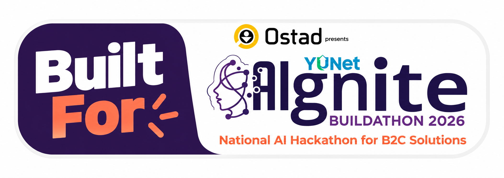
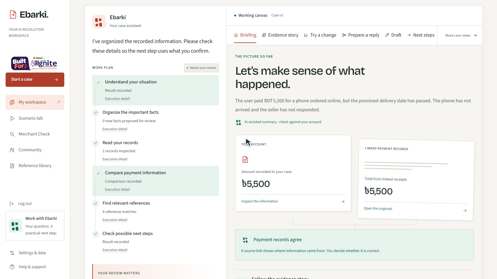

# এবারকি — পরের পদক্ষেপ, আরও পরিষ্কার

[English README](README.md) · [বিচারকের walkthrough](docs/pitch/judge_quickstart.md) · [ডকুমেন্টেশন](docs/README.md)

বাংলাদেশের ভোক্তাদের জন্য evidence, review ও পরবর্তী কাজ প্রস্তুতের একটি workspace। নিজের বক্তব্য, রসিদ, বিক্রেতার বার্তা, ছবি ও অডিও একই কেসে রেখে কী জানা আছে এবং কী যাচাই করা দরকার, তা বোঝা যায়।

<a href="https://yunet-aignite26.devpost.com/"></a>

নির্মাতা: **Sakibul Islam Shovon**, একক প্রতিযোগী।

## ডেমোর লিংক

- [Live app](https://ebarki.165.99.219.253.sslip.io/)
- [English demo video](https://www.youtube.com/watch?v=FE5Hs5RiUUw)
- [৫-slide Presentation PDF](docs/pitch/Ebarki_AIgnite_2026_Pitch_Deck.pdf)

Live app ও YouTube-এর আসল লিংক যুক্ত হয়েছে; deck লিংক থেকে ৫-slide PDF download করা যাবে। [Submission checklist](docs/pitch/SUBMISSION_CHECKLIST.md)

## ছোট একটি উদাহরণ

ক্রেতার বক্তব্যে ফোনের জন্য দেওয়া টাকা ৳৫,৫০০। প্রথম রসিদে ৳৫,০০০। Ebarki ৳৫০০-এর অমিলটি দেখায়। ক্রেতা উৎস পরীক্ষা করে দ্বিতীয় রসিদ যুক্ত করলে linked total ৳৫,৫০০ হয়; মূল বক্তব্য অক্ষুণ্ণ থাকে। এরপর শর্ত দেখে পরবর্তী পথ বোঝা, উত্তর সম্পাদনা এবং review করা খসড়া download করা যায়।



## কী কী আছে

- English/বাংলা interface এবং English, বাংলা বা Banglish বক্তব্য গ্রহণ।
- Native PDF extraction; সম্মতিসাপেক্ষে image/scanned-PDF reading ও audio transcription।
- মূল উৎসের পাশে তথ্য, chronology, review ও payment reconciliation।
- AI-assisted summary/reply; editable wording এবং আসল processing receipts।
- True/false/unknown শর্তে procedural paths; saved case থেকে আলাদা what-if preview।
- Review করা draft/export, filing preparation, activity ও ব্যক্তিগত reminder।
- Seeded community preview; category, discussion, comment ও reaction। নতুন public post unavailable; comment/reaction স্থায়ী database storage নয়।
- আলাদা admin evaluation: case/access controls, notices, moderation, source review, release controls ও audit trail।

[বর্তমান feature ও সীমা](docs/product/FEATURES.md) · [AI কোথায় কাজ করে](docs/engineering/providers.md)

## চালু করা

Python 3.12 recommended, Node.js 20+, pnpm 12.16.1 ও uv লাগবে। Fresh clone-এর root থেকে:

```sh
python scripts/tasks.py bootstrap
python scripts/tasks.py doctor
python scripts/tasks.py dev --no-reload
```

English: `http://localhost:3000/en`; বাংলা: `http://localhost:3000/bn`। Provider key server-side configuration-এ রাখতে হবে। Existing database বা চলমান server থাকলে আগে [setup guide](docs/engineering/LOCAL_DEVELOPMENT.md) পড়ুন।

## কী প্রমাণ আছে, কী বাকি

৫ নভেম্বরের session-এ ১৮৪ backend ও ২৭ web test pass; foundation এবং ২২টি local production-mode check-এর recorded evidence আছে। বাস্তব provider calls ও আসল UI recording-ও আছে। এগুলো output-এর পূর্ণ নির্ভুলতা বা production readiness-এর নিশ্চয়তা নয়।

এটি hackathon evaluation build। Public hosting, qualified legal review এবং comprehensive browser/accessibility acceptance এখনো certified নয়। Judge-admin entry privileged ভূমিকা দেয়; শুধু আলাদা synthetic evaluation environment-এ ব্যবহারযোগ্য। Seeded merchant/community content বাস্তব অভিযোগ বা যাচাইকৃত ঝুঁকির প্রমাণ নয়।

Ebarki অভিযোগ জমা দেয় না, বিক্রেতাকে বার্তা পাঠায় না এবং refund নিশ্চিত করে না। ব্যবহারকারী তথ্য মিলিয়ে নিজে বাহ্যিক পদক্ষেপ সম্পন্ন করেন।

[পরীক্ষার প্রমাণ ও বাকি কাজ](docs/qa/CURRENT_STATUS.md) · [Privacy ও safety](docs/PRIVACY_AND_SAFETY.md) · [গবেষণা ও strategy](docs/research/DOCUMENTATION_RESEARCH_2026-11-05.bn.md)
