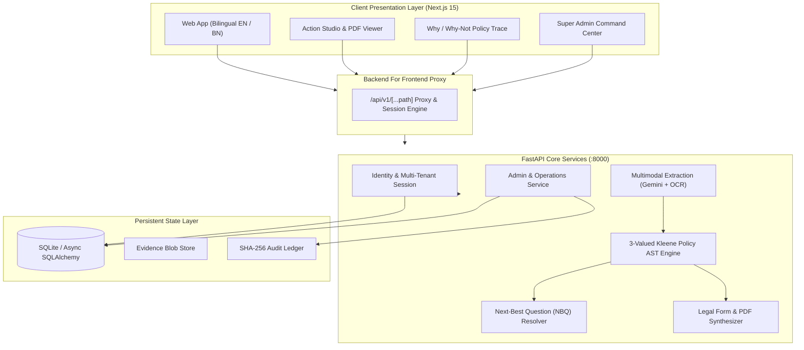

# ClaimCraft BD (এবারকি? — EbarKi?)
### Bangladesh-First Consumer Resolution Copilot & Statutory Claim Automation Engine
**Ostad Presents YUNet AIgnite Buildathon 2026 (Solo Track)**  
*Developed & Architected by Sakibul Islam Shovon*

[](https://python.org)
[](https://fastapi.tiangolo.com)
[](https://nextjs.org)
[](https://www.typescriptlang.org)
[](https://tailwindcss.com)
[](file:///services/backend/tests)
[](LICENSE)

---

## 🎯 Executive Summary & Mission

Consumer dispute resolution in Bangladesh faces three crippling bottlenecks:
1. **Procedural Complexity:** Consumers do not know which statutory law applies (Consumer Rights Protection Act 2009 vs. Digital Commerce Guidelines 2021 vs. Penal Code 420 vs. Bangladesh Bank MFS Directives).
2. **The 30-Day Statutory Limitation Cliff:** Section 60 of the Consumer Rights Protection Act 2009 strictly mandates that formal complaints to the DNCRP (জাতীয় ভোক্তা-অধিকার সংরক্ষণ অধিদপ্তর) must be lodged within **30 calendar days** of the cause of action. Consumers frequently forfeit their legal rights simply by waiting for informal seller chats.
3. **Evidence Burden & Documentation Deficits:** Hand-written invoices, bKash/Nagad TrxID SMS, courier tracking slips, and unrecorded Facebook shop conversations fail to meet statutory petition formats.

**ClaimCraft BD (এবারকি?)** solves this with an agentic, multimodal, mathematically grounded copilot. It ingests colloquial Bengali voice notes and OCR evidence, extracts material facts into structured schemas, evaluates legal remedies across a **3-valued Kleene logic policy tree**, dynamically interviews the consumer using **Next-Best Question (NBQ)** algorithms, and synthesizes 100% grounded pre-action demand notices and official DNCRP Schedule-1 formal complaints.

---

## 🌟 Key Capabilities & Architectural Innovations

### 1. Multimodal Bengali Intake & Evidence Vault
- **Voice Ingestion:** Ingests colloquial conversational Bangla, English, and regional dialect variations; transcribes audio streams with speaker segmentation and emotion/urgency scoring.
- **Multimodal OCR & Document Extraction:** Reconciles invoice images, courier receipts (Steadfast, Pathao, RedX), and MFS transaction screenshots (bKash, Nagad, Rocket) into structured dispute facts.
- **Bi-Directional Fact Reconciliation:** Flags discrepancies between consumer verbal narratives and physical receipt amounts (e.g., stated ৳3,500 vs invoice ৳3,200).

### 2. 3-Valued Kleene Policy AST Engine (`TRUE` / `FALSE` / `UNKNOWN`)
- Unlike conventional black-box LLMs that hallucinate legal advice, ClaimCraft BD executes a deterministic **Abstract Syntax Tree (AST)** evaluator.
- Evaluates statutory eligibility against the **Consumer Rights Protection Act 2009 (Sections 37-56)**, **National Digital Commerce Operations Guideline 2021**, and **MFS Guidelines**.
- Implements Kleene strong 3-valued logic:
  - $\text{TRUE} \land \text{UNKNOWN} \implies \text{UNKNOWN}$
  - $\text{FALSE} \land \text{UNKNOWN} \implies \text{FALSE}$
- Produces full **Why/Why-Not condition traces** detailing why each statutory route is `supported`, `needs_facts`, or `excluded`.

### 3. Active-Learning Next-Best Question (NBQ) Agent
- When a statutory route evaluates to `UNKNOWN`, the system dynamically ranks missing material facts by information gain and legal criticality.
- Presents progressive single-tap clarification questions in English and Bengali to resolve uncertainty.

### 4. Grounded Action Studio & Legal Output Generator
- **Pre-Action Demand Notices:** Auto-drafts formal 72-hour formal pre-action legal notices formatted for WhatsApp, email, or registered post with Section 45 statutory warnings.
- **DNCRP Schedule-1 Statutory Complaint:** Generates official government complaint petitions formatted to Directorate standards with itemized remedies (refund, replacement, compensation, 25% administrative reward).
- **Zero Mock / Zero Fabrication Rule:** Every party name, transaction reference, amount, and date is strictly grounded in verified facts.

### 5. Merchant Scam Radar & Community Watch
- Live algorithmic risk scoring analyzing dispute volume, blacklists, and non-delivery patterns.
- Direct search against verified merchant intelligence database.
- Anonymous consumer grievance sharing with community upvoting.

### 6. Super Admin & Platform Operations Portal
- Master administrative dashboard for platform controllers and legal reviewers.
- Statutory candidate reviewer for legal updates and regulatory changes.
- Merchant risk overrides, user management, and broadcast public alert banners.
- Tamper-evident administrative audit log with SHA-256 state hashing.

---

## 🏗️ System Architecture



---

## 🚀 Quick Start Guide

### Prerequisites
- **Node.js** >= 18.18 (recommended Node 20 LTS)
- **pnpm** >= 9.0 (`npm install -g pnpm`)
- **Python** >= 3.11
- **uv** (ultra-fast Python package runner, `pip install uv` or `winget install astral-sh.uv`)

### 1. Clone & Bootstrap
```bash
git clone https://github.com/sakibul-shovon/YUNet-hackathon.git
cd YUNet-hackathon

# Install frontend and backend dependencies
python scripts/tasks.py bootstrap
```

### 2. Seed Deterministic Scenarios
```bash
python scripts/tasks.py seed-demo
```

### 3. Launch Development Stack
```bash
python scripts/tasks.py dev
```
Both services will spin up concurrently:
- **Web Frontend:** [http://localhost:3000](http://localhost:3000)
- **Backend API Docs (Swagger):** [http://127.0.0.1:8000/docs](http://127.0.0.1:8000/docs)
- **Backend Health Check:** [http://127.0.0.1:8000/health/ready](http://127.0.0.1:8000/health/ready)

---

## 🔑 Judge Quick-Start & Evaluation Credentials

ClaimCraft BD comes pre-configured with evaluation sandboxes for hackathon reviewers:

| Portal | URL Path | Credentials | Description |
|---|---|---|---|
| **Super Admin Portal** | `/en/admin` | `admin@claimcraft.bd` / `Admin@ClaimCraft2026!` *(or click ⚡ 1-Click)* | Platform-wide metrics, dispute overrides, merchant blacklisting, audit logs. |
| **Judge 1-Click Demo** | Bottom-left banner on any page | *Automatic 1-Click Button* | Pre-seeds test disputes and switches into an authorized evaluator session. |
| **Pre-Seeded Scenarios** | `/en/scenarios` | *Publicly Accessible* | Benchmark scenarios: Gadget Zone defective phone, bKash wrong payment, and counterfactual simulation. |

---

## 🧪 Test Suite & Verification Commands

ClaimCraft BD enforces strict quality gates using `scripts/tasks.py`:

```bash
# 1. Foundation Checks (Doc integrity, i18n parity, Ruff lint, Next.js typecheck/build)
python scripts/tasks.py check --scope foundation

# 2. Core Test Suites (134 Automated Pytest suites passing)
python scripts/tasks.py check --scope core

# 3. Regenerate TypeScript contracts from backend OpenAPI spec
python scripts/tasks.py contracts

# 4. Query token-saving codebase knowledge graph
python scripts/tasks.py graphify query "How does 3-valued policy evaluation work?"
```

---

## ⚖️ Statutory Grounding & Legal Invariants

ClaimCraft BD strictly adheres to actual Bangladesh statutes and regulations:

1. **Consumer Rights Protection Act 2009 (আইন নং ২৬, ২০০৯):**
   - **Section 37:** Penalties for failure to display price lists.
   - **Section 40:** Sale of goods/services at price higher than prescribed.
   - **Section 44:** Misleading or false advertisements.
   - **Section 45:** Failure to deliver promised goods/services within agreed timeframe.
   - **Section 51:** Counterfeit goods and deceptive representations.
   - **Section 52:** Adulterated or substandard merchandise.
   - **Section 53:** Service deficiencies causing financial or physical injury.
   - **Section 60:** **30-Day Mandatory Limitation Period** for lodging formal complaints.
   - **Section 76(4):** Consumer entitlement to **25% of administrative fines** imposed by the Director General.
2. **National Digital Commerce Operations Guideline 2021 (ডিজিটাল কমার্স পরিচালনা নির্দেশিকা ২০২১):**
   - Mandates delivery within 5 days (inside same city) or 10 days (inter-district) upon advance payment.
   - Strict 72-hour refund policy upon order cancellation.
3. **The Penal Code 1860 (Act No. XLV of 1860):**
   - **Section 420:** Cheating and dishonestly inducing delivery of property (applied strictly in criminal fraudulent merchant cases).

---

## 👥 Hackathon Team & Acknowledgments

- **Author & Architect:** Sakibul Islam Shovon
- **Hackathon:** Ostad Presents YUNet AIgnite Buildathon 2026 (Solo Track)
- **Special Thanks:** Ostad and YUNet for fostering cutting-edge AI and agentic software innovation in Bangladesh.
