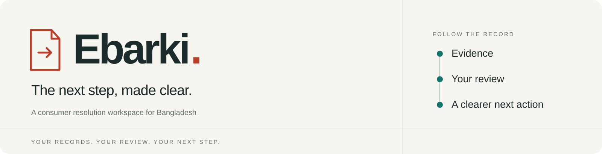
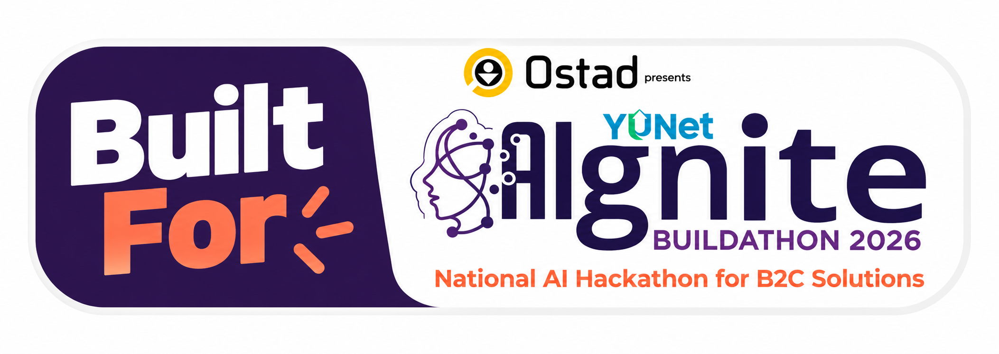
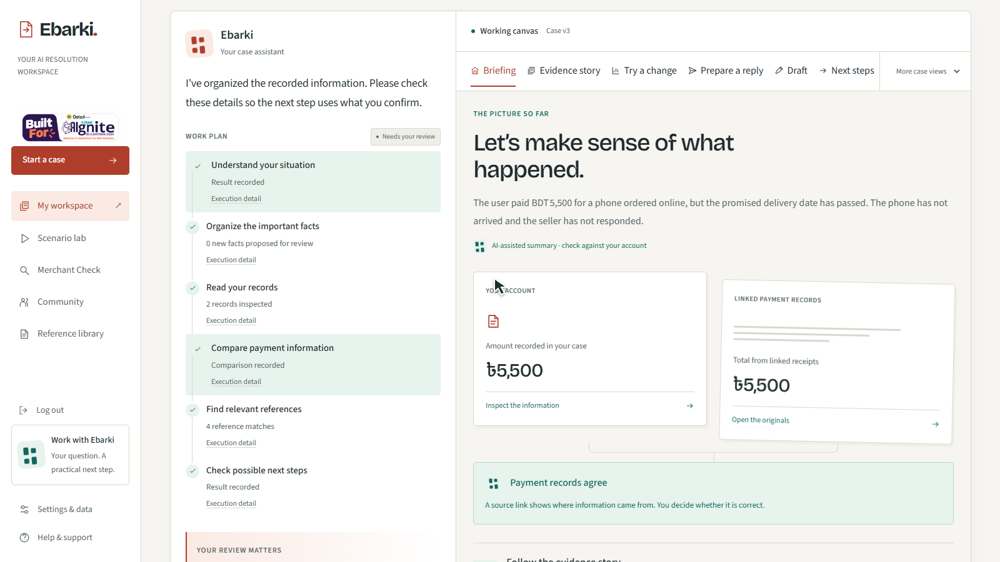
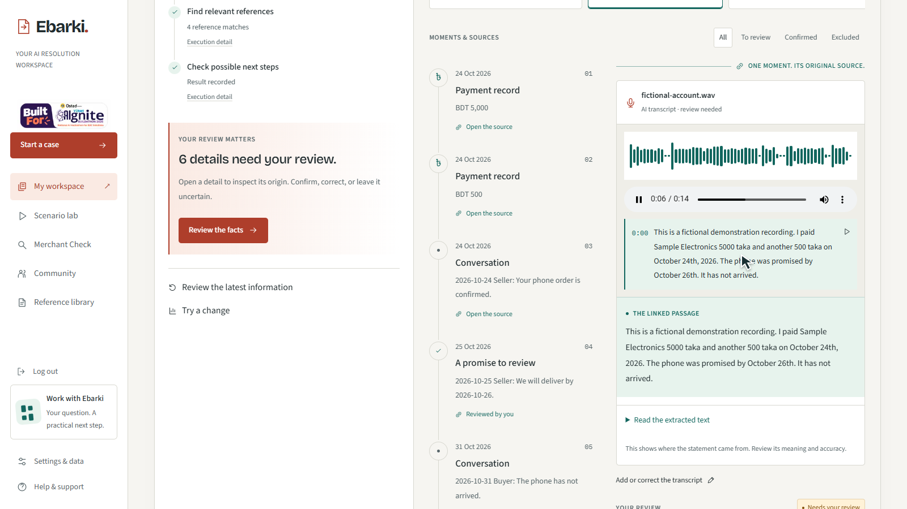
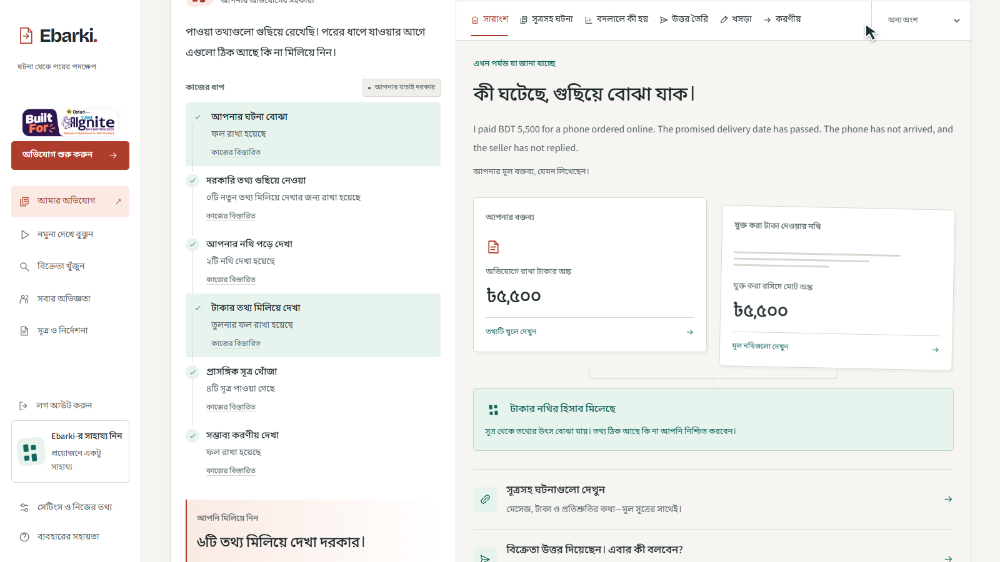
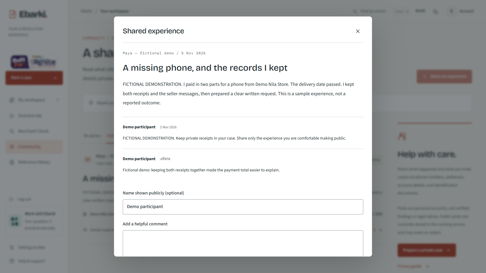
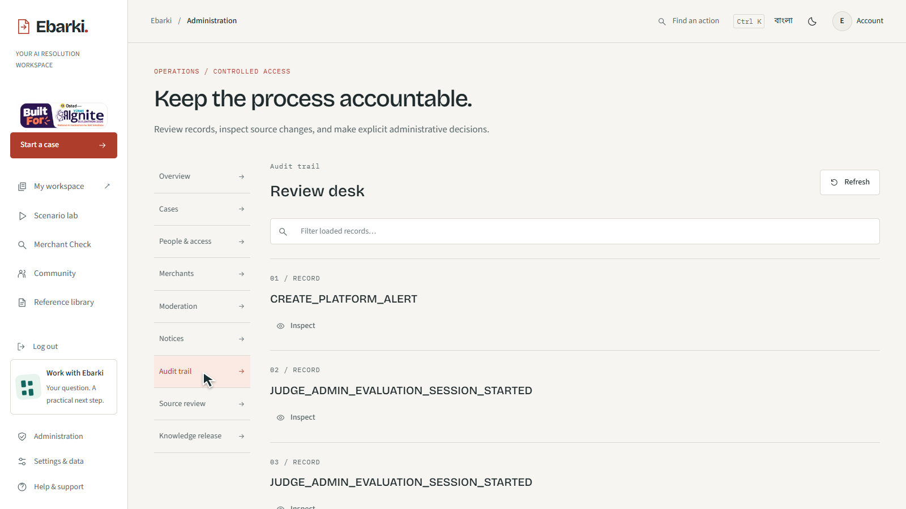
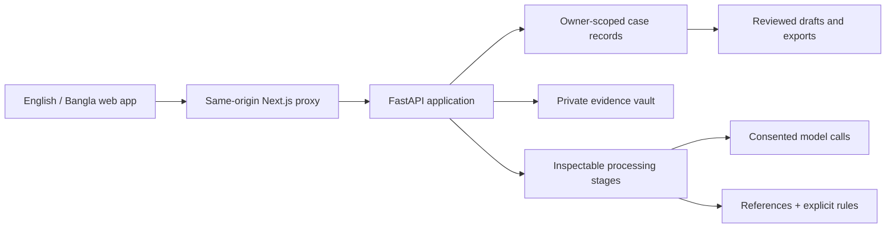

<div align="center">
  
  <p><strong>An AI-assisted consumer resolution workspace for Bangladesh.</strong><br />Turn receipts, messages and your account of a dispute into preparation you can review.</p>
  <p>
    <a href="https://ebarki.165.99.219.253.sslip.io/">Live app ↗</a> ·
    <a href="https://www.youtube.com/watch?v=FE5Hs5RiUUw">Watch the demo ↗</a> ·
    <a href="docs/pitch/Ebarki_AIgnite_2026_Pitch_Deck.pdf">Presentation PDF</a> ·
    <a href="docs/pitch/judge_quickstart.md">Judge walkthrough</a> ·
    <a href="docs/README.md">Documentation</a> ·
    <a href="README.bn.md">বাংলা</a>
  </p>
  <a href="https://yunet-aignite26.devpost.com/">
    
  </a>
  <p>Built by <a href="https://github.com/sakibul-shovon">Sakibul Islam Shovon</a> · Solo hackathon project · English + বাংলা</p>
</div>

## One order. Two receipts. A clearer next step.

A phone has not arrived. The consumer remembers paying **৳5,500**, but the first receipt records **৳5,000**. The delivery promise is in another message. Explaining the problem means reconstructing the records before deciding what to do.

Ebarki keeps the original account, reads available evidence, exposes the **৳500 discrepancy**, and lets the consumer inspect and confirm the missing payment. The result is a traceable case and an editable next action, with the consumer in control.



*Actual local application, fictional evaluation case. Screenshots are demonstrations, not real complaints, recovered funds or verified merchant allegations.*

## Evaluate Ebarki in three minutes

1. Open the app in **English** or **বাংলা**, then choose **Judge Demo**. A fresh consumer workspace opens with fictional records.
2. Compare the reported amount with the receipt. Open **Evidence story**, inspect the source and review the payment link.
3. Add the second sample payment. Watch the linked total become **৳5,500** without changing the original account.
4. Preview a fact change in **Try a change**. Inspect the conditions behind the possible next steps.
5. Review a reply or draft, then download the preparation materials. Switch language and keep working in the same case.

For the separate administrative entry and expected results, use the [judge walkthrough](docs/pitch/judge_quickstart.md). Use fictional information throughout.

## What the product brings together

| Consumer need | Ebarki capability |
| --- | --- |
| Explain a problem naturally | English, Bangla and Banglish narrative intake; optional records and consent choices |
| Understand scattered evidence | Native PDF extraction, consented image/scanned-PDF reading, audio transcription and source inspection |
| Know which details need checking | Source-linked moments, fact review, uncertainty and linked-payment reconciliation |
| Understand the next step | Conditional procedural paths, references, useful questions and isolated what-if comparisons |
| Prepare a considered response | AI-assisted summaries and seller replies, editable wording and reviewable documents |
| Keep the case moving | Saved drafts, version checks, activity, personal reminders and guided filing preparation |
| Learn from shared experiences | Seeded community preview with categories, discussions, comments and reactions |
| Make operations inspectable | Administrative case/access controls, notices, moderation, source review, release controls and audit receipts |

The [feature guide](docs/product/FEATURES.md) separates implemented behavior, provider-dependent paths, preview data and unfinished work. Community comments/reactions are process-local; new public posts are unavailable. Merchant preview records are seeded examples, not a verified risk service.

## Meaningful AI, with visible work

The workspace records what ran, which source was used and what still needs review.

| Stage | Actual implementation |
| --- | --- |
| Understand the situation / prepare wording | Configured Groq text model after applicable consent; editable output |
| Read a native PDF | Local text and page-coordinate extraction |
| Read an image or scanned page | Configured vision reader; bounded processing and source attribution |
| Transcribe a recording | Configured speech model; original playback and transcript review |
| Find references | Lexical retrieval and exact-reference lookup in the active workspace |
| Assess conditions | Deterministic true / false / unknown rules |
| Apply a change or export | Case/document version checks and explicit user review |

Model responses can be wrong. A provider receipt proves a request ran; it does not prove the answer is correct. Missing consent, unavailable readers and provider limits lead to visible fallback or review states.

[AI, models and data handling →](docs/engineering/providers.md) · [Architecture →](docs/engineering/ARCHITECTURE.md)

## A connected bilingual experience

<table>
  <tr>
    <td width="50%"><br /><strong>Inspect the original.</strong> Keep speech and its reading together.</td>
    <td width="50%"><br /><strong>Continue in Bangla.</strong> Change language within the same case.</td>
  </tr>
  <tr>
    <td width="50%"><br /><strong>Shared experience.</strong> Private cases are not automatically posted.</td>
    <td width="50%"><br /><strong>Recorded operations.</strong> Inspect changes and their receipts.</td>
  </tr>
</table>

## Built as a full application



Next.js, React and TypeScript power the interface; FastAPI, Pydantic and SQLAlchemy power the API and persistence. SQLite/local storage support evaluation. PostgreSQL infrastructure is present; hosted durability and PostgreSQL/RLS acceptance remain separate deployment work.

[Architecture and source map](docs/engineering/ARCHITECTURE.md) · [API guide](docs/engineering/API_REFERENCE.md) · [Dependency register](docs/engineering/versions.md)

## Run locally

Prerequisites: **Python 3.12 recommended**, Node.js 20+, **pnpm 12.16.1**, and uv. From a fresh clone:

```sh
git clone https://github.com/sakibul-shovon/YUNet-hackathon.git
cd YUNet-hackathon
python scripts/tasks.py bootstrap
python scripts/tasks.py doctor
python scripts/tasks.py dev --no-reload
```

Open [English](http://localhost:3000/en) or [বাংলা](http://localhost:3000/bn). The API serves [interactive documentation](http://127.0.0.1:8000/docs).

The native development path defaults to SQLite/local storage. External AI needs server-side configuration and case consent. The development command takes over ports 3000/8000 and clears its Next.js development cache. Read the [setup guide](docs/engineering/LOCAL_DEVELOPMENT.md) before using an existing database or starting beside another session.

## Evidence of implementation

| Evidence | Recorded scope |
| --- | --- |
| Automated core checks | 184 backend + 27 web tests passed in the 5 November session; 7 backend warnings |
| Foundation checks | Recorded lint, message-key parity, production build and typecheck pass |
| Local production-mode checks | 22 recorded checks: migrated SQLite, sessions, administration and restart behavior |
| Actual AI calls | Fictional summary, image, scan, audio and reply runs; quota failures retained |
| Browser demonstrations | Actual local consumer, community and admin interactions recorded for the product demonstration |

These are scoped observations, not a product-wide accuracy score or production certification. [Current evaluation status](docs/qa/CURRENT_STATUS.md) connects each claim to evidence and remaining gates.

```sh
python scripts/tasks.py check --scope foundation
python scripts/tasks.py check --scope core
```

## Product boundaries

Ebarki prepares and explains. The consumer reviews facts and completes external actions. It does not send notices, file government complaints, authenticate evidence, establish liability or guarantee a refund.

This is a **hackathon evaluation build**. The public app and video links are supplied by the builder; hosted end-to-end readiness, qualified legal review and comprehensive browser/accessibility acceptance are not certified. The one-click judge-admin entry deliberately grants privileged access; use it with isolated synthetic data. A general consumer deployment needs that entry gated or removed.

[Privacy and safety](docs/PRIVACY_AND_SAFETY.md) · [Known gaps and roadmap](docs/qa/CURRENT_STATUS.md#remaining-work) · [Security reporting](SECURITY.md)

## Explore the project

| Start here | Read next |
| --- | --- |
| Judge | [Walkthrough](docs/pitch/judge_quickstart.md) · [Submission story](docs/pitch/devpost_submission.md) |
| Engineer | [Setup](docs/engineering/LOCAL_DEVELOPMENT.md) · [Architecture](docs/engineering/ARCHITECTURE.md) · [API](docs/engineering/API_REFERENCE.md) |
| Operator | [Administration](docs/ADMIN_PORTAL_GUIDE.md) · [Evaluation evidence](docs/qa/CURRENT_STATUS.md) |
| Contributor | [Contribution guide](CONTRIBUTING.md) · [Documentation index](docs/README.md) |
| Submission owner | [Checklist](docs/pitch/SUBMISSION_CHECKLIST.md) · [Five-slide content](docs/pitch/deck_slides.md) |

The public interface is **Ebarki**. Historical specifications and internal packages retain **ClaimCraft BD** for traceability. Design plans describe intent; the guides above describe current behavior.

Built by **Sakibul Islam Shovon** for [Ostad Presents YUNet AIgnite Buildathon 2026](https://yunet-aignite26.devpost.com/). Event branding identifies the buildathon; it does not imply organizer or government endorsement. [Asset credits](docs/assets/README.md)

No repository-wide software license has been selected in this tree. Third-party assets retain their own notices; no blanket MIT or other license is claimed.
