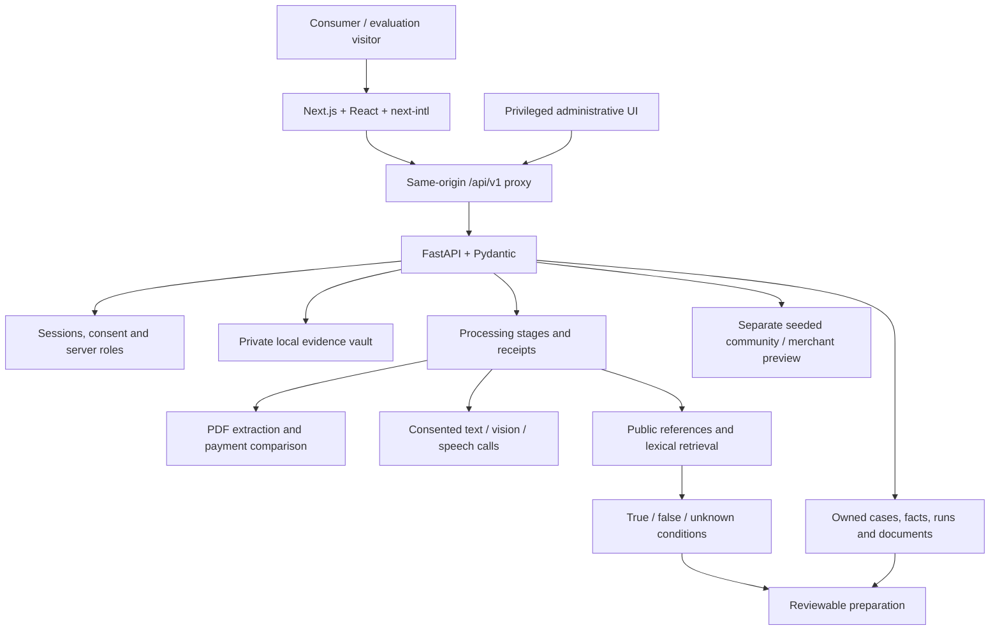
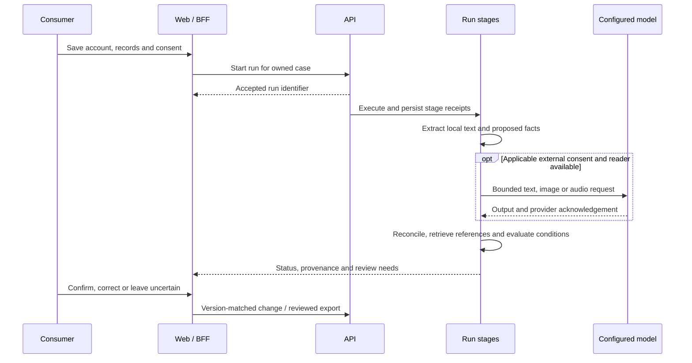

# Architecture and engineering decisions

[Documentation](../README.md) · [API](API_REFERENCE.md) · [Provider register](providers.md)

Snapshot: **5 November 2026**. Ebarki combines an interactive bilingual workspace with owner-scoped persistence, inspectable processing and reviewed preparation.

## Application boundaries

Private evidence does not become a public knowledge source merely because a case was processed. Public preview records are a separate lane. The current judge-admin launcher is an intentional global-role exception for synthetic evaluation; it must be gated before a general consumer deployment.

## Follow one processing run

Summary generation, extraction and other stages run in the order selected by the operation; this diagram describes the boundary, not a promise that every run calls every model. SSE and polling paths expose progress. Cancellation/recovery paths exist, with their actual test scope in the audit.

## Decisions that matter

| Decision | Why it matters | Current implementation |
| --- | --- | --- |
| Keep the original account | Clarification should not silently rewrite what the consumer said | Original narrative and attributed records remain inspectable |
| Separate reading from relevance | An uploaded amount might be unrelated or duplicated | Explicit source review/linking governs the payment ledger |
| Preserve uncertainty | Missing facts should not become confident advice | Three-valued conditions and review states |
| Separate model wording from rule evaluation | A fluent response should not determine procedural validity | Configured models assist language/readings; explicit rules assess recorded conditions |
| Reject stale changes | Two tabs or a changed case can invalidate an old draft | Expected-version checks on case/document operations |
| Record execution | A staged interface should reflect actual work | Run stages, durations, methods, cached-reading provenance and provider receipts |
| Own private records | Knowing a case identifier should not grant access | Application-level principal/case ownership checks; privileged administration is separate |

## Data and persistence

SQLAlchemy models cover principals, accounts, sessions, consents, cases, evidence metadata, facts/source links, runs, documents and administrative records. SQLite/local storage is the exercised local baseline. Production schema setup uses Alembic; the current migration head is `0007_workspace_persistence`.

PostgreSQL/RLS helpers and infrastructure exist. They have not been certified by the local SQLite restart checks. The local evidence backend is a filesystem vault, not evidence of encrypted object storage, antivirus scanning, cross-region redundancy or tested backups.

Public community comments/reactions and seeded merchant/community stores remain process-local. SQL-backed notices and administrative audit receipts do not make those stores durable.

## Retrieval and model boundaries

The active workspace run calls `HybridRetriever` with `dense_enabled=False`, recording `bm25_lexical_with_exact_lookup`. The legacy `E5EmbeddingAdapter` uses deterministic hashing; it does not execute pretrained E5 inference. Do not describe the observed path as a deployed dense-vector RAG system.

The configured Groq model names, reader limits, consent checks and fallback behavior are in the [provider register](providers.md). Google-related settings/adapters are optional or historical; their presence does not prove live execution.

## Repository map

| Location | Responsibility |
| --- | --- |
| `apps/web/src/features/agent/` | Shared workstream/canvas, connected source/reply views and entry points |
| `apps/web/src/features/workspace/` | Cases, evidence, paths, documents, activity, accounts and administration |
| `services/backend/app/identity/` | Accounts, sessions, roles and consent |
| `services/backend/app/operations/` | Runs, readers, connected sources, summaries and replies |
| `services/backend/app/evidence/` | Accepted files, parsing, previews and source metadata |
| `services/backend/app/facts/` | Assertions, normalization, review and provenance |
| `services/backend/app/retrieval/`, `policy/` | Reference lookup and explicit condition evaluation |
| `services/backend/app/actions/` | Preparation documents, exports, field maps and versioned documents |
| `services/backend/app/admin/` | Administrative operations and audit records |
| `packages/contracts/` | Generated OpenAPI and TypeScript surface |
| `knowledge/` | Reference/policy/source artifacts and release structures |
| `evaluation/`, `services/backend/tests/` | Fixtures, harnesses and automated checks |
| `infra/` | Deployment scaffolding, not hosted acceptance evidence |

## Operational scope

Local startup/readiness, migrated schema and restart checks have recorded evidence. Hosted TLS, PostgreSQL isolation, volume replacement, backups, observability under load and comprehensive device/AT acceptance still need verification. Job/outbox interfaces in the repository do not establish a deployed distributed worker fleet.

See [current status](../qa/CURRENT_STATUS.md), [ADR-110](../adr/ADR-110-ebarki-release-audit-integrity.md) and [ADR-111](../adr/ADR-111-ebarki-sessions-admin-media-and-reference-integrity.md). These preserve how integrity failures were found and corrected; they are not blanket safety guarantees.
