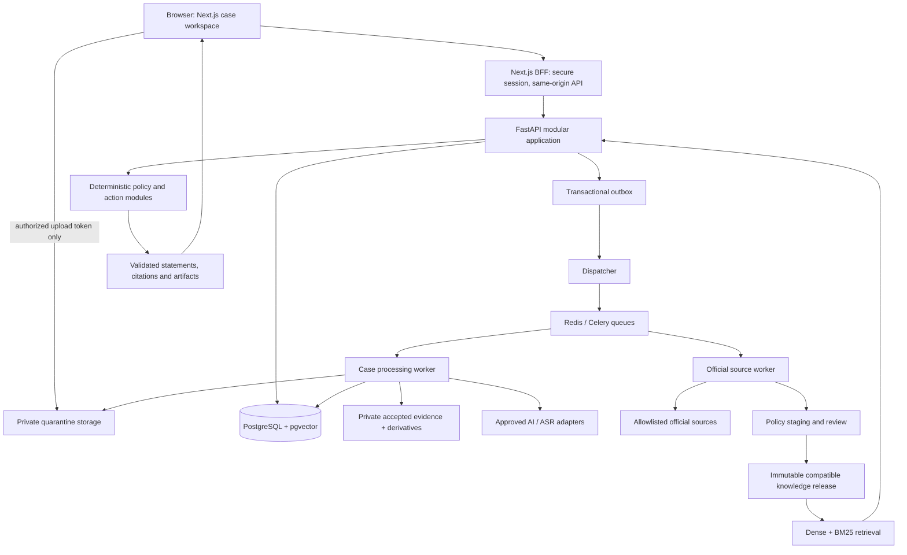

# ClaimCraft BD — Agent Execution Plan

> **Build a consumer resolution product people can understand and use, with evidence they can inspect and actions they control.**

| Plan metadata | Value |
|---|---|
| Version | 1.2 — blank-project startup, resumable phases and per-phase GitHub pushes |
| Prepared / research cutoff | 1 November 2026, Asia/Dhaka |
| Product | ClaimCraft BD — The Consumer Resolution Copilot |
| Positioning | Bangladesh-first B2C consumer dispute preparation and follow-up |
| Tagline | Know Your Rights. Take the Right Action. |
| Intended executor | Antigravity, Codex, Claude Code, Cursor, or another coding agent |
| Current repository state | Two source documents only; application implementation has **not** started |
| Delivery policy | Dependency-based phases and quality gates; **no deadline-driven feature cuts** |
| Implementation status | **All tasks TODO. Nothing in this plan is an achieved benchmark or completed feature.** |
| Execution inventory | 15 required phases, 86 required tasks; 4 optional experiment tasks; 54 behavior-test families |
| Plan language | Engineering instructions in English; complete English/Bangla product, **English default** |
| Appearance | Complete light and dark themes, **light default**; explicit saved user preferences |
| Scenario experience | Eight realistic synthetic scenarios run through the actual production pipeline; three featured quick starts |
| Git delivery | Commit and verify a GitHub push after each completed phase; preserve local progress if remote/auth is unavailable |

## Navigation

1. [Start/resume protocol](#1-startresume-protocol)
2. [Source precedence and hackathon strategy](#2-source-precedence-and-hackathon-strategy)
3. [Product scope and deliberate improvements](#3-product-scope-and-deliberate-improvements)
4. [User journeys and experience design](#4-user-journeys-and-experience-design)
5. [Visual and interaction specification](#5-visual-and-interaction-specification)
6. [Architecture and ownership boundaries](#6-architecture-and-ownership-boundaries)
7. [Chosen stack and replacement gates](#7-chosen-stack-and-replacement-gates)
8. [Repository and developer workflow](#8-repository-and-developer-workflow)
9. [Data model and invariants](#9-data-model-and-invariants)
10. [Contracts, API and concurrency](#10-contracts-api-and-concurrency)
11. [Evidence and multimodal pipeline](#11-evidence-and-multimodal-pipeline)
12. [Knowledge, temporal retrieval and policy](#12-knowledge-temporal-retrieval-and-policy)
13. [AI orchestration and output guarantees](#13-ai-orchestration-and-output-guarantees)
14. [Actions, filing, exports and living cases](#14-actions-filing-exports-and-living-cases)
15. [Security, consent and deletion](#15-security-consent-and-deletion)
16. [Jobs, reliability and operations](#16-jobs-reliability-and-operations)
17. [Phase/task execution ledger](#17-phasetask-execution-ledger)
18. [Test catalogue and measurable release gates](#18-test-catalogue-and-measurable-release-gates)
19. [Deployment, recovery and release procedure](#19-deployment-recovery-and-release-procedure)
20. [Judge experience and submission materials](#20-judge-experience-and-submission-materials)
21. [Requirement traceability](#21-requirement-traceability)
22. [Research register and unresolved inputs](#22-research-register-and-unresolved-inputs)
23. [Agent handoff prompt and completion contract](#23-agent-handoff-prompt-and-completion-contract)

---

## 1. Start/resume protocol

### 1.1 Rules for every coding agent

Read this section before writing code. This is an implementation specification, not permission to silently redesign the product.

1. Inspect the actual repository, `git status`, applicable `AGENTS.md`, this plan, and `.agent/state.json` if it exists. Preserve unrelated user changes. Never assume the scaffold below already exists.
2. On first execution read the hackathon requirements, this plan's startup sections, and the phase-specific contracts in Section 1.4. The planning author has already analyzed the complete blueprint. Use its relevant sections as a reference; do not consume the entire historical narrative on every coding session. Resolve any discovered source conflict using Section 2.
3. Find the first incomplete task whose dependencies and entry gate are satisfied. Work on **one task at a time** unless independent work is explicitly coordinated. Finish an end-to-end vertical slice before expanding infrastructure.
4. Record the active task and intended output before edits. Keep each task small enough to explain, validate, and resume. Split a task into child IDs if necessary; do not delete its parent acceptance criteria.
5. Implement real data flow. Test doubles belong in tests and an explicitly labelled development mode. Never silently use fake AI, fake legal sources, fake portal submissions, random scores, or fabricated analytics in the public product.
6. Validate behavior, not just compilation. Record exact commands, exit status, test evidence, and remaining limitations. A button that renders but does nothing is incomplete.
7. Set a task `DONE` only after its exit gate passes. `BLOCKED` requires a concrete external dependency, not difficulty. Continue other independent tasks when possible.
8. Update the checkpoint after each task and before stopping. A new agent must be able to recover without the previous chat.
9. Do not change an approved API, schema, authorization boundary, or policy semantics silently. Add an ADR and migration, update generated clients and contract tests, then continue.
10. Never approve a legal source, manufacture a reviewer signature, invent an official sticker, or set a failed test to skipped merely to finish a phase.
11. The initial project is blank apart from planning/source documents. Missing application code or checkpoint files is expected: bootstrap from P00.1, create the scaffold/checkpoints, and continue implementation instead of asking where to start.
12. After each phase's required tasks and exit checks pass, create a meaningful phase completion commit and push it to the intended GitHub branch under Section 8.4. Verify the remote result and record/report the commit. Do not pause for renewed permission for each ordinary phase push; the user has explicitly requested them.

### 1.2 Execution state, created by P00.1

Keep this plan as the stable specification. Use `.agent/state.json` for frequently changing status; mirror phase completion summaries here. This prevents repeated rewriting of a very long file.

```json
{
  "plan_version": "1.2",
  "updated_at": null,
  "current_task": "P00.1",
  "last_completed_task": null,
  "tasks": {},
  "blockers": [],
  "next_action": "Inspect repository and create the execution ledger",
  "last_validation": [],
  "environment": {"mode": "unconfigured", "live_ai_verified": false},
  "release": {"application_commit": null, "knowledge_release_id": null}
}
```

Each `tasks[id]` stores `status`, `started_at`, `completed_at`, `dependencies`, `changed_paths`, `acceptance_evidence`, `validation_commands`, `blocker`, and `next_action`. Allowed statuses: `TODO`, `IN_PROGRESS`, `BLOCKED`, `DONE`. Checkpoint text belongs in `.agent/handoff.md`: what works, current failure, exact next command, changed files, relevant ADRs, and environment needs. Never store credentials or private case content there.

Also track phase delivery separately: `phase_id`, `implementation_status`, `validation_status`, `push_status` (`not_ready`, `pending`, `verified`, `blocked`), intended remote/branch, completion commit SHA, verified remote SHA and last attempt/error. A completed local phase with an unavailable GitHub remote is **complete locally, push blocked**, not successfully pushed. On resume reconcile this record with actual git history/remote state and retry pending phase delivery before claiming sync.

Resume algorithm: inspect changed files → verify checkpoint against code/tests → finish or repair active task → choose next dependency-ready task. If ledger and code disagree, record the discrepancy and revalidate; do not trust a green checkbox over reality.

Progress = completed required tasks / all required tasks, reported as **task completion**, not effort or product readiness. Report blocked count and passed release gates separately. Optional research tasks do not inflate or reduce core delivery progress.

### 1.3 Global definition of done

A required task is done when code, schema/migration where relevant, accessible UI states, authorization, failure behavior, appropriate tests, and documentation agree. No unresolved critical/high security issue may be hidden under “polish later.” Public release additionally requires Sections 18–20. Missing credentials can block live integration validation, but do not justify reporting it complete.

### 1.4 Context loading map for smaller coding agents

This file is self-contained for execution. Read Sections **1–3, 6–8 and the current phase in 17** when starting the repository; then load only the contract sections needed below. On resume, read Section 1 and the checkpoint first. Keep Section 15's authorization/consent rules in scope whenever touching private data. A task's acceptance tests in Section 18 and traceability in Section 21 are always relevant. Never omit a security contract just to save context.

| Phase | Load these plan contracts | Consult blueprint sections if more product context is needed |
|---|---|---|
| P00 | 1–3, 6–8, 17/P00, 23 | 1–2, 10, 29 |
| P01 | 4–5, 17/P01, T48 | 7, 16 |
| P02 | 9–10, 15–16, 17/P02 | 10, 12, 26 |
| P03 | 9–10, 12, 15, 17/P03 | 9, 19, 21–22, 25–26 |
| P04 | 4, 9–10, 12–14, 17/P04 | 6–8, 10–11, 25 |
| P05 | 9–11, 15–16, 17/P05 | 6.1–6.3, 12, 23, 26 |
| P06 | 10–11, 13, 15, 17/P06 | 6.1–6.4, 23, 25 |
| P07 | 9–10, 12–13, 17/P07 | 21, 24–26 |
| P08 | 4, 9–10, 12–14, 17/P08 | 5–6, 9, 11, 25 |
| P09 | 5, 10, 13–15, 17/P09 | 6.8–6.11, 20/Appendix A–C, 25 |
| P10 | 9–10, 14–16, 17/P10 | 6.12, 10.7, 26, 28 |
| P11 | 9–10, 12, 15–16, 19, 17/P11 | 21–22, 26–28 |
| P12 | 3–4, 12, 14, 17/P12 | 5, 9.3, 11, 19 |
| P13 | 15–18, 21, relevant contracts for failures | 8, 12–14, 27 |
| P14 | 15–16, 18–20, 22, 17/P14 | 2, 15–17, 27, 29 |
| P15 | 7, 13.6, 18, 17/P15 | 13–14, 29.2 |

Read relevant source/code ranges rather than dumping this entire file into every prompt. If a session approaches its context limit, finish a safe checkpoint and resume with the active task, paths, contracts, failing test and next command. Preserve the original requirement IDs and gates across that handoff.

---

## 2. Source precedence and hackathon strategy

### 2.1 Source documents and precedence

1. [Hackathon requirements](docs/hacakthon%20details.txt).
2. [ClaimCraft master blueprint v4.1](docs/ClaimCraft_BD_Master_Product_Blueprint_v4.1_Knowledge_AI_Engineering.md). This plan was prepared after reading all sections; execution agents use the Section 1.4 map to consult relevant parts. Sections 21–29 contain the more specific AI/knowledge design.
3. This plan translates that product into executable engineering choices. The input documents remain unchanged.

Precedence: current explicit user instructions → verified current official competition/legal facts for their respective subjects → explicit improvements in this plan → v4.1 canonical decisions → historical/rejected proposals. This plan's engineering choices supersede illustrative technology options, not verified law. If a conflict is consequential, document it and fail safely instead of guessing.

The deadline is intentionally excluded from engineering scope and phase sizing. Eligibility, solo entry, public accessibility, official sticker, and submission materials still matter. AI coding tools are permitted; never imply a human team built a solo entry.

### 2.2 What the competition asks for

Build a useful public B2C web app with meaningful AI, a prominent official event sticker, and a deck of at most five slides. An English demo video and source repository are optional. Published primary-round weights are problem/value 12, innovation 12, technical AI implementation 10, UX/product readiness 16. Rules can change; verify before submission. Sources: [official rules](https://yunet-aignite26.devpost.com/rules), [published judging overview](https://yunet-aignite26.devpost.com/).

**Engineering implication:** turn backend intelligence into understandable, useful product interactions. A complex architecture diagram without an understandable next action will not satisfy the product goal.

| Criterion | Product proof to build | Evidence to retain |
|---|---|---|
| Real user value | An ordinary buyer organizes a confusing dispute and prepares an appropriate next step | User task study, actual case workspace and export |
| Innovation | Material fact correction changes an explainable path; irrelevant changes do not | Paired counterfactual tests and visible decision diff |
| Meaningful AI | Bangla/Banglish/voice intake, receipt/chat reading, issue proposals and grounded drafting | Real model run IDs, extraction spans, evaluated failures |
| UX/readiness | User understands facts, uncertainty and next action; can return and continue | Mobile/keyboard tests, comprehension study, persistence |
| Pitch | One relatable story with observable product behavior | Honest short demo and five-slide narrative |

### 2.3 Primary product promise

“Tell us what happened. Review what your records show. Understand your possible path. Prepare your next action.”

North-star task: **a user can identify and prepare a defensible next step, with material facts reviewed and relevant sources inspectable**. Measure time to reviewed next step, successful preparation, comprehension, and safe abstention. Do not measure success as a guaranteed refund or externally resolved dispute.

---

## 3. Product scope and deliberate improvements

### 3.1 Support ladder

| Capability | Required delivery depth | Public availability gate |
|---|---|---|
| Shopping / F-commerce / e-commerce | Complete intake → evidence → conditional routes → action → follow-up | Reviewed procedural pack; statutory claims separately gated |
| Bank / finance company / MFS service disputes | Complete staged provider workflow and conditional escalation preparation | Reviewed provider/authority scope and exclusion rules |
| Fraud/phishing concern | Immediate protective guidance, evidence organization, verified official resources | Reviewed safety templates; no guilt/authenticity claims |
| Telecom/ISP | Complete domain pack using the same engine | Domain-specific source and form review plus tests |
| Insurance | Complete guided domain pack | Insurer/regulator applicability review and tests |
| Government GRS | Secondary extension, clearly labelled public-service context | Exclusion review; never the B2C hero story |
| Other jurisdictions | Unsupported with useful evidence-organizer fallback | New reviewed jurisdiction pack required |
| Small-model training / dedicated GraphRAG | Optional post-core experiments | Held-out benefit and no safety regression |

“Staged” means dependency and verification order, not deletion from the requested vision. Build all required phases; expose only the capabilities that pass their gates. Unsupported domains must never appear enabled because a generic model can discuss them.

### 3.2 Explicit improvements over the master blueprint

| ID | Improvement adopted here | Reason |
|---|---|---|
| IMP-01 | A modular FastAPI application plus workers, with one canonical PostgreSQL database | Clear ownership without unnecessary distributed services |
| IMP-02 | Orthogonal source origin, review, verification, and conflict status for facts | User confirmation must not erase document origin or imply independent verification |
| IMP-03 | Separate case lifecycle, ingestion, assessment, action, external-report and source-health states | One mega status cannot describe a partly reviewed multi-issue case |
| IMP-04 | Optimistic case versions, immutable snapshots, outbox jobs, stale-result protection | A slow model must not overwrite a newer correction |
| IMP-05 | pgvector + persisted `bm25s` lexical snapshots with explicit allowed-document filtering | Keeps genuine hybrid retrieval without requiring another database at this corpus size |
| IMP-06 | Reviewed templates for material legal/procedure assertions; model prose cannot invent them | Existence of a citation does not prove that a sentence is supported |
| IMP-07 | Native PDF extraction with pdfplumber and PDFium rendering by default | Avoid implicitly selecting PyMuPDF's AGPL/commercial licensing path; retain it only by explicit licensing decision |
| IMP-08 | Procedure-only release mode while statutory interpretation is not qualified-review approved | Useful product can run truthfully without pretending all legal packs are approved |
| IMP-09 | Adult real-data pilot, explicit external-processing controls, paid/approved provider configuration | Sensitive files and provider age/data terms require deliberate handling |
| IMP-10 | Direct-to-quarantine uploads with accepted immutable copies; no invented signed-URL expiry | Match storage behavior and prevent parsing mutable upload bytes |
| IMP-11 | Server sessions and same-origin BFF, no private-data caching | Simplify browser security and prevent anonymous-session cache leakage |
| IMP-12 | Guided case workspace, one next action, optional route comparison, progressive disclosure | Sophisticated functionality must remain understandable to everyday users |
| IMP-13 | Full requirements traceability and task checkpoints from the first coding session | Enables less capable agents to resume and prove progress |
| IMP-14 | Complete English/Bangla parity with English default, required light/dark themes with light default | Explicit user update supersedes the blueprint's older UI-language/theme defaults |
| IMP-15 | Eight-scenario interactive lab, modality coverage matrix and owner-scoped execution receipts | Judges can exercise full capabilities and inspect actual processing, not just watch a scripted story |
| IMP-16 | Complaint destination cards and direct original-reference links, with measured link health | Users can move from preparation to the appropriate official channel |
| IMP-17 | Polished SaaS landing page plus accessible product-level pipeline explanation | Make the product and its technical work understandable without exposing private internals |

These are engineering/product recommendations, not claims of measured superiority. Changes of a benchmark-dependent choice require evidence and an ADR. Preserve the product's strongest concepts: Proof-to-Path, multi-issue cases, provenance, official filing companion, reviewed legal updates, and living case decisions.

### 3.3 Permanent boundaries

No automatic external messages or filings; no official credentials, OTP/PIN or card secrets; no guaranteed refund, guilt, authentic screenshot certificate, win probability, fictitious legal deadline, or government affiliation. No private screenshots in shared legal indexes, training sets, public demo fixtures, telemetry or shared caches. Seller non-delivery and payment-provider service failure are distinct issue types.

---

## 4. User journeys and experience design

### 4.1 Information architecture

Public route names: `/`, `/how-it-works`, `/sources`, `/privacy`, `/limitations`, `/help`, `/demo`, `/technology`. Localized pages use `/en/...` and `/bn/...`; a fresh root visit resolves to English. API/auth routes remain outside locale prefixes. See Section 5.7 for locale precedence and full translation scope.

Private routes: `/start`, `/cases`, `/cases/[id]`, `/cases/[id]/review`, `/cases/[id]/paths`, `/cases/[id]/actions`, `/cases/[id]/activity`, `/settings/data`.

Privileged routes: `/admin/sources`, `/admin/reviews/[id]`, `/admin/releases`, `/admin/operations`. Hide from consumer navigation and enforce backend RBAC; hiding a menu is not authorization.

The five canonical blueprint screens become five connected views inside the same case, not five unrelated apps. Desktop case navigation: **Overview · Evidence · Paths · Actions · Activity**. Intake is before those views; fact review opens from Overview/Evidence. Mobile: Overview, Evidence, Actions, More; Paths/Activity remain one tap away via More or their contextual links.

### 4.2 Hero journey A — prepaid purchase, contradictory amount

Use synthetic demonstration data: a buyer says “৫,৫০০ টাকা দিয়েছি, ফোন পাইনি”; receipt A indicates ৳৫,০০০; receipt B, added later, indicates ৳৫০০. Fictional seller and references; visibly synthetic evidence.

1. On landing choose **Start a case / সমস্যা বলুন** or **Try an example / উদাহরণ দেখুন**. No email wall before trying the synthetic product.
2. Intake asks for story and desired outcome. Optional voice/files. Show concise processing/privacy information before upload, not a modal full of legal text after uploading.
3. Save narration immediately. Show editable proposed timeline/amounts. Source chips distinguish “You said” and “Image shows.”
4. Ask one useful question: whether the total came from multiple payments. Offer “Add another receipt”, “Correct my amount”, “Keep uncertain”.
5. On adding receipt B, preserve the original amounts, link both transactions to the order after user review, and resolve only the relevant total mismatch. Do not add unrelated receipts together automatically.
6. Show merchant issue, desired remedy and possible consumer path. Explain why the payment method alone does not establish a provider-service complaint. Clarify missing eligibility/trigger information without claiming a definite statutory result.
7. Offer one next action, a respectful reviewed request or a conditional filing checklist as supported. User can prepare an official complaint without a universally imposed seller-message prerequisite.
8. Export/copy a reviewed pack. Status remains **prepared, not submitted**.
9. User records an actual external submission/reference or a seller response. The system records its origin as user-reported and shows the resulting decision change.

### 4.3 Hero journey B — provider service failure

Use debit/no-credit narrative plus synthetic provider correspondence. Review transaction status, provider identity and prior contacts; select provider issue when supported. Explain the relevant documented stage and next missing information. Later provider response can alter the next action. A seller-only issue must not inherit this route because an MFS brand appears in the receipt.

### 4.4 Other essential journeys

| Situation | Required experience |
|---|---|
| No evidence available | Start from attributed narrative; useful evidence checklist; avoid calling facts verified |
| Blurred or cropped image | Show what was readable; ask a targeted clarification; allow manual entry |
| User declines external AI processing | Save a private manual case, structured entry and verified non-AI checklists; explain which features are unavailable |
| Source unavailable/changed | Keep safe case organization; qualify/disable affected guidance; show current verification state |
| Ongoing phishing risk | Protective template appears before ordinary review questions; no forced complaint wizard |
| Unsupported court/legal issue | Scope explanation and qualified referral category; preserve organizer/export usefulness |
| Returning anonymous user | Resume same session; explain device-loss limitation and optional account upgrade |
| Network/model failure | Saved draft remains; real job status, retry/cancel/manual entry; no fabricated completion |
| New evidence after export | New version and visible diff; old export remains identifiable, no silent replacement |
| User deletes case | Immediate access block, trackable deletion job and plain explanation of backup/processor limits |

### 4.5 Learning through interaction

Do not put a product tour in front of the first case. Use short context explanations: “Why this question?”, “Where did this come from?”, “Why this path?”, “What changes this answer?”. Explain provenance in ordinary language. A user should not need to understand RAG, policy graphs, JWT, or LLMs.

---

## 5. Visual and interaction specification

### 5.1 Art direction

Build a polished SaaS product with a calm consumer workspace, a strong editorial landing page and clear product navigation. English is the initial UI language, Bangla has full feature/copy parity, and Bangla/Banglish input remains a core strength. Light is the initial theme, using restrained forest-green identity, warm neutral backgrounds, excellent bilingual typography, evidence previews and practical writing. The product's character comes from its case workspace and thoughtful interactions.

Initial design tokens, to validate for contrast and Bangla rendering:

```css
:root {
  --canvas: #f6f7f4;
  --surface: #ffffff;
  --ink: #17251f;
  --muted-ink: #55645b;
  --border: #d9e1da;
  --brand: #175c45;
  --brand-hover: #104833;
  --brand-soft: #e8f2eb;
  --warning-ink: #854515;
  --warning-soft: #fff4dd;
  --danger-ink: #a52b2b;
  --danger-soft: #fff0ee;
  --focus: #2169cb;
  --radius-control: 10px;
  --radius-panel: 14px;
}
```

Use locally bundled **Noto Sans Bengali** for Bangla and **Inter** for Latin UI; record font licenses. Body 16px minimum, Bangla line-height about 1.65, compact metadata at least 13–14px with adequate contrast. Use tabular numerals for amounts and dates; preserve full Bengali shaping. H1 about 32px desktop/26px mobile; no giant marketing typography crowding the form.

Spacing scale 4/8/12/16/24/32/48. Desktop content max 1280px; reading width around 680px. A subtle border carries most hierarchy; restrained shadows only for overlays/elevation. Consistent outline icons with accompanying labels. Avoid floating glass cards, rainbow gradients, robot imagery, excessive sparkle icons, giant pill controls, gratuitous charts, fake live counters and “AI confidence 98%”. **Dark mode is required and must match light-mode functionality; light remains the first-visit default.**

### 5.2 Layout blueprint

```text
TOP: ClaimCraft BD | My cases | How it works | বাংলা / EN | account
     Official event sticker, prominent and readable near the top

CASE HEADER: Phone order not delivered          Saved / Needs your review
             Case reference · last updated     [Add an update]

NAV: Overview | Evidence | Paths | Actions | Activity

MAIN (about 2/3 width)                         CONTEXT (about 1/3 width)
  ONE NEXT STEP                               Case summary
  Clarify the payment amount                   Desired outcome
  Why it matters + 2–3 clear choices           Source/route health
  [Add second receipt]                         Relevant help

  What happened — concise timeline
  Facts needing review — only material items
  Prepared actions / recent changes
```

On mobile, context follows the main task. A bottom action bar may carry one primary CTA, with sufficient safe-area padding; it must not hide content or keyboard focus. Evidence comparison becomes a full-screen viewer with clear close/back behavior rather than tiny split columns.

### 5.3 Screen contracts

| View | Primary job / primary CTA | Required supporting content |
|---|---|---|
| Landing | Understand value / Start a case | Real workspace preview, 3-step explanation, examples, scope, sticker and independence text |
| Intake | Tell story / Continue | Story area, explicit optional attachments and mic, desired outcome chips, saved draft |
| Fact review | Correct material information / Confirm reviewed items | Source highlight, original value, edit/unknown/reject controls, conflicts retained |
| Overview | Know next step / Contextual next action | Three plain summaries: what happened, possible path, what to do next |
| Evidence | Inspect/attach evidence / Add evidence | Thumbnail/list, processing status, fact links, page/region viewer and removal control |
| Paths | Understand alternatives / Continue recommended path | At most 3 initially expanded cards; additional routes collapsed; why/why-not, source, missing conditions |
| What-if drawer | Understand a changed fact / Close simulation | Original vs hypothetical facts, changed conditions, changed action; no persistent save by default |
| Actions | Prepare useful materials / Review draft | Editable request, portal fields, copy feedback, attachments checklist, explicit unsubmitted state |
| Activity | Continue after response / Add update | Human-readable event timeline, source-labelled status, decisions and document versions |
| Sources | Inspect trustworthy basis / Open official source | Title/type, verification/review scope, dates, excerpts and availability |
| Data controls | Manage retention / Delete selected case | Export, consent controls, deletion progress and consequences |

Every screen must have empty, loading, partial, validation-error, offline/retry, permission-denied and success states where applicable. Write those states before implementing the happy path. Success toasts must reflect a completed backend mutation; `copied` means clipboard write succeeded, not merely button clicked.

### 5.4 Copy and usability rules

Use “আপনার পরের কাজ”, “তথ্যটি মিলিয়ে নিন”, “আপনার বক্তব্য”, “ছবিতে দেখা যাচ্ছে”, “পথটি এখনও নিশ্চিত নয়”. Use concise English equivalents, not untranslated engineering words. Retain official institution names and original source excerpts.

No mandatory 20-question intake. One high-impact question at a time; show why it matters and allow “I don't know”. Do not block all progress over a missing optional field. Do block a consequential assertion or filing field that depends on an unresolved material value. Distinguish workflow readiness from legal eligibility. Never show a green “verified” badge merely because a user clicked confirm.

### 5.5 Accessibility and visual QA

Target WCAG 2.2 AA: semantic headings, programmatic labels/errors, visible focus, keyboard dialogs, focus restoration, reduced motion, non-color status labels, and accessible live job announcements. Use at least 44px product touch targets; check contrast rather than assuming the proposed colors pass every combination. Reference: [WCAG 2.2](https://www.w3.org/TR/WCAG22/).

Review screenshots at 360, 390, 768, 1280 and 1440px. Test long Bangla names, Bengali/Latin numerals, long official URLs, no attachments, many attachments, validation errors and 200% zoom. No horizontal page scrolling at phone widths. Evidence canvas can pan internally. Do not approve design from a desktop screenshot alone.

### 5.6 SaaS landing page — required product surface

Design a complete, polished SaaS landing page that makes the consumer outcome and the working product clear. The first screen must contain a real product-workspace composition with legible content, one concise value proposition, **Start your case** as primary CTA, **Explore scenarios** as secondary CTA, English/Bangla switch, light/dark control and the official event sticker. Avoid an abstract illustration as the sole explanation of the product.

Required sections, in this order unless usability evidence warrants a change:

1. **Hero:** “Turn scattered evidence into your next clear step.” Explain local-language input and consumer preparation in one short sentence; show an actual case/next-action preview. Do not promise a refund or legal outcome.
2. **Interactive product preview:** a clearly labelled sample with evidence → reviewed facts → possible path → prepared action. CTA opens its real scenario run; the static landing preview must not claim a live run is happening.
3. **Scenario gallery:** three featured examples plus “View all 8 scenarios”; show issue, available input formats and what the visitor can try.
4. **How it works:** tell/upload → review → understand path → prepare and follow up. Each step links to an actual experience or concise explanation.
5. **Capabilities:** multimodal intake, conflicts/provenance, source-backed paths, what-if comparison, filing companion and living-case changes. Each capability points to a scenario checkpoint that demonstrates it.
6. **Trust and control:** direct official sources, user-reviewed information, private files, deletion, and user-controlled external filing. No fake certification, partner logo, testimonial or customer-count social proof.
7. **Technology explained:** a compact plain-language pipeline with an optional “See how it is built” link to `/technology`; names/status derive from the actual build manifest.
8. **FAQ and final CTA:** scope, supported inputs/languages, privacy, independent-product status, what is prepared vs filed, and free-pilot terms if accurate. Footer includes sources, help, privacy, limitations and technology links.

Use responsive real product screenshots after implementation; until then development placeholders are explicitly labelled and not represented as working results. Provide visual depth through typography, spacing, restrained composition and useful previews. Do not invent paid plans, billing or subscriptions merely to make the interface look like SaaS.

### 5.7 Complete bilingual behavior — English default

**This requirement supersedes older Bangla-default wording in the source blueprint.** Full parity covers landing/help/FAQ, all case screens, scenario instructions, source-card explanations, processing details, errors, empty/loading states, dialogs/toasts, consent/data controls, admin/operator screens and export controls.

Locale precedence: explicit `/en` or `/bn` URL → saved explicit user preference when entering an unlocalized route → **English**. A fresh visitor starts in English regardless of browser language. Use UI locale keys `en`/`bn`, with `en-BD`/`bn-BD` formatting where appropriate; store the user's deliberate preference. Do not switch UI language automatically because the user uploads a Bengali receipt or narrates in Bangla.

Keep these separate: **UI language**, **input language**, **generated draft/export language**, and **official source language**. An English UI must accept Bangla/Banglish/English and mixed-language evidence; a Bangla UI must accept English input. Output defaults to the chosen UI language but is independently selectable before drafting/export. Preserve original evidence and official excerpts; show explanatory translations as derived translations with the original accessible. Never claim to translate a third-party government portal's interface.

Switching language preserves case, active tab, form state, uploaded items, review progress and job IDs. Do not duplicate the case or restart expensive processing just for a locale change. Use typed message keys and CI checks for missing/interpolation-incompatible messages. User-facing backend errors use translation keys and safe parameters; raw provider exceptions are never user copy. Required comparison views/exports cover English and Bangla; untranslated third-party institution names remain original with a useful explanatory label.

### 5.8 Complete themes — light default

Light and dark themes are both required, including landing, private workspace, demo lab, admin, evidence viewer, charts/processing diagrams, source drawers, form validation, overlays and skeletons. Fresh visitors get **light**, even when the OS is dark. Explicit saved choice overrides that default. An optional “Use device setting” control can be offered only as a deliberate selection.

Use semantic tokens, not scattered hardcoded white/black classes. Dark baseline: canvas `#101713`, surface `#18221c`, elevated `#213027`, text `#edf3ed`, muted text `#a9b8ac`, border `#35453b`, brand accent `#83d2a2`; test actual contrast, focus, disabled/error/warning and hover combinations. Status meaning always includes text/icons. Preserve original evidence appearance; do not invert receipt/photos or change PDF page colors in a way that obscures source content.

Render initial locale/theme from a server-safe saved preference or deterministic default; avoid hydration mismatch and light/dark flash. Preference cookies must not cause private information or one user's settings to leak through shared caching. System changes do not override an explicit selection. Exported complaint PDFs use a controlled readable light paper design independent of website theme. Run the key flows in all four UI combinations: English/light, English/dark, Bangla/light, Bangla/dark.

---

## 6. Architecture and ownership boundaries

### 6.1 Chosen topology



One backend codebase, separately deployed API and workers. No Kafka, Kubernetes, Neo4j, autonomous agent swarm, OpenSearch cluster, or microservice mesh by default. Scale individual workers or replace an adapter after actual measurements establish a need.

### 6.2 Three knowledge planes

| Plane | Owner and storage | Permitted use |
|---|---|---|
| Official public corpus | Source module, immutable versions/provisions and approved release indexes | Legal/procedure context with review and temporal checks |
| Decision knowledge | Reviewed versioned YAML/JSON policy, compiled typed AST and relational dependencies | Evaluate conditions, exclusions, question dependencies and allowed actions |
| Private case memory | Case/evidence modules, tenant-scoped DB and private objects | Facts, claims, conflicts, drafts and case-specific context only |

Case content never changes public law. A retrieved official page is still untrusted model input and cannot issue tool instructions. The model has no release-promotion, arbitrary network, shell, email, filing, storage enumeration or administrative tool.

### 6.3 Module ownership

| Module | Owns | May not do |
|---|---|---|
| identity | Principals, sessions, actor roles, account upgrade | Accept role/owner ID from browser as trusted |
| cases | Case metadata, versions, immutable snapshots | Mutate published source rules |
| evidence | Upload manifests, original/derived objects, spans | Share private data in public retrieval |
| extraction | Provider execution and fact/issue proposals | Overwrite reviewed facts or certify truth |
| facts | Review records, assertions, relationships, conflicts | Treat model confidence as legal validity |
| knowledge | Sources, provisions, approvals, release manifests | Auto-approve discovered law |
| retrieval | Exact/dense/lexical candidates and citations | Decide eligibility from similarity |
| policy | Deterministic evaluations and counterfactuals | Execute arbitrary expressions from YAML |
| actions | Remedy/stage-aware action graph, questions, form fields | Claim external action completed |
| artifacts | Editable document AST, validation, PDF/ZIP output | Render arbitrary remote HTML/resources |
| activity | Reported outcomes, decision diffs, reminders | Infer receipt of a complaint from a download |
| operations | Job dispatch, health, deletion, incidents | Log raw private prompts or user attachments |

Use module service functions with typed inputs. API handlers do auth/validation and call services; they do not contain policy logic. Workers call the same services. Prevent circular imports by putting shared value objects/interfaces in `core/`.

---

## 7. Chosen stack and replacement gates

These are implementation defaults, not a list of equally acceptable alternatives. Pin exact compatible versions in P00; later replacement needs an ADR and regression evidence. Do not use `latest` container tags or canary packages in a release.

| Layer | Default | Why / gate |
|---|---|---|
| Web | Next.js 16 Active LTS family, React version compatible with selected release, strict TypeScript | Pin current patched stable version, consult security/support docs |
| Styling | Tailwind CSS 4, shadcn/ui primitives, Lucide icons, explicit design tokens | Components are customized to Section 5, not copied as generic dashboard |
| Forms / remote data | React Hook Form + Zod; TanStack Query | Generated API types, deliberate invalidation and recoverable mutations |
| Localization | next-intl | Full en/bn UI parity, English default (`en-BD` formatting), explicit Bangla option, ICU and locale-aware number/date formatting |
| Themes | CSS semantic tokens and server-safe theme preference | Complete light/dark modes, light default, saved explicit preference, no first-render flash |
| API | Python 3.12, FastAPI, Pydantic v2, SQLAlchemy 2, Alembic, psycopg 3 | One canonical contract and migration path |
| DB | Supabase-managed PostgreSQL with pgvector; equivalent local Postgres | Relational integrity, approved corpus vectors, no private vectors by default |
| Auth | Supabase Auth behind server session/BFF | Anonymous sandbox identity, optional verified account upgrade |
| Objects | Private Supabase Storage, separate quarantine/evidence/export/policy buckets | Direct uploads, server-controlled accepted copies, short read leases; distinct machine identities/policies for case vs policy storage |
| Jobs | Celery stable 5.x + Redis + one beat scheduler + DB outbox | Explicit job state, retries, recovery and scheduled source checks |
| PDF reading | pdfplumber native text/coordinates; pypdfium2 render/probe | Validate licensing and text extraction on Bengali samples |
| OCR | Tesseract 5 with `ben` and `eng`, TSV/HOCR boxes | Local baseline; low-quality critical tokens trigger review |
| Layout fallback | VLM adapter; Docling experimental for difficult official layouts | Adopt Docling only after parser benchmark and license/dependency review |
| LLM/VLM | Paid approved Gemini adapter using Google GenAI Python SDK | Observed stable Flash candidate is `gemini-3.8-flash`; capability/availability/terms smoke test required |
| Stronger LLM | Configurable stronger documented model, disabled by default | Promote only for demonstrated ambiguous-case quality benefit within budget |
| Speech | Google Cloud STT V2 adapter, start with documented `bn-BD` + `chirp_2` in `asia-southeast1` | Benchmark with regional/code-mixed speech; compare Chirp 3 only in supported, approved regions |
| Embeddings | Local `intfloat/multilingual-e5-small`, pinned revision, 384-dimension baseline | Prefix/query handling and truncation per model card; compare BGE-M3/hosted embeddings on Bangla retrieval |
| Lexical | `bm25s` persisted release snapshots, custom Unicode/Bangla tokenization | Actual BM25, not plain Postgres text rank labelled BM25 |
| Fusion | Application RRF, initial k=60 and 40 candidates/channel | Tune on validation set; no addition of raw dense/BM25 scores |
| PDF export | Playwright Chromium worker, bundled fonts, controlled HTML template | Good Bengali shaping, no remote resources, rendered page QA |
| Testing | pytest + hypothesis where useful, Playwright + axe-core, Vitest/Testing Library | Focus on consequential behavior and user tasks |
| Observability | Structured JSON logs + OpenTelemetry metrics/traces; optional error tracker scrubbed | No raw inputs, signed URLs or PII in traces |
| Deployment | Vercel web/BFF; Docker API, workers, beat/dispatcher on Railway; managed DB/storage | Verify runtime limits, regions and current plans before provisioning |
| Dev tooling | pnpm, uv, Ruff, mypy, ESLint, Prettier, Docker Compose | Linux containers for native parsers and Celery; Windows host supported |

Primary documentation supports capabilities, not “best model” claims: [Next.js support](https://nextjs.org/support-policy), [Gemini structured outputs](https://ai.google.dev/gemini-api/docs/structured-output), [model catalogue](https://ai.google.dev/gemini-api/docs/models), [STT language/region table](https://docs.cloud.google.com/speech-to-text/docs/speech-to-text-supported-languages), [E5 model card](https://huggingface.co/intfloat/multilingual-e5-small), [pgvector](https://github.com/pgvector/pgvector), [BM25S](https://github.com/xhluca/bm25s).

### 7.1 Important choice qualifications

The online catalogue is a live source, not an archived proof of every model's historical availability. Treat the named model as an observed candidate as of this research session, never a hardcoded promise. Record model IDs, SDK versions, capability tests, region, terms review and account access in `docs/engineering/versions.md`. If unavailable, use a currently documented stable compatible model and benchmark it; never invent an endpoint or silently change the provider.

The Gemini API terms distinguish paid/unpaid data handling and include age restrictions. Real-data processing must not use an unapproved unpaid configuration. This plan chooses an adult pilot; age/provider eligibility must be checked before enabling processing, with synthetic/manual access otherwise. Paid service does not itself prove zero retention or local-law compliance. Source: [provider terms](https://ai.google.dev/gemini-api/terms).

PyMuPDF is a capable option but its project license is AGPL; selecting it requires an explicit licensing decision. Default to the alternate parser/render combination and benchmark it. Do not interpret this plan as legal advice about license obligations. Sources: [PyMuPDF license](https://github.com/pymupdf/PyMuPDF/blob/main/COPYING), [pdfplumber](https://github.com/jsvine/pdfplumber), [PDFium wrapper docs](https://pypdfium2.readthedocs.io/en/stable/).

### 7.2 Replacement thresholds

Start with exact pgvector scans over a small approved corpus and in-memory/memory-mapped lexical snapshots. Before enabling a larger corpus, measure index memory, candidate-filter correctness and retrieval p95. Consider HNSW with filtered-recall tests, or a filter-capable lexical service, if the corpus exceeds roughly 50,000 chunks or the measured retrieval budget in Section 18 fails. This is a review trigger, not a universal scaling limit. No architectural migration merely because a technology sounds more advanced.

---

## 8. Repository and developer workflow

### 8.1 Target structure

```text
/
  plan.md
  AGENTS.md                         # concise execution, security and commands
  .agent/state.json
  .agent/handoff.md
  apps/web/
    src/app/[locale]/...
    src/app/api/v1/[...path]/        # constrained BFF, not arbitrary proxy
    src/features/{intake,cases,evidence,paths,actions,activity,pipeline,scenario-lab}/
    src/components/{ui,layout}/
    src/lib/{api,auth,i18n}/
    public/brand/                    # official sticker only when actually supplied
    messages/{bn,en}.json
  services/backend/
    app/{core,identity,cases,evidence,extraction,facts,knowledge,
         retrieval,policy,actions,artifacts,activity,operations}/
    app/main.py
    app/worker.py
    migrations/
    tests/{unit,integration,security,policy,retrieval,fixtures}/
    pyproject.toml
    uv.lock
  packages/contracts/
    openapi.json                     # generated from backend, committed
    src/generated.ts                # generated; never hand-edit
  knowledge/
    registry/                       # official URLs/configuration, no private data
    packs/bd/{shopping,finance,safety,telecom,insurance,grs}/
    templates/{bn,en}/
    manifests/                      # signed release metadata, no secrets
  evals/{datasets,annotations,scripts,reports}/
  demo/{specs,synthetic-assets}/
  docs/
    [the two supplied source documents]
    adr/
    engineering/{versions,api,security,retention,local-setup}.md
    design/{screens,copy,usability}/
    operations/{deploy,restore,deletion,source-incident}.md
    pitch/
  scripts/                          # cross-platform task runner and verification
  infra/{compose.yaml,docker/,deploy/}
  .github/workflows/
  .env.example                      # empty placeholders only
  package.json
  pnpm-lock.yaml
```

Choose one migration owner: **Alembic for application schemas**. Supabase config manages local auth/storage setup; do not create two independent migration histories for the same tables. Keep private tables outside exposed Data API schemas and revoke unintended grants.

### 8.2 Standard commands to implement in P00

These are target commands; **they do not exist yet**. Create a Python cross-platform task runner so agents do not invent shell-dependent command chains.

| Command | Required behavior |
|---|---|
| `python scripts/tasks.py doctor` | Show missing runtimes/configuration/capabilities without printing secret values |
| `python scripts/tasks.py bootstrap` | Install pinned dependencies; no automatic cloud creation or secret generation in git |
| `python scripts/tasks.py dev` | Start documented local stack or print exact foreground service instructions |
| `python scripts/tasks.py migrate` | Apply Alembic migration to selected environment; explicit target display |
| `python scripts/tasks.py contracts` | Export OpenAPI and regenerate TypeScript; fail on breaking drift in CI |
| `python scripts/tasks.py seed-demo` | Idempotently add synthetic fixture definitions, never overwrite real cases |
| `python scripts/tasks.py check --scope foundation` | Lint/types/schema/auth smoke checks |
| `python scripts/tasks.py check --scope core` | Core unit/integration/policy and contract checks |
| `python scripts/tasks.py check --scope release` | Required suites plus visual/a11y/security and build evidence |
| `python scripts/tasks.py eval --suite routing` | Versioned dataset evaluation with machine-readable and readable reports |
| `python scripts/tasks.py status` | Validate ledger dependencies and show truthful progress/next eligible task |

Optional paid/live tests require an explicit environment flag and budget; never silently call billable APIs in routine unit CI. Core tests use deterministic adapters. Release still requires separately recorded live-provider tests. Run containers through Docker Desktop/WSL2 on the Windows workspace; do not assume Celery/native OCR behaves identically on native Windows.

### 8.3 Architectural decision records

Create ADR-100+ to avoid confusion with the blueprint's ADR-01–14. Initial ADRs: stack/topology; identity and tenancy; orthogonal fact model; policy DSL; release/index atomicity; PDF licensing/default; model/privacy selection; public demo isolation; deletion/backup strategy. Each records context, decision, consequences, validation and replacement conditions. Use this plan's defaults unless real evidence requires a change.

### 8.4 GitHub delivery after every phase

**Explicit user requirement:** after each completed phase, commit the reviewed work and push it to GitHub. This applies to P00–P14 and any completed optional P15 work. The instruction authorizes normal pushes to the intended project repository/working branch; it does not authorize making a private repository public, force-pushing, deleting branches/history, or overwriting unrelated work.

**Initial setup in P00:** inspect whether the project has its own git repository, intended remote/upstream and usable authentication. If the blank project has no repository, initialize git at the actual project root and create a safe `.gitignore` before staging files. Do not accidentally use an unrelated ancestor repository. Use an existing designated project branch; otherwise create a clearly named working branch such as `build/claimcraft`. Do not silently change a supplied remote or expose credentials in its URL/logs.

If no GitHub destination/authentication is configured, the exact repository/credential access is a missing input: record it, request the repository URL or normal sign-in when needed, and continue useful local implementation/commits. Do not invent a remote or create a public repository. Once access is available, push pending local phase commits in order and verify their presence.

For each phase:

1. Complete its tasks and relevant exit checks. A blocked required task means the phase is not complete; a partial checkpoint may be committed/pushed under an explicitly partial/WIP label, never a false phase-complete message.
2. Review `git status`, intended diff and staged content. Stage only project files relevant to the work; preserve unrelated user changes. Include migrations, lockfiles, sanitized evidence summaries and tracked checkpoint documentation where applicable.
3. Exclude `.env` values, API keys, credentials, private uploads, raw customer/provider payloads, local databases, unsafe logs, dependency/build directories and sensitive research data. Configure the ignore rules from P00, not after an accidental commit.
4. Commit with a meaningful message such as `feat(P01): complete bilingual SaaS shell and themes`. Maintain a short phase summary containing validated behavior, test commands/results and outstanding live/review limitations.
5. Push the working branch to the intended GitHub remote. On the first push set its upstream; later pushes use that verified upstream. A standard command shape is `git push -u <remote> <branch>` initially, then `git push`. Substitute observed names, never guessed destinations.
6. Confirm push exit status and query the intended remote branch SHA. It must match the pushed completion commit or demonstrably contain it if collaborators advanced the branch. Record the commit URL/SHA, target branch and verified result; do not equate a local commit with a successful push.
7. Continue to the next dependency-ready task after successful delivery. No separate confirmation is needed for each already-authorized ordinary phase push.

If push fails due to auth/network/protection/non-fast-forward state, retain local commits and record the exact reason. Fetch/inspect before reconciling legitimate divergence; preserve both sides, run relevant checks after a merge, and never use force/reset to erase remote work. A protected default branch may require pushing a working branch and a draft PR instead. Remote unavailability should not erase or prevent independent local progress, but pending pushes remain visible and are retried when possible.

Git history is the source of truth for commits. Avoid recursive amend/commit loops merely to put a commit's own final hash inside itself: report the verified SHA and record it in the next checkpoint or a local ignored push receipt. When all required phases are complete, finish with a verified sync of the final tracked handoff state as well as the code.

---

## 9. Data model and invariants

### 9.1 Common value types

Use UUIDs for internal identities and a separate non-secret display reference. Timestamps are timezone-aware UTC. Legal/calendar dates are `DATE` with original date string, timezone/precision/ambiguity metadata; do not convert a date-only event into an invented exact midnight instant.

Money = `{currency: "BDT", minor_units: 550000}` for ৳5,500.00; never binary floats. Phone/transaction references are strings, never numbers that lose leading zeros. Store original Bangla/Banglish text separately from normalized derived values. A future date is not automatically invalid: a promised delivery date can be future; date interpretation depends on field semantics.

Every private aggregate has `principal_id`, `case_id`, `created_at`, and appropriate version/deletion fields. Composite foreign keys bind children to the same case/owner. Client-supplied IDs are references to authorize, not proof of ownership.

### 9.2 Case and identity tables

| Table | Minimum fields / constraints |
|---|---|
| `principals` | `id` maps to Supabase user; kind is `anonymous` or `permanent`, locale, consent revision, creation/deletion timestamps |
| `web_sessions` | Hashed opaque session ID, principal, encrypted provider session/refresh material, expiry/revocation, refresh lock/version; server access only |
| `actor_roles` | Principal/role, grant origin/time, scope; no self-edit; consumer, reviewer, publisher, operator |
| `cases` | Principal, title, jurisdiction, locale, desired outcomes, lifecycle, `row_version`, `is_demo`, deletion state |
| `case_snapshots` | Case, monotonic version, canonical input hash, selected fact IDs/review versions, issue state, created time; immutable while retained |
| `issue_tracks` | Case, canonical taxonomy, hypothesis state, user review, desired remedy, active flag; many tracks allowed |
| `case_events` | Case, event type, actor/origin, monotonic sequence, schema version, minimal redacted payload/ref, timestamp |
| `external_references` | Case/issue, authority/channel, reference encrypted as needed, origin, reported event date, optional private supporting attachment |
| `consents` | Principal/case scope, purpose, policy/processor version, affirmative action/time, withdrawn time |
| `deletion_requests` | Scope, requested time, access-revoked time, step statuses, retries, completion/backup expiry, exceptional retention reason |

### 9.3 Evidence and factual assertions

| Table | Minimum fields / constraints |
|---|---|
| `upload_intents` | Case/owner, server-chosen object path, declared bytes/type, quota reservation, actual expiry, completion/cancel state |
| `evidence_items` | Accepted object key, owner/case, SHA-256 computed by server, actual MIME, byte/page/duration counts, ingestion state, privacy class, deletion state |
| `parsed_artifacts` | Evidence, parser/model version, accepted-byte hash, page metadata, quality report and derivative references |
| `extraction_spans` | Parsed artifact, page/block, normalized box or text offsets/audio interval, original extracted text, extraction method, uncertainty |
| `fact_assertions` | Case/issue, typed field/value, original representation, origin, asserting actor/source, created version; immutable assertion |
| `fact_source_links` | Assertion → authorized span/user statement/external verification; relationship and exact locator |
| `fact_reviews` | Assertion, actor, review outcome (`accepted`, `corrected`, `rejected`, `unsure`), correction assertion ID, review time/version |
| `fact_resolutions` | Field/context, selected assertion(s), unresolved/contested state, rationale, case version; never silently erase alternatives |
| `verification_records` | Narrow verified fact, legitimate method/source/receipt, actor/time/scope; required for independent-verification label |
| `claims` / `claim_evidence_edges` | Attributed statements/allegations and support/contradiction/context-only links |
| `conflicts` / `conflict_members` | Amount/date/role/entity disagreement, linked assertions, severity, resolution origin/reason/version |
| `transactions` / `transaction_order_links` | Separately indicated payments, IDs if available, amount/date, status, user-reviewed order linkage; enables defensible multi-payment totals |

**Orthogonal fact status example:** receipt origin remains `document`; review can be `accepted`; verification remains `none`; conflict can be `resolved_by_user_explanation`. UI can show both “Image shows” and “You confirmed the reading”. Neither makes the transfer externally authenticated. Blueprint labels are derived presentation tags, not a single destructive enum.

Use `unknown` as an explicit resolution/field status. Absence, false, zero and unknown are different. `contradicted` and `disputed` describe relationships/epistemic state, not where a fact originated.

### 9.4 Decision and action tables

| Table | Minimum fields / constraints |
|---|---|
| `assessments` | Case snapshot, issue, knowledge release, rule code hash, status, generated/committed times |
| `route_assessments` | Assessment/route, condition results, exclusions, missing facts, source dependencies, reason codes, source health |
| `case_policy_dependencies` | Assessment → source version/provision/rule/form version; indexed for targeted invalidation |
| `question_log` | Case, semantic question key, dependency version, asked/skipped/answered state, answer assertion refs |
| `action_plans` / `actions` | Snapshot/release, plan version, action type, dependencies, readiness, user-reported completion, superseded state |
| `generated_artifacts` | Case snapshot, plan/release, AST/hash, draft revision, review status, language, export object/hash, superseded warnings |
| `artifact_statements` | Sentence/block classification, assertion/rule/citation references, review result |
| `decision_diffs` | Before/after assessment IDs, changed inputs/conditions/actions, stable reason codes |
| `reminders` | User-selected due time/timezone, origin (`personal_followup` or `source_based_possible_deadline`), channel/consent, sent/cancelled state |

### 9.5 Public knowledge and operation tables

| Table | Minimum fields / constraints |
|---|---|
| `official_source_feeds` / `source_monitor_runs` | Allowlisted origin, adapter, cadence, retrieval/check health, fingerprints and failures |
| `source_families` / `source_candidates` | Stable family; discovered official candidate, origin chain, raw hash, quarantine/review state |
| `source_versions` | Immutable bytes/text hash, issuer/type/title, publication/enactment/effective intervals, applicability status, review scope |
| `source_provisions` / `citation_spans` | Stable logical provision path, concrete version ID, exact text, page/box/offsets, exception/definition dependencies |
| `amendment_links` | Reviewed amends/repeals/replaces/inserts relationships, target/version and temporal notes |
| `source_approvals` | Reviewer identity, scope (`origin_and_procedure` or `statutory_interpretation`), evidence, rationale and time; cannot be generated by AI |
| `rule_bundles` / `form_map_versions` | Versioned validated AST/template definitions, approved dependencies, tests/reviewer metadata |
| `retrieval_chunks` / `chunk_embeddings` | Release/provision membership, normalized text, tokenizer/embedding revision, vector and parent context refs |
| `knowledge_releases` / `active_release` | Manifest/hash/signature, source/policy/form/index versions, compatible schema, health, rollback target; one active pointer per jurisdiction/channel |
| `jobs` / `job_attempts` | Type/scope, idempotency key, expected case version, release, lease/attempt/status, redacted errors |
| `outbox` | Event/task payload with IDs only, dispatch lease/time, attempts; transactional with originating mutation |
| `model_runs` | Task, provider/model/prompt version, schema version, token/cost/latency, input hashes, validation codes; no raw PII by default |
| `pipeline_runs` / `pipeline_stage_runs` | Owner/case/snapshot, stage/attempt/status, sanitized input/output refs, actual method/version/timings, release and job/model-run references; extends canonical jobs rather than a second workflow controller |
| `audit_events` | Privileged changes/approvals/releases; metadata and minimal actor identifiers; retention policy applies |

### 9.6 Required invariants and indexes

1. Foreign keys cannot attach one owner's span/evidence/action to another case. Deny by default and return a non-enumerating 404 for foreign private resources.
2. Unique `(case_id, case_version)`, `(case_id, event_sequence)`, immutable source version hash, and job idempotency constraints. Unique upload completion consumption; no accepted object overwrite.
3. Index owner/case and creation order, active issues, job status/due time, outbox dispatch state, source family/version, effective intervals, release ID and dependency references. Add targeted JSONB indexes only from actual query needs.
4. Events and derived summaries must be erasable/retained according to policy; “append-only” means no ordinary edits, not an exception to erasure rights.
5. A source approval, user review, and external verification are distinct records. Never infer one from another.
6. Snapshot canonicalization is versioned: stable key order, explicit nulls, normalized typed values and sorted ID sets where order is not semantic. Hash excludes random IDs/timestamps that do not change reasoning; include relevant review and source versions.
7. Do not persist private vector search by default. If later introduced, use separate storage/index namespace with owner/case predicates and deletion tests.

### 9.7 Orthogonal state machines

```text
Case lifecycle: draft → active → archived
               any nondeleted state → deleting → deleted

Ingestion: awaiting_upload → quarantined → scanning → parsing
          → extracted_needs_review | ready | failed | rejected | cancelled

Assessment: not_run → queued → running → complete | clarification_needed
            | source_unverified | out_of_scope | human_review | failed | superseded

Route result: supported | excluded | needs_facts | needs_review | out_of_scope
              ("supported" is conditional procedural support, not official acceptance)

Action readiness: blocked | ready | draft_needs_review | prepared
Action history: not_started | user_reported_done | superseded | cancelled

External outcome: no_report | user_reported_sent | user_reported_filed
                  | user_reported_response | user_reported_resolved
                  | user_reported_unresolved

Source health: current_check_passed | check_overdue | change_under_review
               | temporarily_unavailable | conflicted | emergency_disabled
```

External verification states are reserved for a future legitimate integration with actual receipts; do not expose a misleading selectable “verified filed” option. Derive Overview status from these dimensions with a clear precedence: deletion → urgent safety → consequential clarification → affected source caution → ready next action → follow-up.

---

## 10. Contracts, API and concurrency

### 10.1 API conventions

Canonical backend prefix `/v1`; same-origin BFF exposes `/api/v1`. Pydantic models generate OpenAPI and TypeScript types. Never maintain independent handwritten TS payloads for server contracts. Include `schema_version` on persisted AI/assessment artifacts.

Synchronous reads/mutations return JSON; long work returns `202 {job_id, status_url, case_version, request_id}`. Cursor pagination, default 20/max 100. List responses do not include raw evidence text. Validation = 422 with field errors; unauthenticated = 401; foreign private object = 404; privileged forbidden = 403; version/idempotency conflict = 409; quota = 429 with retry guidance; provider unavailable = typed recoverable error. Never return provider exception bodies/secrets.

```json
{
  "error": {
    "code": "CASE_VERSION_CONFLICT",
    "message_key": "case.changed_reload",
    "request_id": "opaque-correlation-id",
    "retryable": false,
    "details": {"expected_version": 4, "current_version": 5}
  }
}
```

Use `If-Match`/expected version for consequential edits. Use `Idempotency-Key` for creation, upload completion, analysis, reassessment, export and deletion requests; bind it to owner, endpoint and request hash. Same key/same request returns the original result; same key/different request returns 409. Keep keys for a documented bounded period, initially 24 hours.

### 10.2 Endpoint inventory

| Method / backend route | Purpose / request boundary | Auth / result |
|---|---|---|
| `GET /health/live`, `/health/ready` | Process health; dependency readiness, no secret details | Public minimal response |
| `GET /v1/capabilities` | Enabled packs, languages, provider readiness, public release mode | Public safe metadata |
| `GET /v1/technology` | Sanitized actual build inventory and implemented/configured capability status | Public; no secrets/private topology |
| BFF `POST /auth/guest` | Create/reuse anonymous session, CSRF/abuse checks | New opaque server cookie |
| BFF `POST /auth/login`, `/auth/logout`, `/auth/upgrade` | Managed verified identity flows; no silent account merge | Session / safe redirects |
| `GET /v1/me` | Locale, identity kind, consent versions | Owner |
| `POST /v1/consents` | Record explicit purpose/processor consent | Owner, versioned receipt |
| `POST /v1/cases` | Narrative, jurisdiction, locale, desired outcomes; owner from token | Owner, 201 |
| `GET /v1/cases`, `/cases/{id}` | Authorized list/detail, version and current assessment refs | Owner |
| `PATCH /v1/cases/{id}` | Metadata/remedy correction; expected version | Owner, new version |
| `POST /v1/cases/{id}/intake` | Append text/transcript-confirmed statement | Owner, versioned event |
| `POST /v1/uploads/init` | Case, declared type/size; reserve quota | Owner, one-path upload token and actual expiry |
| `POST /v1/uploads/{id}/complete` | Consume upload intent; server validates actual object | Owner, 202 job |
| `GET /v1/jobs/{id}` | Stage, redacted error, attempt, cancelled/superseded state | Scoped owner or privileged scope |
| `POST /v1/jobs/{id}/cancel` | Cancel request checked between stages | Owner; no promise provider call already stopped |
| `POST /v1/jobs/{id}/retry` | Bounded retry from durable checkpoint | Owner, only retryable states |
| `GET /v1/cases/{id}/evidence` | Evidence metadata and processing status | Owner |
| `GET /v1/cases/{id}/evidence/{eid}/preview` | Authorized derivative/read lease | Owner, short-lived private response |
| `GET /v1/cases/{id}/evidence/{eid}/regions` | Parsed pages/spans and quality | Owner |
| `DELETE /v1/cases/{id}/evidence/{eid}` | Invalidate dependent findings and start scoped deletion | Owner, 202 |
| `POST /v1/cases/{id}/extract` | Propose facts/issues for authorized inputs at expected version | Owner, 202 |
| `POST /v1/cases/{id}/facts/review` | Array of accepted/corrected/rejected/unsure assertions | Owner, atomic new snapshot |
| `POST /v1/cases/{id}/issues/review` | Confirm, merge, reject or split hypotheses; preserve IDs/history | Owner |
| `POST /v1/cases/{id}/assess` | Explicit snapshot + active release captured by server | Owner, 202 |
| `GET /v1/cases/{id}/assessment` | Routes, reason codes, NBQ and action plan refs | Owner |
| `GET /v1/cases/{id}/pipeline-runs`, `/pipeline-runs/{run_id}` | Real sanitized stage/channel/version execution receipts | Owner; same-case run authorization |
| `GET /v1/cases/{id}/routes/{rid}/why` | Same evaluated condition trace in readable form | Owner |
| `POST /v1/cases/{id}/what-if` | Allowlisted hypothetical field overrides; immutable base snapshot | Owner, transient simulation result |
| `GET /v1/cases/{id}/next-question` | Highest-priority unanswered semantic question | Owner |
| `GET /v1/cases/{id}/actions` | Current valid plan and dependencies | Owner |
| `POST /v1/cases/{id}/drafts` | Artifact kind/language, approved snapshot/plan | Owner, 202 |
| `PATCH /v1/cases/{id}/drafts/{did}` | User-edited document AST, expected draft version | Owner; revalidate material assertions |
| `POST /v1/cases/{id}/drafts/{did}/review` | Review acknowledgement plus validation result | Owner |
| `GET /v1/cases/{id}/filing-guide/{portal}` | Reviewed field map or fallback checklist | Owner, map/source status |
| `POST /v1/cases/{id}/exports` | Selected reviewed artifact, attachments/redaction choices | Owner, 202 |
| `GET /v1/cases/{id}/exports/{eid}` | Download metadata/read lease if still authorized | Owner |
| `POST /v1/cases/{id}/updates` | New response/status/reference/evidence refs; explicit origin | Owner, versioned event |
| `POST /v1/cases/{id}/reassess` | Affected issue reassessment with old/new snapshots | Owner or scoped worker, 202 |
| `GET /v1/cases/{id}/activity`, `/decision-diffs` | Cursor history, versioned human-readable reasons | Owner |
| `POST /v1/cases/{id}/reminders` | Explicit time/channel/type/consent | Owner |
| `GET /v1/sources/{id}`, `/citations/{id}` | Public approved legal spans; private evidence citations require owner | Mixed, scope enforced |
| `GET /v1/knowledge/release` | Active compatible release metadata/health | Public |
| `GET /v1/demo/scenarios` | Synthetic scenario descriptors only | Public |
| `POST /v1/demo/scenarios/{id}/instantiate` | Copy immutable synthetic inputs into own demo case; real pipeline | Anonymous/permanent owner, quotas |
| `DELETE /v1/cases/{id}`, `DELETE /v1/me/data` | Revoke access and enqueue complete deletion | Owner, 202 status reference |
| `GET /v1/deletions/{id}` | Non-content deletion progress | Original owner/session or protected receipt |
| `GET /v1/admin/source-candidates` | Privileged source review queue | Reviewer |
| `POST /v1/admin/source-feeds/{id}/check` | Allowlisted feed check, no publication | Reviewer/operator, 202 |
| `POST /v1/admin/source-versions/{id}/review` | Scope, reviewed spans, applicability and decision | Reviewer with suitable authorization |
| `POST /v1/admin/releases/build` | Stage compatible source/rule/form/index manifest | Publisher, 202 |
| `POST /v1/admin/releases/{id}/promote` | Validate gates and atomic pointer swap | Publisher, audited |
| `POST /v1/admin/releases/{id}/disable`, `/rollback` | Affected-scope emergency action | Publisher/operator policy, audited |

Do not add a general browser/shell execution API or arbitrary provider proxy. BFF route dispatch is a fixed allowlist, preserves authorization and expected-version headers, and strips untrusted forwarding headers.

### 10.3 Fact proposal contract

```json
{
  "schema_version": "fact-proposal.v1",
  "case_snapshot_id": "server-provided-id",
  "proposals": [{
    "field_key": "receipt_displayed_amount",
    "typed_value": {"kind": "money", "currency": "BDT", "minor_units": 500000},
    "origin": "document",
    "source_refs": [{"span_id": "server-issued-span-id"}],
    "extraction_uncertainty": "requires_review",
    "review_required": true
  }],
  "issue_hypotheses": [{"type": "merchant_non_delivery", "supporting_span_ids": []}],
  "uncertainties": ["payment_total_linkage_unknown"]
}
```

The model cannot set `independently_verified`, a source approval, final route result, owner IDs, or external submission state. API rejects extra fields and unknown IDs/enums. Server fills authoritative case/model/job metadata, not the model. A source ref must belong to the exact authorized input set and snapshot.

### 10.4 Assessment and explanation contract

```json
{
  "schema_version": "assessment.v1",
  "assessment_id": "server-generated-id",
  "case_version": 7,
  "knowledge_release_id": "approved-release-id",
  "status": "clarification_needed",
  "routes": [{
    "route_id": "merchant_resolution",
    "state": "needs_facts",
    "condition_results": [{"condition_id": "payment_context", "value": "unknown"}],
    "reason_codes": ["PAYMENT_CONTEXT_UNCONFIRMED"],
    "missing_fact_keys": ["payment_total_explanation"],
    "rule_refs": ["reviewed-rule-id@version"],
    "citation_ids": [],
    "source_health": "current_check_passed"
  }],
  "next_question": {"key": "payment_total_explanation", "template_id": "ask.multiple_payments"},
  "external_outcome": "no_report"
}
```

This payload is assembled by code from validated outputs and reviewed bundles. It is not one giant LLM response. A practical organizational action can have no statutory citation; it must then be labelled a product suggestion. Material legal/procedure statements require typed support:

```text
Statement {
  id, kind: case_fact | allegation | legal_information | procedure | product_suggestion | uncertainty,
  template_id?, localized_text, fact_refs[], rule_refs[], citation_ids[],
  support_state, review_required
}
Citation {
  id, visibility: public_policy | private_case,
  source_version_id?, provision_id?, span_id, official_url?,
  relevant_date_basis?, effective_status?, reviewed_at?, source_health
}
```

### 10.5 Transaction and concurrency protocol

For every consequential case edit: authorize → lock/check `row_version` → create new assertions/review records → increment version → append event and outbox row **in the same DB transaction** → commit. Never enqueue a task before its originating database mutation commits.

Worker reads immutable snapshot `V` and knowledge release `R`, runs expensive work outside a long DB transaction, then rechecks current case version, deletion state, consent, release compatibility/health and task lease before commit. If material inputs changed, save the run as `superseded` and queue a fresh assessment if needed. Never overwrite V+1 with results for V.

Concurrent fact edits: one succeeds; the other gets 409 and a reload/merge UI. Concurrent release promotion uses DB lock/CAS on the active pointer. New answer requests resolve the active release once and use it throughout. Any emergency-disable overlay is checked again before result delivery/export.

What-if results are ephemeral and owner-scoped. They cannot create persistent case events, change real facts, produce a “filed” state, or modify reminders. If the user chooses to apply a hypothetical fact, require a normal explicit fact correction/review request and assess again.

---

## 11. Evidence and multimodal pipeline

### 11.1 Upload flow

1. Create upload intent after ownership, consent and quota checks. Server chooses an unpredictable path; filename is metadata, not a path. No browser `upsert` or bucket-list permissions.
2. Browser uploads directly to a private quarantine bucket using the one-path token. This avoids routing large payloads through a serverless BFF.
3. Completion consumes the intent once. Worker inspects actual bytes, computes SHA-256, validates size/signature/MIME/pixels/pages/duration, scans, then copies to a distinct accepted location and computes/verifies the **accepted bytes** hash.
4. Parse only accepted, server-controlled immutable bytes. Client cannot read quarantine or overwrite accepted objects. No scan/parse race against a mutable uploaded path.
5. Delete abandoned quarantine objects and release quota reservations. A scanner failure remains quarantined with retry; never “scan passed” because scanner was unavailable.

“Immutable accepted bytes” is application-enforced: new unpredictable object keys, no upsert/overwrite API, unique DB manifest and hash validation before use. Do not claim provider-level WORM/object-lock guarantees unless the selected storage actually supplies them. Quota and completion races are integration tests, not assumptions about SDK defaults.

Supabase's documented signed-upload lifetime is **two hours**, not a configurable ten-minute guarantee. Return its real expiry. The application may expire its upload intent sooner, but that alone does not revoke the storage token; reject completion, sweep late uploads, and isolate quarantine. To require a truly shorter/revocable upload lease later, replace the storage adapter with one that supports it. Source: [signed upload API](https://supabase.com/docs/reference/python/storage-from-createsigneduploadurl).

Initial configurable product limits: 20 MB per image/PDF, 50 pages/PDF, 25 megapixels/image, 5-minute voice note, 20 MB audio, 20 accepted items/case, 100 MB aggregate/case. Rejected/quarantine files count toward abuse quotas while pending. Audio formats include WebM/Opus, Ogg, WAV, MP3, M4A only where actual decoder signatures are supported. Support mobile Safari's chosen format; do not assume every browser records WebM. Limits are proposed product budgets, not statutory rules.

### 11.2 Page-aware parsing

```text
accepted file
  → safe probe in resource-limited parser process
  → per-page native text quality check
     → usable native text: pdfplumber words/characters/tables
     → scanned/broken text: PDFium render → Tesseract ben+eng
     → difficult layout: isolated fallback parser/VLM proposal
  → stable source spans + raw and normalized text
  → critical-token/coordinate quality checks
  → fact proposals → user review → conflict reconciliation
```

Keep page dimensions, rotation/transform and normalized `[x1,y1,x2,y2]` boxes. Normalize PDF bottom-left coordinates and image top-left coordinates once in an adapter. Test rotated pages and CSS-resized previews; highlight must land on the right text. Native extraction failure does not justify reconstructing law wording from memory.

Public policy ingestion and private evidence ingestion are distinct job types with separate storage roles, outputs and indexes. They can reuse safe parser code; they may not reuse private extracted text as public source data.

### 11.3 Vision behavior

OCR creates source spans. VLM reads bounded page/image inputs and proposes semantic roles, amounts, dates, UI labels, bubble direction, and uncertain context. Reconcile with OCR; material disagreement is visible. If VLM geometry is unreliable, point to the whole relevant page/crop with `approximate_region`, not invented precise boxes.

Do not infer absent chat bubbles, missing counterpart identity, authenticity, guilt, transfer settlement or mandatory legal evidence from appearance alone. A transaction UI type is `as_shown`, not a jurisdiction decision. Crop/speaker ambiguity must survive into user review.

### 11.4 Voice behavior

Explicit record start/stop and permission handling; duration display, replay/delete and typing fallback. Decode/transcode safely; normalize codec/sample rate for the selected provider. ASR returns editable transcript and timestamps if supported; absent word confidence remains absent. Do not manufacture token confidence from a provider that does not supply it.

Transcript review precedes consequential extraction; amounts, dates and references need explicit review. Consent for temporary cloud audio copies must be disclosed. If STT requires a staging bucket, use a separately controlled private bucket, bounded retention and deletion tracking. Compare regional/code-mixed results before changing providers/regions.

### 11.5 Normalization and conflicts

Normalize Bengali digits in a derived field; preserve original. Interpret ambiguous dates with locale hints and confirmation. “Yesterday” uses input timestamp plus Asia/Dhaka and remains traceable. Date-only legal calculations use a reviewed calendar rule, not timestamp subtraction in UTC.

Conflict detector groups assertions only after entity/order/transaction linkage. It distinguishes totals, partial payments, fees, refunds, currencies and repeated screenshots of the same transaction. Same hash/reference is a duplicate candidate, not another payment. Resolution retains originals and user explanation; deleting evidence invalidates dependent extracted facts and requires reassessment, not silent confidence retention.

### 11.6 Every supported input reaches the same complete case pipeline

Users may provide any one supported input or combine them. Do not require a voice note, image and typed story simultaneously. “Complete pipeline” means the appropriate extraction stages feed the **same** fact review → conflict/gap analysis → issue/remedy review → source retrieval → policy → next question/action → filing/draft/export → update/reassessment workflow. Missing information results in a useful clarification/manual path, not a dead screen or invented answer.

| Entry modality | Required extraction and review | End-to-end requirement |
|---|---|---|
| English text only | Narrative spans, typed proposals, user review | Paths/actions and factual export reachable; no image/audio requirement |
| Bangla/Banglish/mixed text only | Preserve original and normalize derived fields | Same feature depth as English input |
| Voice recording only | ASR → editable confirmed transcript → proposals | User can build and continue a case without retyping the story |
| Uploaded supported audio only | Safe decoder/provider path → editable transcript | Equivalent downstream behavior to browser recording |
| One screenshot/receipt/photo only | OCR/VLM and source locations | Extract visible facts, ask for missing story/remedy/actors; never invent commercial context |
| Multiple images only | Per-item proposals, duplicate/linkage/conflict review | Build coherent case after needed clarification; preserve each source |
| Native PDF only | Text/coordinates/structure; OCR only if needed | Draft/order/provider letter can start the case with material-field review |
| Scanned or mixed PDF only | Page-aware rendering/OCR/native combination | Same downstream contract with quality flags and manual recovery |
| Text + images + PDF + voice | Merge proposals through shared assertion/source model | No double counting, lost corrections or duplicate issue tracks |
| New input after prior analysis/export | Append/review new assertions at a new version | Targeted reassessment, change explanation and new artifact version |

For every row, run an E2E test from creation through a reviewed next step, direct-source/destination access, draft/export and an update. Include appropriate negative/uncertain cases. Voice/vision quality errors are surfaced for correction, never hidden to make a demo appear perfect.

Stage statuses are `queued`, `running`, `completed`, `not_applicable`, `needs_review`, `failed`, `cancelled` or `superseded`. Text-only input has OCR/ASR **not_applicable**, not a fake green completed tick. A native PDF can legitimately skip OCR. A text-only case may still carry explicitly attributed allegations and reach procedural help without external authenticity verification.

Define supported formats in UI and capabilities API from the actual parser registry. Unsupported types, unreadable audio, encrypted PDFs without supported handling, oversize files and damaged documents receive actionable alternatives and preserve the case. Do not interpret “all input types” as a promise to execute arbitrary files or follow arbitrary URLs embedded in evidence.

---

## 12. Knowledge, temporal retrieval and policy

### 12.1 Bootstrap a governed corpus

Start from the blueprint's official source register, but treat each entry as a **candidate**, not pre-approved knowledge. Capture origin, actual content, hash, checked time, document type, relevant exact spans, applicability and reviewer scope. The initial two deep domains need enough material to explain their practical pathways; corpus size is not a success metric.

CCMS currently describes complaint description, business details and evidence. Bangladesh Bank's procedure describes provider contact and escalation stages with stated exclusions. These observations support a procedural baseline, not all possible legal interpretations or remedies. Sources: [CCMS](https://ccms.dncrp.com/), [CIPC procedure](https://www.bb.org.bd/en/index.php/services/cipc_procedure).

Use two release modes:

| Mode | Allowed | Disallowed |
|---|---|---|
| `procedure_guidance` | Builder/reviewer-confirmed official workflow descriptions, evidence organization, conditional next steps, exact reviewed procedural excerpts | Unreviewed statutory interpretation, definitive eligibility/entitlement, invented deadlines |
| `reviewed_statutory_guidance` | Specifically qualified-reviewed provisions, conditions and templates within approved scope | Assuming one approved provision authorizes analysis of every law/industry |

The solo builder may review accurately transcribed procedural facts and publish in an explicitly documented solo mode. Do not forge a second reviewer or claim expert legal sign-off. Material statutory interpretation requires a suitably qualified review before its definitive template/rule becomes active. Meanwhile retain useful procedural guidance and explicit abstention.

### 12.2 Source and publication lifecycle

```text
discovered → fetched/quarantined → parsed → quality_checked
  → review_required → reviewed_for_scope → policy_tested
  → staged → approved_release → active

Branches: manual_source_needed / rejected / conflicted / emergency_disabled
Historical versions: preserved with effective interval, not silently deleted/replaced
```

Approval records include exact spans, source authenticity, operative dates, exceptions, scope, portal map review, reviewer identity, test hash, and limitations. Reviewer/publisher can be the same named solo builder for procedure-only mode; warn in admin audit and never describe this as separation of duties. Production multi-review mode can require distinct authorized actors for high-impact changes.

### 12.3 Temporal semantics

Model publication, commencement, effective interval, repeal/supersession, transition/savings, incident/conduct date, assessment date and intended filing date separately. “Newest document” is not “law applicable to this case.” `effective_to` is exclusive; unknown commencement does not become publication date by default.

Rule dependencies declare date basis: `conduct_date`, `filing_date`, `assessment_date`, or `review_required`. If candidate versions give different relevant outcomes and the date/effect is unresolved, return clarification/human review, not an arbitrary current version.

For deadline rules record duration/unit, trigger fact, calendar/counting convention, endpoint inclusivity, authority/source and uncertainty. A user-confirmed date does not itself establish that it is legally the correct cause-of-action trigger. Keep the deadline conditional until both trigger interpretation and rule semantics are reviewed. No timer derived automatically from payment date. Missing counting convention produces a caution, not a precise cutoff.

### 12.4 Retrieval algorithm

1. Resolve and pin compatible release R. Identify issue, jurisdiction, intended use and relevant date contexts; derive the set of approved applicable chunk IDs. If no unique temporal interpretation exists, search separately per possible context and return the uncertainty.
2. Normalize search-only Unicode/digits/aliases. Preserve negation, section paths, punctuation needed for `45(2)`, law/circular identifiers and original text. Banglish expansion may help recall; it cannot alter typed case facts.
3. Exact citation/source-ID lookup runs first when the query supplies one. Reject unknown IDs rather than letting the model fill a section.
4. In parallel, retrieve dense cosine candidates in PostgreSQL and true BM25 lexical candidates over R. **Apply the allowed-document mask before each channel's top-k selection.** Global top-k then filtering can lose all relevant historical/authority matches.
5. For the initial small corpus the BM25 adapter may score all documents then mask disallowed IDs before selecting 40. Validate `bm25s` API behavior and snapshot vocabulary round-trip; do not assume a native metadata-filter API. Above the measured safe corpus limit, adopt a filter-capable index instead of increasing global k and hoping.
6. Fuse per-channel ranks with `RRF(d)=sum(1/(60+rank_i(d)))`. Deduplicate by versioned provision/span, not title alone. Protect exact matches while respecting temporal restrictions.
7. Optional reranker only after evaluation. Fetch canonical complete provision plus required exceptions/definitions/parent context. Never silently truncate an operative exception to fit a prompt.
8. Final output contains candidate source spans and their statuses. Reviewed rule dependencies are also loaded by exact IDs regardless of whether semantic retrieval happened to rank them.

Embeddings are for approved public chunks only. E5 input prefixes and length handling follow the pinned model card; split long provisions into linked subchunks while retaining the complete original provision. No silent truncation of long Bengali legal text. An embedding-model change requires a new complete compatible embedding/index release.

Lexical baseline: NFC-normalize derived search text, tokenize Unicode letters **including combining marks** and digits (Python `regex` property classes, not ASCII-only `\w` assumptions), retain negation, disable stemming/stopword deletion initially, and add canonical exact-ID aliases such as `sec:45(2)` plus Bengali/Latin numeral aliases. Do not split Bengali vowel signs into separate words. Persist tokenizer/vocabulary/normalization versions with the index and verify identical query behavior after reload. Add more aggressive morphology/character n-grams only through retrieval evaluation.

### 12.5 Policy DSL and evaluator

Use Pydantic-validated YAML compiled to a small typed AST, never Python `eval`, JavaScript, SQL fragments, or arbitrary executable templates. Operators initially: `all`, `any`, `not`, `eq`, `in`, `exists`, `date_compare`, `money_compare`, `source_approved`, `review_accepted`, `has_verified_external_record`. Unknown facts propagate through three-valued logic.

```yaml
# STRUCTURAL EXAMPLE ONLY. Not an approved legal rule; never seed into live policy.
schema_version: policy.v1
rule_id: example.provider_issue_scope
status: test_only
jurisdiction: BD
issue_type: financial_provider_service
date_basis: assessment_date
source_dependencies: []
conditions:
  all:
    - eq: {fact: complaint_target_kind, value: regulated_provider}
    - eq: {fact: alleged_provider_service_failure, value: true}
exclusions: []
unknown_behavior: ask_material_question
reason_templates: {unknown: ask.provider_failure_context}
allowed_actions: [clarify_provider_issue]
```

Before a production rule is active, replace placeholders with reviewed exact source dependencies and concrete conditions/exclusions. `test_only` rules cannot compile into an active release. Application safety/workflow rules may have no legal source but must be typed `product_policy` and cannot manufacture legal obligations.

Three-valued evaluation: `all(true,unknown)=unknown`, `all(false,unknown)=false`, `any(true,unknown)=true`, `not(unknown)=unknown`. Any applicable exclusion blocks the affected path; unresolved material exclusion yields `needs_facts`/`needs_review`. No missing boolean defaults to false. Trace every condition with values, fact refs, rule version and reason codes.

Guard taxonomy separates payment instrument, merchant behavior, provider behavior and safety concern. Issue hypotheses need distinct conduct/decision support; do not create three tracks merely to decorate the interface. A bank/MFS brand mention alone is not a provider-failure predicate.

### 12.6 Next best question and action selection

Generate candidate questions from unresolved material conflicts and unmet route/action dependencies. Rank deterministically by: immediate safety priority → route disambiguation → potential time-sensitive materiality → next-action readiness → lower sensitivity/burden → stable ID tie-break. Do not ask already answered questions unless a changed dependency makes the old answer insufficient.

Question templates include purpose, answer type/options, “unknown”/skip handling, affected routes/actions and privacy class. A skipped critical question retains uncertainty; it does not become a negative answer. Model rephrasing cannot change requiredness or collect extra sensitive fields.

Select one primary useful action across issues while retaining issue-specific secondary actions. Account protection can take precedence over document preparation. A material conflict blocks only dependent assertions/actions; evidence preservation and verified general guidance can remain available.

### 12.7 Automatic updates and atomic compatible releases

Monitor the official Gazette/Legislative Division/Laws of Bangladesh and relevant regulator sources with tested allowlisted adapters. Conditional requests where supported; stable text/section fingerprints as well as raw hashes. HTML chrome changes are not automatically legal amendments. Discovery, parsing, diff and impact proposals can run automatically; approval/publication cannot.

Build release files and indexes before activation; upload checksummed immutable artifacts; workers preload and verify manifest compatibility. Store dense rows tagged by R, a BM25 artifact identified by R, rule/form versions and source snapshots in one manifest. Promote **one DB pointer** in a transaction after gates pass. Each request pins R; an instance lacking its artifact fails/degrades safely instead of mixing old lexical and new rules.

An external object store/vector cache cannot participate in a PostgreSQL transaction. The atomic guarantee is therefore the active manifest pointer and immutable resources, not simultaneous mutation of external services. Keep old release resources until in-flight jobs finish and retention allows cleanup.

On material source change awaiting review: apply an explicit dependency-scoped caution/disable overlay; keep historical assessment records. On new approved release: enqueue impacted open cases through dependencies, create new assessments/diffs, never rewrite historical advice in place. Emergency rollback repoints to a complete compatible safe release and maintains the disable overlay where old advice is also unsafe.

---

## 13. AI orchestration and output guarantees

### 13.1 Model execution is a bounded service, not the application controller

```text
authorize + capture snapshot/consent
  → immediate conservative safety screen
  → parse/transcribe with explicit review gates
  → structured fact/issue proposals
  → deterministic validation/reconciliation
  → user material-fact review
  → exact + hybrid official-source retrieval
  → deterministic policy evaluation
  → next question / action planning
  → reviewed statement templates + optional plain-language drafting
  → output/citation/provenance validation
  → final version/consent/source-health check
  → publish authorized case result
```

Urgent protective templates may precede ordinary fact review. A simple explicit-risk screen handles clear account-danger indicators immediately; an optional classifier can add recall but cannot delay a safe warning awaiting the entire pipeline. Test false positives, quiet failure and regional phrasing. Do not ask the user to disclose the exposed secret.

### 13.2 Adapter contracts

```text
Transcriber.transcribe(authorized_audio, locale_hints) -> TranscriptProposal
DocumentParser.parse(accepted_bytes, limits) -> ParsedArtifact
VisionExtractor.propose(parsed_pages, allowed_spans, schema) -> FactProposalSet
CaseExtractor.propose(statement_spans, fact_context, taxonomy) -> FactProposalSet
Embedder.encode_queries/encode_passages(public_text) -> VersionedVectors
Retriever.search(query, temporal_context, release) -> SourceCandidateSet
PolicyEvaluator.evaluate(snapshot, reviewed_bundle, sources) -> RouteAssessmentSet
QuestionSelector.select(assessments, conflicts, history) -> Question | null
ActionPlanner.plan(assessments, remedy, safety_state) -> ActionPlan
DraftWriter.write(approved_statement_blocks, tone, locale) -> DraftAST
OutputValidator.validate(draft, snapshot, release) -> ValidatedOutput | Block
```

Only proposal/drafting adapters call generative models. The code orchestrator decides the sequence and capabilities. No framework is required merely to call these functions; use ordinary typed Python services. A future workflow framework must demonstrate recovery/observability value before replacing the explicit job state machine.

### 13.3 Prompt and provider configuration

Store versioned prompts, JSON Schemas, examples and allowed taxonomy in source control. Provider configuration contains exact model ID/version, endpoint/region, maximum input/output, timeout, retry policy and daily budget. Keep credentials outside the repository. Never send an entire case when only a cropped receipt or a few reviewed statements are needed.

For each request log input/reference hashes, prompt/schema version, actual returned model ID if provided, token usage, latency, validation codes and estimated cost using a dated pricing record. Do not log raw private bodies. External provider file IDs are tracked as processors' copies and included in deletion workflows.

Initial bounds: one extraction pass, at most one schema-repair attempt, one optional quality escalation for an ambiguous input, and a hard per-case/day token-spend cap configured at deployment. Provider 429/5xx uses bounded backoff; invalid semantic output is not retried indefinitely. Partial extraction can be useful with explicit uncertainty. No nested unbounded agent loops.

### 13.4 Validation layers

| Layer | Enforcement |
|---|---|
| Syntax | Strict Pydantic schema, forbid unexpected fields, bounded text/list sizes |
| Reference integrity | IDs restricted to authorized input span set and active approved public release |
| Numeric/date normalization | Typed values, currency, plausible field semantics, original text preserved |
| Provenance | Source origin immutable; independent-verification tag requires actual verification record |
| Policy | Legal route/exclusion/deadline results come from reviewed evaluator only |
| Citations | Source/provision exists, correct release/date/scope, span hash matches, reviewed template supports assertion |
| Draft factuality | Material statement references accepted reviewed assertions or explicitly reviewed attributed allegations |
| Safety | No invented receipt of filing, guilt, guaranteed remedy, secrets, threats or fabricated authority |
| Presentation | Escaped strings, controlled Markdown/AST, no remote-resource execution |
| Race guard | Current case/deletion/consent/release health checked before committing or serving |

A second LLM may help flag semantic mismatches but is not a proof of entailment. **Material legal/procedure assertions use reviewed claim templates bound to exact source spans and condition IDs.** Generative prose can simplify surrounding explanations or draft factual requests; it cannot introduce new statutory obligations, sections, numerical limits or rights. If novel legal prose is requested, return a reviewed template or abstain pending review.

### 13.5 Structured explanation assembly

Overview summary = attributed case facts + route reason templates + next action + uncertainty + source cards. Do not stream raw model legal prose to the screen before validation. Show real processing stages and then validated complete blocks. Source names, section labels and URLs are fetched from the registry, not generated by the LLM.

Differentiate “source was checked”, “source was reviewed”, “rule applies conditionally”, and “fact was independently verified”. A source badge must not imply endorsement or official acceptance of this user's complaint.

### 13.6 Model selection evaluation

Before calling a model “selected”, compare candidates on a fixed mini-benchmark: 12 Bangla/Banglish extraction inputs, 8 screenshot layouts, 8 noisy/number-heavy voice clips, and 12 grounded drafting cases. Overlap is permitted for development selection, but final held-out evaluation remains separate. Measure critical amount/date/ref errors, uncertainty, source attribution, schema failure, latency/cost and privacy suitability, not prose polish alone.

Keep the cheapest provider/model that passes the risk-specific gate. Preserve a manual path and source-backed templated outputs when providers fail. If the named candidate is unavailable or terms do not fit the audience/data, document a replacement before real-data use. Do not defer all integration work until “choose the best model later.”

### 13.7 Make the real engineering visible inside the product

Provide two layers: a nontechnical **How this result was built** panel attached to every assessment, and an optional technical **Processing details** view for that owner's case. Ordinary users see “Read your files → Reviewed the facts → Checked official sources → Compared possible paths → Prepared the next step”. Judges can expand the real underlying execution evidence. This is a product feature, not a replacement for normal next-action UI.

| Stage | Show when genuinely executed | User can inspect |
|---|---|---|
| Intake/parsing | Actual input types, page/file counts, native vs OCR/voice path | Owned input preview and quality flags |
| ASR/vision/extraction | Provider/model/parser revision, completed/needs-review status, observed duration | Editable transcript, source regions and proposed fields |
| Fact reconciliation | Reviewed facts, unresolved conflicts and source-origin labels | Amount/date comparison and actual resolution history |
| Retrieval | Dense and BM25 channels separately, applicable corpus release, actual retrieved provision count | Public source cards and direct originals; optional ranked candidates labelled retrieval ranks, not legal probability |
| Policy | Rule-bundle version, tested conditions, exclusions and missing facts | Why/why-not trace and relevant what-if option |
| Actions/artifacts | Prerequisites, draft review, validated citations and artifact version | Filing companion, actual document, unsubmitted state |
| Living case | Actual changed input/rule dependencies and before/after assessment | Decision diff and superseded output status |

Add `pipeline_runs` and `pipeline_stage_runs`, or an equivalent normalized extension to existing jobs/model-runs, with `run_id`, owner/case/snapshot, stage key/attempt, status, started/finished timestamps, safe input/output refs, method/provider/model/parser version, knowledge/rule/form versions, metrics and error code. Each retry/superseded run remains distinguishable. Public counters only use genuinely measured aggregated, privacy-safe data; default is no site-wide counters.

Expose owner-authorized `GET /v1/cases/{id}/pipeline-runs` and `/pipeline-runs/{run_id}` plus safe public `GET /v1/technology`. Return sanitized execution receipts, not raw logs. Do not expose secret keys, prompts containing private data, hidden chain-of-thought, private developer instructions, other tenants' files, internal network topology or privileged source-review actions. Show observable decisions/evidence and reason codes instead of a model's private reasoning.

The public `/technology` page contains a small interactive architecture/pipeline explanation and “Used in this build” inventory generated from a sanitized build manifest. Classify each item as **implemented and exercised**, **available but not used in this run**, **disabled/unconfigured** or **planned experiment**. List actual stack/provider/parser/retrieval/policy capabilities and recorded release version; do not advertise every library in this plan as already deployed. Link capability cards to scenario checkpoints. A case-specific view must never say “hybrid retrieval completed” when only an LLM ran.

Processing details update from durable job/run state with authenticated polling or a validated streaming transport. No theatrical timers, simulated token counts or hardcoded stage delays. Keep the panel collapsed by default for ordinary case work and readily accessible in the judge lab. Localized explanations exist in both themes/languages.

---

## 14. Actions, filing, exports and living cases

### 14.1 Action graph

An action has `type`, `issue_id`, `purpose`, `prerequisites`, `source_refs`, `fact_refs`, `readiness`, `external_effect=false`, `user_review_required`, and a stable reason code. Actions form a dependency DAG. For example, reviewing a transaction status may unlock a provider request; completing a generated request does not prove it was sent.

Private seller contact is optional unless a reviewed procedure for that specific route actually requires it. Do not impose a mandatory pre-filing delay or let a personal response timer appear to extend a possible official limitation period. A user can keep preparing while seeking human clarification of an uncertain legal deadline.

### 14.2 Official Filing Companion

Per portal, store a versioned field map: official domain/URL, reviewed labels, requiredness, evidence formats/limits where verified, fact-to-field mapping, transformations, missing-field behavior, review date, and map health. No invented authenticated form fields based solely on a portal's public marketing page.

Each field displays prepared value, source/review status, “Copy”, and missing-info explanation. Keep original names/addresses/transaction IDs out until actually needed and entered/reviewed by the user. User navigates to the verified official site themselves. Open external links with safe new-tab behavior; never embed government login pages or ask for their credentials.

If a map is unverified/stale, show the reviewed general checklist and official destination, disable precise field mapping, and say why. A portal may accept file types that ClaimCraft does not; do not widen upload support simply to match it. No CAPTCHA bypass, unofficial form bot, hidden auto-submit or fabricated tracking integration.

### 14.3 Draft and export workflow

1. Build typed document AST from selected snapshot, issue/action, reviewed facts and statement templates. Sections: purpose/destination, complainant details if provided, counterpart details, chronological narrative, desired remedy, explicit uncertainties/allegations, evidence index, source notes, preparation checklist and metadata.
2. User reviews/edits. Keep generated original and edit revision. New material claims introduced by an edit require review/attribution, not auto-label as verified.
3. Validate mandatory fields only for the selected purpose. A safe private request can be prepared while formal complaint details remain incomplete. Unknown fields stay unknown, not fictional placeholders presented as real.
4. Before export show privacy choices: which attachments, whether original unredacted evidence is included, which contact/reference fields are exposed, and how masks affect evidentiary context.
5. Generate UTF-8 Markdown/HTML plus A4 PDF; optional ZIP of user-selected evidence and index. Export metadata includes case snapshot hash, knowledge/policy/form versions, creation date and language. Label **preparation materials — not submitted by ClaimCraft**.
6. PDF uses bundled Bengali-capable fonts, predictable page breaks, readable evidence index, page numbers and clickable official links. Long tables wrap; citations do not detach into empty pages. Render every representative template and visually inspect PNGs, including multi-page Bangla output.

Use real raster redaction for redacted image derivatives: remove pixels and strip metadata. Never hide private text with a reversible CSS rectangle. Do not claim PDF redaction is secure if hidden text/objects remain; initially omit/redact rendered derivatives instead of offering unsupported editable-original PDF redaction. Preserve original privately until deletion. Warn clearly before including unredacted originals in a download; user-selected download cannot later be recalled.

PDF rendering runs in a container/subprocess with no external network, bounded CPU/memory/time, escaped content and local allowlisted assets. Never fetch user URLs while rendering. ZIP names are sanitized and never interpreted as filesystem paths.

### 14.4 Living Case

New event → immutable snapshot → affected assertion/issue dependencies → assessment pinned to release → semantic diff. Show “You changed the payment total”, “The earlier amount conflict is now explained”, “Provider response changed the next step”, or “No routing change; document version updated”. Diff uses stable codes and actual dependencies, not an LLM's invented explanation.

Store old assessments/documents while retention permits; mark old outputs stale when material facts/sources change. Re-export is a new artifact version. User-reported submission/outcome remains labelled throughout. A source-release change can require review without asserting the older event is governed retroactively by the newer law.

### 14.5 Reminders and notifications

Core reminders are in-app and user-set, saved with Asia/Dhaka display and IANA timezone. Personal follow-up timers are visibly distinct from conditional source-based deadline cautions. Optional email reminders require verified address, explicit opt-in and a configured delivery provider; do not implement an unverified outbound channel just to show a button.

Never email raw complaint details, financial identifiers or attachments by default. Use a neutral “You have a case update” link. Users can cancel reminders. Source-update notices target affected cases only and are consented; no autonomous messages to seller/provider/regulator in this release.

### 14.6 Direct complaint destinations and original-reference links

Every applicable path and next-action card must answer **where to go**, **why that channel**, **what must be ready**, and **which official page supports it**. Provide a primary **Open official complaint portal** or **Open provider complaint channel** CTA plus a separate **Read official procedure/source** link. If prerequisites remain uncertain, label the destination as a possible channel and show what to clarify; never turn a convenient link into an acceptance/eligibility guarantee.

Registry entries carry `destination_id`, authority/provider identity, channel type, canonical HTTPS URL, related procedure URL, allowed official host, reviewed scope, `last_checked_at`, `last_success_at`, link health and safe fallback. Provider-specific links must come from that provider's independently checked official page. Do not send every financial complaint straight to the regulator when the reviewed stage calls for the provider.

Initial official destination candidates, rechecked during this plan update; verify again before deployment:

| Destination | Direct official target | Registry status / fallback |
|---|---|---|
| Consumer complaint / CCMS | [CCMS](https://ccms.dncrp.com/) | Landing/intake information observed; user completes official authentication themselves |
| Bangladesh Bank CIPC | [Complaint form linked by BB](https://cms.bb.org.bd/ords/f?p=107%3A133%3A) | Link observed on [official procedure page](https://www.bb.org.bd/en/index.php/services/cipc_procedure); target fetch timed out in this check, so treat as linked-but-unconfirmed until health check passes and retain procedure fallback |
| Telecom/ISP / BTRC | [Complaint box](https://crm.btrc.gov.bd/) | Public complaint form observed; specific route/category still reviewed |
| Insurance / IDRA | [Grievance form](https://cms.idra.org.bd/grievence-form) | Public form observed; no inferred outcome/eligibility |
| Government-service GRS | [GRS portal](https://www.grs.gov.bd/) | Public entry observed; secondary scope/exclusions remain visible |

Every public-law/procedure citation opens the **exact official section/document URL when available**, with a separate internal reviewed excerpt/card. If no stable section deep link exists, open the direct official document and show the exact section/page label; do not invent anchors. Case-evidence references stay private and owner-authorized; never replace them with publicly shareable storage URLs. PDF/HTML exports preserve clickable public originals and meaningful source titles.

Check links through the guarded allowlisted source service with GET fallback where HEAD is unsupported, rate limits, redirect validation and a recorded checked time. HTTP success is not proof that the original complaint form still exists; detect moved/login/error/maintenance content and verify semantic destination. When broken, show a clear warning and last independently verified official fallback; never redirect to an unofficial lookalike or fabricate a new path. Website language changes do not alter official destination URLs unless a separately verified official translation exists.

---

## 15. Security, consent and deletion

### 15.1 Authentication and tenancy

Browser uses an opaque, random, HttpOnly, Secure, SameSite=Lax server-session cookie. Store its hash and encrypted Supabase refresh/session material server-side; the web runtime uses a DB role limited to session storage. No provider access/refresh token in localStorage or client logs. Use per-request auth clients; never a singleton holding another user's session.

BFF refreshes sessions with concurrency protection and forwards short-lived access JWTs to FastAPI over TLS. FastAPI verifies signature with the configured trusted Supabase JWKS, algorithm allowlist, issuer, audience and expiry. It does not trust BFF-injected owner/role headers. Handle key rotation and unknown-key refresh with bounded caching; legacy token verification requires a separate documented choice, not unchecked decoding. Source: [Supabase signing keys](https://supabase.com/docs/guides/auth/signing-keys).

Anonymous sign-in creates a real isolated identity, not shared `demo_user`. The publishable/anon API key is not an identity. Anonymous sessions are device-bound unless upgraded; explain this before the user relies on persistence. Private pages/responses are dynamically rendered with `Cache-Control: private, no-store`; CDN/service-worker caches exclude case content. Source: [anonymous auth and rendering caveat](https://supabase.com/docs/guides/auth/auth-anonymous).

Optional upgrade links a verified permanent identity while preserving the same principal when supported. If an email already belongs to an account, require authentication to both sides and explicit case-transfer consent; never merge by matching an email string. Test callback state/PKCE, allowed redirect destinations and logout/revocation.

API DB connections use a non-owner role without `BYPASSRLS`; set the verified principal in a transaction-local setting and enforce RLS plus service ownership checks. Clear it at transaction end; test connection-pool reuse between tenants. Migration/admin roles are separate and never used for consumer reads. Sensitive schemas are not exposed through Supabase's public Data API. Storage runtime credentials stay server-side and use distinct machine identities with bucket/path RLS: case ingestion/export, public-policy processing and cleanup have only their required capabilities. An unrestricted Supabase service-role credential is a privileged provisioning/recovery secret, not a supposedly bucket-scoped worker key. Test that the policy identity cannot list/read case objects. If this separation cannot be implemented with the chosen storage account, use a separate policy storage account/project or an equivalently scoped object-store adapter and document the ADR.

### 15.2 Application threat controls

| Threat | Required control and test |
|---|---|
| Cross-case IDOR | Object ownership on every endpoint/span/job/export plus same-owner composite FKs; hostile tenant tests |
| CSRF | Origin/CSRF token validation on BFF mutations, safe cookie policy, no mutating GETs |
| XSS | Escaped AST rendering, sanitized limited Markdown, CSP, no unsafe HTML from uploads/models |
| Session theft/leak | HttpOnly opaque cookie, rotation, TLS, log scrubbing, no URL tokens |
| Upload abuse | Reserved quotas, actual-byte limits, magic/decoder checks, quarantine/scanning and resource isolation |
| Decoder exploit/bomb | Non-root containers, disabled parser network, CPU/RAM/time/page/pixel limits and patched dependencies |
| Prompt injection | Untrusted data roles, schema/ID/ACL enforcement, no dangerous capabilities; adversarial fixtures |
| SSRF/source poisoning | Allowlisted scheme/host/path, public-IP resolution, revalidate each redirect, reject internal/link-local/metadata endpoints |
| DNS rebinding | Controlled egress/fetch implementation that validates/pins destination per connection and blocks unsafe redirects |
| QR/link in evidence | Display as content only; no automatic browsing/fetching |
| Malicious exports | Escaped templates, no renderer network, sanitized filenames and real redaction |
| Admin escalation | Permanent verified identity, server-assigned RBAC, MFA where available, audited approval/publish actions |
| Cost denial | Per-IP/principal/case limits, token/spend budgets, queue concurrency, abuse challenge when appropriate |
| Source update poisoning | Immutable origin/hash and review chain, scoped emergency-disable overlay, release compatibility tests |

Initial rate limits to tune: guest bootstrap 10/hour/IP; ordinary case creation 10/day/anonymous principal; analysis 5/minute and 30/day/principal; max 2 concurrent expensive jobs/principal and 12 isolated scenario instantiations/day to cover the eight-scenario gallery plus retries. Scenario creation has its own bounded quota rather than accidentally consuming the ordinary-case allowance. Use generous verified-owner limits after measurement and configurable event-demo budgets. Avoid treating a shared campus IP as sufficient identity; combine signals and return usable retry instructions. Public safety/static help remains accessible.

Admin bootstrap is an explicit deployment/CLI role grant to a known verified ID, audited and nonpublic. No “first registered user becomes admin” behavior. Models cannot call admin operations. Source workers cannot read consumer storage; consumer workers cannot promote source releases.

Reference security principles: [OWASP RAG guidance](https://cheatsheetseries.owasp.org/cheatsheets/RAG_Security_Cheat_Sheet.html), [prompt injection prevention](https://cheatsheetseries.owasp.org/cheatsheets/LLM_Prompt_Injection_Prevention_Cheat_Sheet.html). Prompt wording alone is not a security boundary.

### 15.3 Consent and privacy UX

Before external processing show purpose, data categories, provider/subprocessor, region where known, retention limitations and manual alternative. Record consent version/purpose; recheck at dispatch and before dependent processing. If consent is withdrawn while a provider call is in flight, stop future stages, avoid publishing unauthorized derived output and request deletion of provider copies where supported. Do not promise to recall already transmitted data.

Real-data pilot defaults to adults only under the selected provider configuration. Do not collect identity documents simply to prove age; use an appropriate eligibility affirmation and risk review. Minors' personal-data AI processing requires a separately supported provider/legal design. Synthetic example browsing and static help should remain understandable without uploading personal data.

Upload UI suggests cropping/masking unnecessary account/identity detail before processing and offers a client preview. Do not require NID, full account number or private financial secrets to organize a case. Never use real consumer data for fine-tuning by default. Derived summaries are also personal data.

### 15.4 Retention proposal and deletion implementation

Initial operational defaults, **subject to applicable legal/processor review**, not statements of statutory retention:

| Data | Proposed handling |
|---|---|
| Abandoned quarantine | Sweep within 24 hours; late token uploads remain isolated and swept |
| Synthetic guest cases | Expire after 24 hours inactivity; no real personal uploads in seed packs |
| Ordinary anonymous/manual cases | 7-day inactivity warning/expiry policy; encourage upgrade/export |
| Permanent-user private cases | User-controlled deletion; configurable 90-day inactivity expiry after notice, review before launch |
| Raw voice | Delete shortly after transcript confirmation, initially within 24 hours, unless user explicitly elects necessary retention |
| Accepted evidence/drafts/spans | Same case retention; no orphan derivatives |
| Operational logs | 14 days initial, redacted metadata only |
| Public source history | Release/audit retention independent of private-case deletion; verify content rights |
| Backups/processor copies | Actual provider-specific expiry documented; do not promise an unsupported universal period |

The published 2026 personal-data law includes operative/commencement distinctions and recordkeeping issues that need a targeted review. Do not invent a blanket five-year retention of screenshots from a register provision. Determine what records must be retained, what can be minimized, and how erasure, cross-border processing and safeguards interact. Official candidate: [Personal Data Protection Act text](https://bdlaws.minlaw.gov.bd/act-details-1692.html?lang=en), [Gazette entry](https://www.dpp.gov.bd/bgpress/bangla/index.php/document/get_extraordinary/61156).

Deletion steps: revoke normal app access immediately → tombstone case/principal as requested → cancel/reject in-flight jobs → remove accepted/quarantine/preview/export objects → delete parsed text/private indexes/facts/drafts and sensitive events → delete provider copies where supported → record minimal non-content deletion receipt → verify no residual search/object references. Existing signed read leases may persist for their short TTL; delete objects/invalidate where supported and disclose actual behavior. Downloaded copies on a user's device cannot be recalled.

Keep a protected minimal deletion-suppression manifest outside ordinary case backups so restoration cannot resurrect deleted cases. Restore procedure applies this manifest **before** reopening traffic. Backup expiry and legally necessary minimal records are disclosed. If legal review requires specific limited retention, make that exception explicit, access-restricted and time-bounded rather than claiming full deletion.

---

## 16. Jobs, reliability and operations

### 16.1 Queue design

Logical queues: `case_parse`, `case_vision`, `case_asr`, `case_assess`, `case_export`, `case_reassess`, `official_fetch`, `official_parse`, `release_build`, `maintenance`. Initially consolidate worker processes where safe, but keep source and consumer permissions isolated. One beat scheduler; multiple schedulers must use a leader lock before enabled.

DB is canonical for job status; Redis is transport, not the durable business ledger. Outbox dispatcher claims undelivered records with a lease, publishes, and marks dispatch; duplicate delivery is possible and safe. Worker atomically claims a job lease and checks its idempotency result. A sweeper detects expired leases and retries/reports stuck work. Avoid promising exactly-once execution.

Configure late acknowledgements/retry behavior deliberately for idempotent tasks. External HTTP calls have explicit timeouts; Celery hard limits are a final safety net. Document worker-loss semantics and poison-file handling. Reference: [Celery task and acknowledgement documentation](https://docs.celeryq.dev/en/stable/userguide/tasks.html).

### 16.2 Retry and checkpoint policy

| Failure | Behavior |
|---|---|
| Temporary provider 429/5xx/network | At most 3 attempts with jittered backoff and provider retry hint; preserve input checkpoint |
| Schema invalid | One constrained repair; then needs review/manual fallback |
| Oversize/malicious/unsupported file | Nonretryable rejection with safe user explanation |
| Parser crash/OOM | Isolate, bounded retry only if appropriate, mark manual alternative; avoid infinite poison loop |
| Source unavailable | Mark monitoring degraded; use reviewed fallback/caution policy, not fabricated updated text |
| Missing release index | Do not mix versions; wait/reload artifact or return safe degraded mode |
| User version changed/deleted/consent revoked | Supersede/cancel result; do not retry stale authorization blindly |
| Redis restart | Reconcile DB outbox/jobs; no loss of saved case or double artifact creation |

Idempotency includes owner/case, accepted evidence hash, parser/model/prompt revision and operation kind. **Do not deduplicate private data globally across owners** in a way that reveals file existence. Public official sources may deduplicate by content hash. Retry may incur a duplicate provider charge if no provider idempotency exists; record it honestly.

### 16.3 Observability

Track request/job correlation ID, stage durations, queue depth/age, attempts, provider errors, schema rejects, citation blocks, source-check freshness, release ID, stale-result suppression, deletion backlog and aggregate token cost. No customer names, messages, phone/account numbers, raw filenames, signed URLs or attachment text in normal logs.

Initial operational alerts: expensive job stuck past its task timeout, active source check overdue, repeated source fetch failures, nonzero cross-tenant policy denial anomaly, deletion backlog beyond stated policy, spend at 80/100% configured daily budget, repeated export/parser failure, and no worker heartbeat. Set actual destinations during deployment; do not claim alerting works before a test incident arrives.

### 16.4 Graceful degradation matrix

| Unavailable component | Product behavior |
|---|---|
| ASR | Keep recording/upload draft when permitted; typing/manual transcript available |
| VLM/OCR | Keep private accepted evidence; manual facts and review, retry status |
| LLM | Reviewed templates, manual case and deterministic existing-fact assessment remain usable |
| Dense/BM25 | Mark grounded retrieval degraded; use only exact already-approved rule dependencies if safe, never claim hybrid search succeeded |
| Policy/source validity | Evidence organizer/export of factual materials, clear uncertainty, official lookup/human referral |
| PDF renderer | Editable/copyable text remains; PDF job retry without claiming generated file |
| Redis/worker | Save DB mutation/outbox; show queued delay; no fabricated progress |
| DB | Do not pretend saves succeeded; preserve unsent text locally only by an explicit privacy-aware draft policy |
| Storage | Metadata still visible where authorized; retry upload/download, no broken public object URLs |

Do not cache private drafts in persistent browser storage by default. If a local draft rescue feature is later added, use explicit opt-in, expiry, clear-device controls and exclude sensitive attachments.

---

## 17. Phase/task execution ledger

### 17.1 Dependency map and milestones

Every row below is initially **TODO**. Checkboxes are the initial ledger, not evidence of progress. P00 creates the machine-readable task records from these IDs. Task dependencies supplement the phase dependencies; a phase's required tests become part of later regression suites.

**Default task dependencies:** tasks within a phase depend on the preceding task row. The first task of P01–P14 depends on the previous phase's last task, except for the explicit overrides below. The override **replaces** that first-task default and permits independent code work when a live gate is blocked; it does not waive the unfinished task. P00.1 has no task dependency. Optional P15.1 depends on P13.6 and P14.4; subsequent optional tasks depend on P15.1 but not on one another. Store these dependencies literally in the state file.

| First task override | Required dependency IDs | Reason |
|---|---|---|
| P05.1 | P02.6, P04.1, P04.3, P04.5 | Evidence work can proceed if the first live end-to-end smoke is blocked |
| P07.1 | P03.5, P05.3, P05.4 | Public retrieval can proceed independently of paid voice/vision validation |
| P08.1 | P07.6, P04.4, P05.5 | Complete policy reasoning does not require a passed voice benchmark |
| P11.1 | P03.5, P07.6, P10.2 | Source monitoring can proceed while reminder/returning-user refinements finish |
| P12.1 | P08.5, P09.3, P11.3 | Domain packs can be prepared while release-impact operations are being finalized |
| P14.1 | P00.5, P02.6, P03.5, P05.6 | Provisioning/rehearsal can proceed before the final quality audit; public readiness still requires P13 |

P06.6 additionally depends on P09.7 and P10.5: its modality contract is designed in P06, but full downstream export/update E2E validation runs after those modules exist. This deliberately late validation task does not block the explicitly independent P07/P08 work. P14.4 additionally depends on **all P00–P13 required tasks DONE** and actual external review/provider prerequisites; P14.5 additionally requires the real official asset/participant details. Mark M1–M4 ready only after all their contributing required tasks and live gates pass. Phase paragraphs describe the intended milestone sequence; this explicit task dependency rule governs which independent implementation can run next.

**Phase delivery gate:** follow Section 8.4 after every phase completes: validate → review/stage → meaningful commit → GitHub push → remote verification → checkpoint/report. Keep implementation completion and remote delivery status distinct. An unavailable remote may leave a visible delivery blocker while independent local work continues.

```text
P00 foundation
  → P01 design shell
  → P02 identity/private case foundation
  → P03 curated knowledge/policy bootstrap
  → P04 first real text-to-action vertical slice [M1]
  → P05 secure evidence and provenance
  → P06 voice/vision compiler
  → P07 hybrid retrieval/citations
  → P08 complete Proof-to-Path [M2]
  → P09 action studio/filing/export
  → P10 living case/follow-up
  → P11 monitored knowledge releases
  → P12 complete additional domain packs [M3]
  → P13 independent evaluation/security/usability
  → P14 deployment and judge/submission readiness [M4]

P15 optional experiments: only after core validation; never prerequisite for M4.
```

This sequence intentionally avoids building every worker/index before an ordinary user can complete one useful case. M1 can use exact approved-source lookup; **M2 and final release require actual dense+BM25 retrieval**. Early partial slices must not claim all planned capabilities are implemented.

| Milestone | Observable proof | Status |
|---|---|---|
| M1 | Text story → reviewed facts → conditional route → useful reviewed request; survives reload | TODO |
| M2 | Voice/images + discrepancy clarification + real hybrid sources + correct what-if behavior | TODO |
| M3 | Action pack + manual filing follow-up + source update diff + all required domain packs | TODO |
| M4 | Public isolated judge flow, evidence-backed evaluation, mobile/a11y, official sticker and ≤5-slide deck | TODO |

An external legal/sticker/provider input can block its **release gate** without halting unrelated implementation. Code/tests can proceed using explicitly test-only fixtures; mark the live gate pending. Never expose test fixtures as approved real law to bypass a blocked review.

### P00 — Repository, execution control and compatibility

**Depends on:** source-document review. **Exit:** clean reproducible scaffold, truthful ledger, pinned compatibility and real capability status.

| Task | Work and deliverable | Acceptance / evidence |
|---|---|---|
| - [ ] P00.1 | Inventory blank/existing repository, preserve source documents, create `.agent/state.json`, handoff and concise root `AGENTS.md`; inspect/init project git and record intended GitHub remote/branch/auth readiness | Status script lists every required ID and next dependency-ready task; original source hashes unchanged; no guessed/public remote |
| - [ ] P00.2 | Scaffold `apps/web`, `services/backend`, pnpm/uv workspace, local environment examples | Web and `/health/live` start from clean install; no credentials committed |
| - [ ] P00.3 | Pin runtime/packages/images; create task runner, lint/type/build checks and CI skeleton | Lockfile installs and foundation command pass on documented host/container path |
| - [ ] P00.4 | Record current model/SDK/STT/auth/storage capabilities and terms; implement `doctor` readiness flags | No secret values printed; unavailable credentials/provider shown unavailable, not simulated live success |
| - [ ] P00.5 | ADR-100+ baseline, modular boundaries, environment modes and OpenAPI generation skeleton | ADRs explain this plan's defaults; generated contract is reproducible |

**Agent stopping point:** exact run commands and missing inputs documented. Do not begin a new architecture framework during this phase.

### P01 — Design system and connected experience shell

**Depends on:** P00. **Exit:** realistic mobile/desktop shell with accessible navigation and complete state design. No public fake data.

| Task | Work and deliverable | Acceptance / evidence |
|---|---|---|
| - [ ] P01.1 | Implement Section 5 tokens, local fonts, typography and customized UI primitives | Contrast checked; Bengali shaping and focus states inspected |
| - [ ] P01.2 | Public landing/how-it-works/privacy/limitations/help pages and honest sticker asset slot | Two primary start/example CTAs; no fabricated official badge or metrics |
| - [ ] P01.3 | Five connected case views, navigation, responsive evidence viewer and one-next-action card | Screens work at 360–1440px and 200% zoom; keyboard navigation logical |
| - [ ] P01.4 | Typed bn/en message catalogue and all empty/loading/error/partial-state designs | No untranslated critical controls; long Bangla labels do not break layout |
| - [ ] P01.5 | Save design reference screenshots/copy decisions in `docs/design` | Manual review against Section 5; no static seeded “working AI” presented publicly |
| - [ ] P01.6 | Implement complete English/Bangla parity, English-first routing and complete light/dark themes with light default | T49/T50; all public/private/privileged screens, dialogs, viewers and loading/error states verified in both languages/themes |

**Do not:** add decorative analytics dashboards, a full-screen chatbot as the primary output, or a mandatory onboarding carousel.

### P02 — Identity, ownership, persistence and secure sessions

**Depends on:** P01 and P00.4 auth readiness for live tests. **Exit:** two isolated sessions create/edit/resume/delete their own cases.

| Task | Work and deliverable | Acceptance / evidence |
|---|---|---|
| - [ ] P02.1 | Alembic identity/case/session/consent/event/outbox tables with constraints and RLS | Migrate up from empty and test upgrade path; tenant pool-reuse tests T01–T03 |
| - [ ] P02.2 | Opaque BFF sessions, anonymous auth, JWT verification, refresh/logout, CSRF and no-store responses | Real auth smoke test; invalid/expired/wrong-issuer tokens fail; no access token in browser storage |
| - [ ] P02.3 | Case CRUD, story/remedy persistence, ownership and version conflicts | Incognito A/B isolation; refresh restores case; stale PATCH gets 409 |
| - [ ] P02.4 | Optional verified account upgrade and safe existing-account handling | Upgrade preserves ownership; no unauthenticated merge; logout loses guest access as explained |
| - [ ] P02.5 | Consent/manual mode UI and initial access-revocation/deletion job framework | Declining AI still permits manual case; deleting blocks normal access and queues cleanup |
| - [ ] P02.6 | Generated TS client and real UI integration for list/intake/overview | No API-shaped localStorage database; T04 persistence and failure behavior pass |

### P03 — Governed initial sources and deterministic policy skeleton

**Depends on:** P02. **Exit:** real source candidates preserved, review tooling and testable first procedural rules. Active-source approval is separately tracked for release.

| Task | Work and deliverable | Acceptance / evidence |
|---|---|---|
| - [ ] P03.1 | Create source registry from blueprint, official host allowlist, feed metadata and actual check results | Each URL labelled observed/unavailable/candidate; no inherited “verified” flag from prose |
| - [ ] P03.2 | Source/version/provision/approval/release migrations plus immutable snapshot storage | Exact text/hash round-trip; candidate sources excluded from approved search T16 |
| - [ ] P03.3 | Implement typed policy AST, three-valued evaluator and reason templates | Missing false/unknown distinction and exclusion truth tables pass T17–T18 |
| - [ ] P03.4 | Review CLI/admin skeleton with explicit named actor/scope and release-manifest build | Cannot approve from consumer/model context; test-only rules rejected for live promotion |
| - [ ] P03.5 | Prepare shopping/finance/safety starter candidates, exact dependencies and source cards | Human procedure-review packet ready; real initial release activation pending until actual approval recorded |

**Important:** use fixture release IDs only in test/development mode. A missing reviewer is an honest deployment input, not permission to mark an unreviewed statutory rule approved.

### P04 — First text-to-action vertical slice

**Depends on:** P03 technical skeleton and P02. **Exit:** M1 passes end-to-end with a real provider run and a reviewed procedural release where enabled.

| Task | Work and deliverable | Acceptance / evidence |
|---|---|---|
| - [ ] P04.1 | Fact/assertion/review/issue/snapshot tables and typed normalization | Money/date/origin invariants T05–T07; original narrative retained |
| - [ ] P04.2 | Real text extraction adapter with bounded schema validation and manual fallback | Bangla/Banglish/English proposals linked to narrative spans; invalid IDs rejected T08 |
| - [ ] P04.3 | Review UI accept/correct/reject/unsure plus desired-remedy selector | Material correction creates new assertion/version; no verification inflation T09 |
| - [ ] P04.4 | Exact-source procedural assessment, merchant/provider distinction, initial NBQ/action selection | Seller-only and provider-service paired fixtures choose correct conditional path T19–T20 |
| - [ ] P04.5 | Simple safe reviewed request draft and copy interaction with unsubmitted state | User can prepare useful request; no threats, fictitious dates or filed status T26 |
| - [ ] P04.6 | Wire saved case UI to actual backend jobs, failure/resume and initial sandbox text case | Real-provider smoke evidence and E2E T04/T27; demo explicitly synthetic and truthful |

If live credentials/review are absent, record the integration gate as pending, preserve a usable manual path and continue P05. Do not report M1 live validation passed.

### P05 — Secure evidence vault and provenance graph

**Depends on:** P04. **Exit:** accepted original files and source spans are private, reviewable and deletable.

| Task | Work and deliverable | Acceptance / evidence |
|---|---|---|
| - [ ] P05.1 | Direct upload intent, quota reservation, quarantine and accepted-copy storage flow | Late/reused token cannot modify accepted data; server actual-byte validation T10–T11 |
| - [ ] P05.2 | Malware/decoder sandbox, limits, parser probe and nonretryable rejection UX | MIME spoof, huge pixels/pages and scanner outage stay rejected/quarantined T12 |
| - [ ] P05.3 | Native/scanned/mixed PDF parsing and Tesseract bn/en OCR with normalized boxes | Rotated/multicolumn/empty text quality tests, source highlight T13–T14 |
| - [ ] P05.4 | Evidence viewer/list, processing stage, span-to-fact links and owner-scoped previews | Foreign evidence/span/preview inaccessible; no public object URLs T01/T15 |
| - [ ] P05.5 | Deterministic conflict/grouping/linkage logic, duplicate and multi-payment handling | ৳5,000 + ৳500 reconciles only after reviewed linkage; unrelated receipt not counted T21 |
| - [ ] P05.6 | Evidence removal and cascading invalidation/deletion, orphan cleanup | Derived fact/assessment invalidated; retries do not resurrect deleted evidence T36 |

### P06 — Multimodal case compiler

**Depends on:** P05. **Exit:** real speech/vision proposals preserve uncertainty and user control.

| Task | Work and deliverable | Acceptance / evidence |
|---|---|---|
| - [ ] P06.1 | Browser recording, safe codec handling, consent and STT adapter | Chrome/mobile Safari permission/codec/error tests; typing fallback T22 |
| - [ ] P06.2 | Editable transcript, replay/delete, uncertain/critical-field review | No material amount/date accepted solely from ASR; timestamp attribution where available |
| - [ ] P06.3 | VLM screenshot layout adapter and OCR disagreement reconciliation | Bubble-role/crop/dark-theme samples produce bounded proposals, no authenticity claim T23 |
| - [ ] P06.4 | Integrate voice/text/image facts into one case and issue review | Same atomic provenance model, no parallel “AI case” store; conflict resolution works across modalities |
| - [ ] P06.5 | Versioned mini-benchmark, actual provider selection report and privacy cleanup tests | Real observed errors/cost/latency recorded; cloud audio/file copies tracked T37 |
| - [ ] P06.6 | Execute every supported modality alone and in combination against the same downstream case pipeline | Section 11.6 matrix and T51; missing modalities intentionally skipped, structured review/routes/actions/exports/updates remain reachable |

### P07 — Genuine hybrid retrieval and exact supported citations

**Depends on:** P06 and P03 source structure. **Exit:** dense + BM25 + RRF work against one compatible reviewed release; source cards support statements.

| Task | Work and deliverable | Acceptance / evidence |
|---|---|---|
| - [ ] P07.1 | Hierarchical provision chunks, definitions/exceptions and stable citation spans | Long Bengali clause preserves qualifications; exact-ID round-trip T24 |
| - [ ] P07.2 | Pinned E5 embedding adapter, pgvector storage and date/scope filtering | Correct prefixes/dimensions; disallowed version excluded before rank selection T25 |
| - [ ] P07.3 | Bengali-aware `bm25s` tokenizer/snapshot save-load and allowed-ID scoring | Bengali letters/marks/negation/numerals/45(2) tests; no default English stopword damage |
| - [ ] P07.4 | Parallel dense/lexical retrieval, exact-ID lookup, RRF and deterministic context assembly | Historical/filter-starvation fixtures pass; scores not naively combined T25 |
| - [ ] P07.5 | Statement/citation validator, reviewed legal/procedure templates and source drawer | Wrong/absent/non-entailing/outdated sections block output T28–T29 |
| - [ ] P07.6 | Retrieval ablations and labeled query report; integrate full pipeline in workspace | Dense/BM25/hybrid metrics reproducible; unavailable channel shown degraded, not successful hybrid |

### P08 — Complete Proof-to-Path and multi-issue reasoning

**Depends on:** P07. **Exit:** M2 route explanations, counterfactuals and questions are deterministic, inspectable and safe.

| Task | Work and deliverable | Acceptance / evidence |
|---|---|---|
| - [ ] P08.1 | Complete shopping/finance/safety rule packs with explicit unknown/exclusion/date handling | Paired jurisdiction tests, unsupported remedy and source-health gates T17–T20/T30 |
| - [ ] P08.2 | User-reviewed issue split/merge and distinct remedy/stage action dependencies | Multi-issue case retains independent paths; brand-only false track rejected |
| - [ ] P08.3 | Why/why-not Paths UI using actual condition traces | No model-invented route rationale; missing conditions visible with source refs |
| - [ ] P08.4 | What-if drawer/service with allowed fact overrides, comparison and explicit apply workflow | Simulation has zero persistent side effects; relevant/irrelevant counterfactuals T31 |
| - [ ] P08.5 | NBQ selection, safety priority, uncertain deadline warnings and skip semantics | No repetitive irrelevant question; unknown not false; exact cutoff withheld when trigger/counting uncertain T30/T32 |
| - [ ] P08.6 | Build owner-scoped Processing details/How this result was built view plus public Technology explanation | Actual stage/source/policy/model/version evidence, no fabricated metrics or hidden chain-of-thought; T53 |

### P09 — Action studio, filing companion and export

**Depends on:** P08. **Exit:** a consumer can review, copy/download and use real official destinations independently.

| Task | Work and deliverable | Acceptance / evidence |
|---|---|---|
| - [ ] P09.1 | Remedy/stage-aware action DAG and one primary next action UI | Dependencies/blocked actions explained; optional seller message not universally forced |
| - [ ] P09.2 | Editable bn/en request/complaint document AST, sentence source mapping and review | New user material assertions rechecked; fact/allegation distinction T26/T29 |
| - [ ] P09.3 | Versioned portal field maps, per-field copy and stale-map fallback | Only observed/reviewed fields; no credentials/CAPTCHA automation T33 |
| - [ ] P09.4 | PDF/Markdown/HTML/optional ZIP export worker and private downloads | Multi-page Bangla artifact visually checked, provenance metadata included T34 |
| - [ ] P09.5 | Attachment privacy review, true raster redaction and metadata-safe derivatives | Sensitive pixels/text cannot be recovered from intended redacted output T35 |
| - [ ] P09.6 | Full prepare/export → open official portal → manually record reference journey | Export never changes external state to filed; official links verified T27/T33 |
| - [ ] P09.7 | Implement official complaint destination cards, direct public references and link-health fallback | T54; route-specific destination/prerequisites, direct-source links in UI and exports, no guessed provider links |

### P10 — Living Case, follow-up and decision changes

**Depends on:** P09. **Exit:** return visits and new evidence produce explainable versioned updates.

| Task | Work and deliverable | Acceptance / evidence |
|---|---|---|
| - [ ] P10.1 | User-reported response/submission/outcome update UI and private references | Origin remains visible; no invented receipt/status T38 |
| - [ ] P10.2 | Dependency-based reassessment, prior/new snapshots and semantic decision diff | Correct material changes, unchanged unrelated facts/actions T39 |
| - [ ] P10.3 | Superseded document/assessment warnings and artifact version history | Old export preserved with status; re-export produces a new version |
| - [ ] P10.4 | In-app reminders, user-selected follow-up times and cancellation | Timezone/DST-safe scheduler semantics; personal timer distinct from legal caution T40 |
| - [ ] P10.5 | Resume stale tab, race cancellation and returning guest upgrade experience | Slow model never overwrites newer edits; deleted/cancelled case cannot reappear T41 |

### P11 — Monitored official updates and safe release operations

**Depends on:** P10 and knowledge infrastructure. **Exit:** new sources can be discovered/staged, reviewed and rolled back without silently changing law.

| Task | Work and deliverable | Acceptance / evidence |
|---|---|---|
| - [ ] P11.1 | Tested watchers for official listing/direct sources, permissions/cadence and manual-import fallback | New/changed/outage/cosmetic/redirect fixtures; no assumed public API T42 |
| - [ ] P11.2 | Section-aware diff, candidate impact proposal, publication/commencement/conflict fields | Unapproved change not current law; unknown dates remain unknown T43 |
| - [ ] P11.3 | Reviewer source/original/diff/quality view and auditable scoped approval | Consumer/model cannot approve; no forged multi-review mode T44 |
| - [ ] P11.4 | Immutable release builder, preload/checksum readiness, pointer promotion/rollback and disable overlays | Source/rule/form/lexical/dense versions never mix T45 |
| - [ ] P11.5 | Impacted-case reassessment queue and source-health/correction notices | Only dependent cases flagged; historical interpretations retained T39/T45 |

### P12 — Telecom, insurance and secondary GRS completeness

**Depends on:** P11; reuses all existing modules. **Exit:** M3, all intended domain packs genuinely work at their disclosed support depth.

| Task | Work and deliverable | Acceptance / evidence |
|---|---|---|
| - [ ] P12.1 | Telecom/ISP taxonomy, reviewed sources/procedure, conditions, form map and templates | Provider-contact/history/category scenarios pass; stale map fallback |
| - [ ] P12.2 | Insurance taxonomy, reviewed current procedure and remedy-aware request/escalation guidance | No insurer/claim entitlement invented; unsupported policy interpretations abstain |
| - [ ] P12.3 | Secondary public-service GRS pack and explicit exclusions | Court-pending/alternative appeal fixtures appropriately exclude/defer |
| - [ ] P12.4 | Domain capability catalogue, disclosure and unsupported-jurisdiction fallback | UI cannot advertise an unapproved pack as fully supported |
| - [ ] P12.5 | Cross-domain regression and multi-issue coherence suite | No shopping/finance regression; each domain has representative action/export/update journey T46 |

### P13 — Evaluation, adversarial testing and usability refinement

**Depends on:** P12. **Exit:** versioned reports, critical gates passed and product comprehension demonstrated. No invented achieved metrics.

| Task | Work and deliverable | Acceptance / evidence |
|---|---|---|
| - [ ] P13.1 | Build adjudicated datasets/splits and annotation source/version records | No incident-family/template leakage; unknown labels explicit; evaluation manifest frozen |
| - [ ] P13.2 | Run baselines/ablations/full system with recorded model/rule/release IDs | Routing/retrieval/conflict/factuality reports and failure examples reproducible |
| - [ ] P13.3 | Security/red-team/privacy suite and parser/export/deletion abuse tests | T01–T03/T10–T12/T35–T37/T44/T47 pass; no critical/high unresolved issue |
| - [ ] P13.4 | Moderated tasks with 5–8 prospective users, including varied language/device comfort | Record completion/comprehension and actual confusion; do not substitute agent self-review |
| - [ ] P13.5 | Mobile/keyboard/screen-reader/contrast/visual regression fixes across both languages and themes | T48–T50 plus Section 5 evidence; key flows understandable without tutorial |
| - [ ] P13.6 | Performance/cost load tests, provider outage/rate limit/recovery drill and gate report | Measured budgets, live API smoke result, unresolved limitations documented |

### P14 — Public deployment, judge sandbox and submission readiness

**Depends on:** P13 for release; infrastructure rehearsal may start earlier. **Exit:** M4 passes in incognito on a public URL and the actual submission package is ready.

| Task | Work and deliverable | Acceptance / evidence |
|---|---|---|
| - [ ] P14.1 | Provision configured production/staging services, TLS, migrations, session/storage policies and secrets | Clean deploy from pinned commit; readiness checks and no client secret leakage |
| - [ ] P14.2 | Eight real-pipeline synthetic scenarios, three featured quick starts, interactive checkpoints/branches, reset/isolation/quota and failure notices | Section 20.1/20.5 and T52; concurrent judges cannot share mutations; each capability has a clickable exercise and run evidence |
| - [ ] P14.3 | Backup/restore/deletion-suppression/source rollback/worker-restart drills | Restored deleted case does not reopen; recovery evidence recorded |
| - [ ] P14.4 | Actual source-review sign-off, processor/privacy configuration, real provider verification and release manifest approval | No test-only legal rules/candidates in public authoritative outputs; mode/support limitations accurate |
| - [ ] P14.5 | Obtain genuine official sticker, add prominently, verify real solo-builder details and prepare ≤5-slide deck | Missing sticker remains an explicit blocker; no recreated fake official sticker |
| - [ ] P14.6 | Public incognito/mobile/judge smoke across all eight scenarios, languages/themes, English demo script/video if chosen, Devpost fields and evidence | T49–T54 passed; all links accessible; full capability coverage evidence; submission performed only when separately instructed |

This plan prepares submission materials and a deployment path. It does not authorize the future agent to invent participant details, register accounts, send external messages or submit the hackathon entry on the user's behalf without an instruction to do so.

### P15 — Optional research after a strong core

**Depends on:** P13 and an intact core release. These tasks are **OPTIONAL**, excluded from required completion percentage. The experiment must be useful even when the decision is “do not ship”.

| Task | Work and deliverable | Adoption gate |
|---|---|---|
| - [ ] P15.1 | Banglish encoder/classifier or small-model experiment with lawful dataset | Improve held-out issue recognition/unknown rejection without increasing unsafe routing; report failed hypotheses |
| - [ ] P15.2 | Dedicated graph retrieval/traversal experiment against relational rule dependencies | Better measured applicability/citation/task outcome after costs and latency |
| - [ ] P15.3 | Embedding/reranker/layout-parser provider comparisons | Defined retrieval/parser improvement, no temporal/privacy regression |
| - [ ] P15.4 | Qualified human referral and authorized official integration feasibility study | Actual partner/API permission and user-controlled effect design; no unsupported live integration claim |

Do not postpone core completeness for fine-tuning, a decorative graph visualization, a voice persona, realtime chat, payments, a marketplace or global legal coverage. Complete English/Bangla support, light/dark themes and the required scenario lab are part of core completeness.

---

## 18. Test catalogue and measurable release gates

### 18.1 Mandatory behavior tests

IDs below are test families, not one trivial test each. Test assertions must inspect server state and returned content/authorization, not merely the presence of a button or mocked callback.

| ID | Required behavior |
|---|---|
| T01 | Cross-tenant case/evidence/span/citation/job/export access denied; guessed UUIDs disclose no private data |
| T02 | Forged/expired/wrong-issuer/wrong-audience JWT, consumer admin request and anonymous role escalation fail |
| T03 | Pooled DB connection does not retain preceding tenant context; RLS applies to insert/update/delete and joins |
| T04 | Story, remedy, reviewed facts and next step survive reload/restart; API failure never appears saved |
| T05 | Bengali digits, ৳5,500, fees, decimals and money_minor serialization round-trip without float errors |
| T06 | DD/MM ambiguity, relative date, date-only facts, timezone boundary and future promise handled correctly |
| T07 | Missing/false/zero/unknown and original vs normalized text remain distinct |
| T08 | Extra model fields, foreign/unknown span IDs, invalid enums and malformed schema rejected with bounded repair |
| T09 | Confirm/edit/reject/unsure preserves origin/old assertion; no independent-verification label without verification record |
| T10 | Declared MIME/size bypass, arbitrary path, object overwrite and reused upload-completion intent rejected |
| T11 | Upload token lifespan/late writes do not bypass intent/accepted-copy checks; quota reservations swept correctly |
| T12 | Parser timeout, malware/scanner outage, pixel/PDF bomb, unsupported/encrypted/active-content file quarantined or rejected |
| T13 | Native/scanned/mixed Bengali PDF keeps correct page/section text, critical token flags and original bytes |
| T14 | Rotated page, crop, reading order and normalized-coordinate highlight align after viewport resize |
| T15 | Private preview requires owner; read lease bounded, cache excluded, no public bucket path |
| T16 | Candidate/unapproved/unknown-commencement source absent from authoritative output; archived version labelled properly |
| T17 | Three-valued policy truth tables, exclusions and source-health overlays produce expected states |
| T18 | Executable YAML/expression injection, missing source dependencies, `test_only` rule and unknown operator cannot activate |
| T19 | Seller non-delivery + payment instrument does not create provider-failure complaint; provider conduct can create one |
| T20 | Provider-stage/exclusion/authorization ambiguity yields reviewed next step or clarification; no automatic regulator acceptance |
| T21 | ৳5,500 narration vs ৳5,000 receipt prompts clarification; second linked ৳500 resolves total; duplicate/unrelated receipt does not |
| T22 | Real supported audio codecs, permission denial, transcript edits and ASR failure preserve manual workflow |
| T23 | Screenshot crop/theme/bubble-role uncertainty preserved; visually plausible receipt never certified authentic |
| T24 | Exact Bengali/Latin section lookup preserves subsection/exception/context and never invents a missing provision |
| T25 | Dense/lexical allowed-ID filters precede top-k; obsolete/unrelated versions do not crowd out applicable results |
| T26 | Draft lacks unsupported threats/guilt/guaranteed refund/mandatory personal timer; material assertions attributable |
| T27 | Generating/copying/downloading a pack does not set user_reported_filed or user_reported_resolved |
| T28 | Fabricated/wrong/outdated/non-entailing citation blocked in UI, export, filing guide and optional audio output |
| T29 | New material user-edited assertion remains attributed and reviewed; fake statutory prose cannot pass as a sourced template |
| T30 | Deadline trigger/counting/effective-date uncertainty prevents a definitive timer or time-bar conclusion |
| T31 | What-if changes no DB case/event/reminder; material pair changes route only when reviewed conditions warrant it |
| T32 | NBQ prioritizes safety/material ambiguity; no OTP/PIN collection, no repeated answered question or unknown=false coercion |
| T33 | Stale field map disables exact mapping; copied portal field uses reviewed fact; no external form automation |
| T34 | PDF/ZIP metadata and multiversion export correct; Bangla shaping, line breaks, links and multi-page layout visually verified |
| T35 | Redacted derivative removes sensitive pixels/metadata/text; unredacted original inclusion requires deliberate selection |
| T36 | Case/evidence deletion removes or invalidates private derivatives, events/content and lookups; jobs cannot recreate deleted data |
| T37 | Withdrawn consent blocks new provider dispatch; provider file/audio references handled under documented deletion limits |
| T38 | Manually entered receipt/outcome remains user-reported; no invented reply, filing or success |
| T39 | New response/source version re-evaluates affected dependencies, preserves old assessment and emits accurate semantic diff |
| T40 | User reminder time/cancellation works; personal follow-up distinct from conditional source-based warning |
| T41 | Concurrent edits, duplicate requests, worker retry and slow old model result do not overwrite/repeat consequential state |
| T42 | Official watcher detects fixture listing/new hash/cosmetic delta/outage; unsafe redirect/host quarantined |
| T43 | Amendment vs commencement vs repeal and historical conduct/filing context handled separately or deferred |
| T44 | Reviewer/publisher authorization and named approval scope enforced; AI/consumer cannot promote source rules |
| T45 | Release promotion/rollback never mixes dense/lexical/rule/form versions; missing artifact safely degrades |
| T46 | Each shopping/finance/safety/telecom/insurance/GRS pack has positive, negative, unknown, update and out-of-scope scenarios |
| T47 | Prompt injection via text/image/hidden PDF/QR/retrieved content cannot exfiltrate data, call privileged tools or alter policy |
| T48 | Phone/desktop/keyboard/screen-reader/contrast/zoom usability; user can identify next action and correct uncertain fact |
| T49 | Complete English/Bangla parity; fresh visit English, explicit locale saved, input language independent, language switch preserves active case/job/draft state |
| T50 | Full light/dark parity; fresh visit light even on dark OS; saved explicit choice, contrast/focus/overlays/diagrams and no hydration flash; evidence originals unchanged |
| T51 | Every Section 11.6 supported modality alone/mixed reaches the same reviewed downstream workflow; unused stages truthfully not_applicable and unsupported files recover safely |
| T52 | All eight interactive scenario manifests run actual services with isolated state, branching/checkpoints/reset and capability coverage; no prewritten final result used as live output |
| T53 | Processing details reflect durable actual stage/channel/version state, including retries/failures/unused components; sanitized technology inventory never exposes private/privileged content |
| T54 | Route-specific complaint CTA and exact official references work or show verified fallback; unsafe/broken/guessed destination rejected; public links survive export and private citations remain private |

### 18.2 Dataset design

Create versioned JSONL manifests with case family, locale, difficulty, expected issue(s), facts/provenance, acceptable route states, required questions/actions, disallowed claims, applicable source/release IDs, reviewer and adjudication notes. Review sources for labels rather than treating a generic LLM's answer as gold.

| Dataset | Initial proposed size and coverage | Split/control |
|---|---|---|
| Routing/task scenarios | 96 families: shopping 28, finance 28, telecom 12, insurance 12, GRS 8, unsupported 8; ≥12 safety-risk tagged cases across groups | 48 development / 24 validation / 24 held-out, grouped by incident family and template |
| Counterfactuals | 24 pairs; include material and deliberately irrelevant changes | 12/6/6 pairs, paired members never split |
| Evidence conflicts | 30 sets, totals/fees/date/identity/crop/duplicate/no-conflict controls | Group by artifact/template family |
| Vision | 36 synthetic image layouts with source boxes and manually labelled critical tokens | Themes/crops/templates distributed without near-duplicate leakage |
| Voice | 24 consented/created samples including money/date/names/code mix and noise | Clearly distinguish actor speech, TTS and actual regional samples; do not claim regional validation from TTS alone |
| Retrieval | 60 reviewed query/context-to-provision items in bn/en/Banglish | 30/15/15 grouped queries; exact/as-of/wrong-domain/negative cases |
| Security | All T01–T03/T10–T12/T35–T37/T44/T47 plus generated attack variants | Deterministic CI corpus plus manually reviewed adversarial additions |

These are proposed minimum evaluation assets, not existing data or claimed results. If a scenario's legal label cannot be reviewed, label it `needs_review`; do not count an invented answer as correct. Holdout files are never used as few-shot prompts or synthetic training templates. Record every time the holdout is inspected; changes based on it require a new untouched validation sample for future claims.

### 18.3 Baselines and ablations

Compare a documented one-shot general LLM prompt, a text+retrieval workflow without the policy/provenance improvements, and the full product. Ablations: no deterministic policy, no conflict gate, no NBQ prioritization, dense-only, lexical-only, hybrid, hybrid+reranker if tested. Freeze model/config and give baselines a fair evidence/source context; do not weaken them to manufacture an advantage.

Metrics: issue multi-label precision/recall and unknown handling; route accuracy among non-abstentions plus coverage; appropriate abstention; material conflict precision/recall; amount/date exact match; source/provision/version correctness; citation support audit; next-question utility; artifact factuality; task completion/comprehension; p50/p95 latency and cost. Report sample sizes, subset failures, annotation disagreement and uncertainty; small samples do not justify broad market accuracy claims.

### 18.4 Proposed hard release gates

These are **targets for release decisions**, not measured achievements. Tune quality thresholds only through a documented risk review; never lower a gate just because the current implementation fails.

| Gate | Proposed pass condition |
|---|---|
| Functional | All required T families executed; no broken primary flow or placeholder public action |
| Tenant/security | Zero observed unauthorized access/privileged side effect in required suite; no unresolved critical/high issue |
| Truthfulness | Zero observed false filed/resolved/authenticity/guilt/guaranteed-outcome claims in critical scenarios |
| Source integrity | Every material legal/procedure statement in the audited release set uses a valid approved applicable source/template; all unsupported examples blocked/deferred |
| Routing | 100% of curated critical seller/provider/exclusion/unknown cases correct or safely abstained; target ≥95% valid route states among non-abstained held-out cases and report coverage separately |
| Coverage | Target ≥80% of in-scope reviewed held-out tasks reach a useful preparation action; preserve justified abstention instead of forcing this number |
| Provenance | All critical fact-origin/confirmation/verification tests correct; no silent material overwrite |
| Retrieval | Target Recall@10 ≥0.90 on reviewed in-scope set, zero wrong-release authoritative use; report exact/as-of and language subsets |
| Artifacts | All sampled material factual sentences attributable; all representative bn/en PDFs visually inspected and safe redaction tests pass |
| Accessibility | No critical/serious automated accessibility findings on primary flows; manual keyboard/focus/zoom and representative screen-reader checks pass |
| User comprehension | At least 4 of first 5 participants can find next step, locate its basis and understand “not filed” without coaching; investigate every failure and retest |
| Recovery/deletion | Restart/retry/restore/release rollback and erasure suppression drills pass; limits documented |
| Live readiness | Real provider/auth/storage smoke test, valid public URL, actual sticker and approved source mode |
| Bilingual/themes | T49/T50 pass across public/private/privileged views and all four language/theme combinations; English/light initial defaults |
| Input completeness | T51 passes every supported modality row with source/path/action/export/update coverage and meaningful uncertainty recovery |
| Judge capability coverage | All eight T52 scenarios and declared capability checkpoints exercised; T53 run receipts and T54 destination/source links pass |

All-pass tests are not proof of zero risk. If a domain/source subset fails, disable/qualify that subset and keep the task/release gate pending until fixed; do not silently advertise full planned coverage.

### 18.5 Performance and cost budgets

Proposed initial budgets: ordinary authorized CRUD p95 <500ms excluding long network path; retrieval/policy internal p95 <1s on the initial corpus; cached nonprivate public shell usable within about 2.5s on a representative mobile test; initial saved/queued feedback <1s after request acceptance. Text analysis target p95 <20s and two-image analysis target p95 <45s under the declared test load; voice depends on clip length/provider. Show queued progress when slower. These are engineering targets, never “legal resolution in 45 seconds”.

Load test initially with 20 concurrent independent case readers and 5 concurrent expensive jobs using bounded worker capacity. Record dataset size, hardware/region and warm/cold conditions. Separate provider time from internal processing. Capture cost per completed case, retries and discarded/superseded runs; establish daily limits from an actual dated pricing record and the owner's budget. No guessed paid-provider bill or permanently free-hosting promise.

Do not rerun full expensive suites after every cosmetic edit. Run task-relevant checks during development; run the complete required gate set before a release or consequential policy change.

---

## 19. Deployment, recovery and release procedure

### 19.1 Environments and mode isolation

| Environment | Data and providers | Availability |
|---|---|---|
| Unit/CI | Isolated DB fixtures, deterministic provider adapters, test-only policy | Never a public product endpoint |
| Local development | Local Supabase Auth/DB/Storage via CLI containers; Compose adds API/workers/Redis/scanner | Test fixtures visibly development-only; optional consented synthetic live calls |
| Staging | Separate Supabase project/buckets/keys, synthetic input only | Protected preview, real provider smoke and deployment rehearsals |
| Production | Separate DB/auth/storage/processor credentials; reviewed compatible sources | Public entry with isolated cases, declared support/processing modes |

Local Supabase provides the one local Postgres; do not accidentally run an unrelated Compose DB for the same app. Alembic still owns application-schema migrations. On Windows, document Docker Desktop/WSL2 networking and explicit DB endpoints. If containers are unavailable, an isolated remote development project is a documented alternative; never run tests against production.

Environment variables are validated at startup. Browser-safe configuration is limited to public site URL/locale/feature metadata; auth is through BFF. Everything else remains server-side.

```text
APP_ENV=development|staging|production
APP_BASE_URL=<public web origin>
API_INTERNAL_URL=<trusted backend origin>
DATABASE_URL=<nonowner application connection>
MIGRATION_DATABASE_URL=<migration-only connection, deployment job only>
SESSION_DATABASE_URL=<role restricted to web sessions>
REDIS_URL=<queue service connection>
SUPABASE_URL=<trusted project origin>
SUPABASE_PUBLISHABLE_KEY=<publishable project key, server auth use here>
SUPABASE_STORAGE_CASE_CREDENTIAL_REF=<case-machine identity/session secret reference>
SUPABASE_STORAGE_POLICY_CREDENTIAL_REF=<policy-machine identity/session secret reference>
SUPABASE_JWKS_URL=<fixed trusted URL; not user-configurable>
SUPABASE_JWT_ISSUER=<trusted issuer>
SUPABASE_JWT_AUDIENCE=<verified expected audience>
SESSION_ENCRYPTION_KEY=<managed secret with rotation plan>
CSRF_SIGNING_KEY=<server secret>
LLM_PROVIDER=gemini
LLM_MODEL=<validated exact model ID>
GEMINI_API_KEY=<approved paid/appropriate configuration>
EXTERNAL_AI_REAL_DATA_ENABLED=false
ASR_PROVIDER=google_stt_v2
GOOGLE_CLOUD_PROJECT=<approved project>
GOOGLE_CLOUD_LOCATION=<verified model/language location>
ASR_MODEL=chirp_2
ASR_LANGUAGE=bn-BD
GOOGLE_APPLICATION_CREDENTIALS=<workload identity or protected credential path>
EMBEDDING_MODEL=intfloat/multilingual-e5-small
EMBEDDING_REVISION=<pinned revision>
KNOWLEDGE_MODE=procedure_guidance
KNOWLEDGE_RELEASE_CHANNEL=production
ALLOW_TEST_POLICY_RELEASES=false
DAILY_AI_BUDGET=<owner-configured cap>
RELEASE_SIGNING_KEY_REF=<secret-manager reference, never in manifest>
```

Use workload identity instead of downloadable cloud keys where supported. `.env.example` contains blank/example placeholders, no usable secrets. Validate that production refuses test policy flags, debug auth bypass, public private-buckets, and real-data processing without required configuration/consent mode.

### 19.2 Deployment order

1. Confirm current hosting service features/limits, regions, persistent storage and budgets from official provider docs during P14. Do not promise a free plan supports long-lived workers, large uploads or production retention.
2. Provision Supabase auth/DB/private buckets and least-privilege roles; set auth redirects and anonymous limits. Use separate keys for environments.
3. Deploy Redis, API, isolated source/case workers, scanner, dispatcher and single scheduler. Container images pin OS/dependencies/fonts/Tesseract language data and non-root user. Preload approved embedding/model assets; no unbounded startup downloads.
4. Run backward-compatible migrations as a dedicated job; verify readiness with actual dependencies. Deploy BFF/web with constrained origin/configuration and secure cookies.
5. Upload/preload checksummed approved knowledge release; run validation, then promote the active pointer. Never ship production with fixture law because the UI needs an example.
6. Seed synthetic **scenario definitions/assets**, not shared mutable case records. Each judge instantiates a private copy and invokes the actual pipeline under quota.
7. Test incognito/phone: example → review → path → action → export → update; test a failure, a second concurrent session and deletion. Check sticker and official links at real viewport sizes.
8. Record commit, migration head, image digests, knowledge manifest, model/prompt IDs, CI/test reports and smoke evidence in release notes. Health only turns ready after required assets are usable.

### 19.3 Application and policy release independence

Application code and knowledge content have separate version IDs but declared schema compatibility. A code deployment must support the active and rollback knowledge manifests. Use expand/backfill/contract database changes; do not destructively drop columns needed by the previous app release in the same deployment.

Rollback application by image/commit while preserving compatible migrations; fix forward if database downgrade would lose user data. Rollback knowledge by compatible manifest pointer. Neither operation deletes private case history or suppresses a required correction notice.

### 19.4 Runbook catalogue

| Incident | Immediate action | Recovery proof |
|---|---|---|
| Wrong source/section/rule | Scope emergency-disable, retain evidence, show caution | Corrected source review + regression + affected-case assessment |
| Official site offline/redesigned | Monitoring degraded, manual intake, no “latest law” claim | Tested adapter and reviewed current snapshot |
| Model/provider outage | Circuit breaker, manual/templates, preserve jobs | Live smoke, bounded replay and cost audit |
| Private-data exposure | Revoke implicated access/keys, contain, preserve minimal incident evidence | Authorization repair, appropriate notification/legal response and tested isolation |
| Worker crash/Redis loss | Stop poison retries, reconcile DB jobs/outbox | No duplicate side effect and no lost accepted case |
| Database restore | Restore into isolated environment, apply deletion suppression and migrations | Reconcile objects/jobs/releases before reopening traffic |
| Broken export/redaction | Disable affected export route, delete unsafe server copies | Visual/security QA and user-appropriate correction handling |
| Spending exceeds cap | Stop new paid jobs; keep saved/manual path | Owner budget review and explicit configuration change |

Before public readiness, rehearse one case-worker restart, one Redis interruption, one manifest rollback, one private-case deletion and one backup restoration. Record actual RPO/RTO observed. Do not invent a recovery SLA from a successful health endpoint.

---

## 20. Judge experience and submission materials

### 20.1 Judge entry

Landing CTA **Explore scenarios** opens an eight-scenario gallery with three featured quick starts (A, B and H) and a visible synthetic-data notice. All eight are required for final capability coverage. No email registration needed to inspect/run a synthetic journey. Real personal uploads require the same consent/security controls as ordinary use; judge identity never confers cross-user or admin access.

| Scenario | Inputs and user choices | Observable differentiator |
|---|---|---|
| A: Phone order not delivered | Bangla/Banglish story or voice, receipt A + chat; later receipt B | Multi-payment discrepancy, provenance, merchant vs provider why-not, what-if, prepared consumer request |
| B: Debit without credit | Voice-only starting option, transaction image and later provider response | Complete voice-to-case, provider-service distinction, stage-based complaint channel and reassessment |
| C: Defective purchase / refused return | English text or native order/return-policy PDF only; add correspondence | Native parsing, policy-vs-law distinction, desired replacement/refund request, original citations and bilingual export |
| D: Telecom/ISP unexpected charge | Screenshot-only entry, bill image/PDF and support ticket | Image-only clarification, provider/category fields, location prerequisites and reviewed BTRC destination |
| E: Insurance claim explanation | Scanned/mixed PDF letter, policy excerpt and optional voice explanation | Mixed page extraction, uncertain policy interpretation, precise evidence links and conditional insurer/IDRA guidance |
| F: Ongoing phishing concern | Text/audio suspicious request, optional cropped screenshot | Safety-first next action, no secrets collection, preservation and independently checked provider channel |
| G: Public-service grievance | Text/letter, government service details, court/appeal-status branch | Secondary GRS scope, exclusions/unknown handling and direct official references |
| H: Living case and trustworthy failure handling | New seller/provider response, amount/date conflict, optional hostile instruction in image | Versioned decision changes, injection isolation, source-health caution, actual processing details and safe read-only source-update workflow |

Synthetic input files are acceptable; hardcoded successful final assessments are not the live demo. If an outage prevents a fresh run, clearly label any saved walkthrough as a recorded example with its original model/release/run date. Do not call it live processing.

### 20.2 Demo script, roughly 4–5 minutes

This is a communication target, not an implementation deadline or product completion-time promise.

1. **Problem:** “The complaint portal exists. The hard part is knowing what happened, what your records support and which step to take.”
2. Start synthetic Bangla story and review a receipt discrepancy. Show exact source highlight and editable facts.
3. Clarify two payments; show that document indication still is not independent authentication.
4. Open path explanation and why-not alternative. What-if a failed transfer in a clearly labelled simulation; show changed conditions without altering real case.
5. Prepare a respectful request/official-field checklist; download a real Bangla/English artifact. Explicitly show not submitted.
6. Add a response/update; show the decision diff. Briefly show source version and injection/uncertainty behavior.
7. End with measured validation and limitations actually observed, then the solo builder introduction.

Use English narration/video for international judges; the product opens in English and can switch fully to Bangla. Show both supported input languages and bilingual output controls. Only show abilities present in the deployed build.

### 20.3 Deck, maximum five slides

| Slide | Message | Required asset |
|---|---|---|
| 1 | Everyday consumer resolution gap and target user | One concrete anonymized/synthetic story; no invented population statistics |
| 2 | ClaimCraft turns story/evidence into a reviewed next step | Actual product screenshot and concise workflow |
| 3 | Proof-to-Path technical differentiator | Small evidence → facts → reviewed policy → action diagram and what-if comparison |
| 4 | Working product and measured trust | Real baseline/full-system scorecard, sample sizes, observed limitations |
| 5 | Bangladesh-first product direction and solo builder | Genuine participant identity, live URL/QR and responsible expansion story |

Expected artifacts under `docs/pitch/`: ≤5-slide deck, English demo script, optional recorded demo URL, source/benchmark summary, judge quick-start and Devpost description. Produce these during implementation, not during this planning-only task. If data or participant details are missing, retain explicit TODOs instead of inventing them.

### 20.4 Competition compliance gate

Verify current [official rules](https://yunet-aignite26.devpost.com/rules) before submission. Genuine event sticker must be prominent near the top on desktop/mobile; retain organizer asset source/permission. The supplied Drive link is truncated and cannot retrieve the real asset. A text placeholder is acceptable during development but **does not satisfy final sticker compliance**.

The provided requirements and Devpost pages differ on some schedule details. The build scope ignores the deadline as requested; the actual submission workflow must still verify current organizer/platform timing. Do not silently select a conflicting final ceremony date or submission timestamp from old prose. No automatic account registration, outbound organizer message or Devpost submission is part of this plan-generation task.

### 20.5 Scenario lab — fully interactive, actual pipeline

Each scenario is a realistic synthetic **starting situation plus optional event branches**, not a stored final recommendation. Run the same authorized intake, parsers, model adapters, retrieval, policy, drafting/export and reassessment services as a normal case. Seed files carry synthetic-data markings and use fictional counterpart/reference details. Use the active reviewed knowledge release for actual legal/procedure guidance; prefilled evidence never bypasses review/validation.

Gallery cards show problem, input formats, features to try, available languages and support/readiness status. Opening a card first shows a concise preview; **Run this scenario** creates a new owner-scoped case/run. Show a genuine **Starting → Processing → Needs your review → Ready for next step** progression. At material review points the judge performs or explicitly confirms an action. Step guidance can be dismissed so the judge can freely explore.

Required controls: **Start fresh**, **Replay with a different input**, **Add the next evidence/response**, **Explore what-if**, **View processing details**, **Open official destination**, **Review/export materials** and **Reset this run**. Never silently skip critical review to auto-complete the tour. Do not autoplay external filing, outbound messages or inferred successful outcomes.

Use short contextual explanations such as “Try correcting the total: see which action changes” and “Open this source: compare the exact official wording”. A capability is demonstrated only when its real output/checkpoint exists. The gallery may explain planned/unconfigured capabilities, but the final release gate remains pending until the required demonstrations run.

Version each scenario as a manifest:

```text
ScenarioManifest {
  scenario_id, version, title: {en,bn}, description: {en,bn},
  supported_input_variants[], synthetic_asset_refs[], initial_statement_variants[],
  required_capability_ids[], entry_case_fields, minimum_reviewed_pack_versions[],
  checkpoints: [{id, instruction_key, trigger_event, expected_observable_behavior}],
  branches: [{id, optional_input_refs, expected_changed_dependencies}],
  required_live_adapters[], reset_policy, privacy_class: synthetic
}
```

Expected behavior is used for quality checks and walkthrough guidance; it is **never** injected as the model/policy's precomputed answer. Store actual judge choices/corrections in their own case. Reset makes a new isolated case or deletes the selected run with confirmation; it cannot affect another visitor. Show safe failure/retry/manual paths when a provider/source is unavailable. Any replayed previously recorded result must carry its run date/release and a prominent **Recorded example** label.

Scenario H may trigger a source-watch adapter against a safe staged fixture or show an actual approved release comparison. The candidate runs through real discovery/parse/diff code and remains visibly pending review; a hypothetical fixture is explicitly **workflow simulation, not operative law**. It never enters the active approved corpus or grants a public judge reviewer/publisher rights. Source promotion/rollback capabilities can be explained through actual safe release metadata and a read-only view; real privileged actions stay protected.

Required coverage evidence in `docs/pitch/scenario-coverage.md` maps every core capability and Section 11.6 modality to scenario/variant/checkpoint, exact live run ID, source release, test result and screenshot/artifact. Include extraction, transcript review, spans, conflicts, multi-issue, remedies, genuine dense/BM25 search, exact citations, policy reasons, what-if, NBQ, urgent safety, filing fields/direct destinations, bilingual export, manual reference, reminders, living-case diffs, source-change caution and deletion/privacy. Run variants fill modality gaps; eight marketing cards alone do not constitute full coverage.

### 20.6 Communicating the architecture without clutter

The landing page gives the value proposition, `/technology` gives the actual build's architecture and capabilities, and each scenario's Processing details gives **execution evidence for that run**. Connect them with links so judges can move from “what is used” to “where it made a difference”. The ordinary case workspace continues to prioritize the user's next action.

Use real counts/versions/durations where available, clear unsupported/not-needed states otherwise, and direct original references. Do not imply more reasoning merely because a long animation displays many tool names. The visible story is: which information arrived, what was read, what needed correction, which source/condition mattered, and how that produced or changed the prepared next action.

---

## 21. Requirement traceability

### 21.1 Blueprint functional requirements

Preserve the blueprint's canonical FR IDs. The following map prevents “feature mentioned in architecture but never implemented”.

| Requirement | Implementation tasks | Primary evidence/tests |
|---|---|---|
| FR-01 natural-language intake | P04.2–P04.3 | T04/T08, bn/Banglish/en fixtures |
| FR-02 voice/editable transcript | P06.1–P06.2 | T22, real provider voice smoke |
| FR-03 image/PDF/chat ingestion | P05.1–P05.4, P06.3 | T10–T14/T23 |
| FR-04 fact review | P04.1/P04.3 | T09 |
| FR-05 explicit provenance | P04.1/P05.4/P06.4 | T09/T23 |
| FR-06 private Evidence Vault | P02/P05.1/P05.4/P05.6 | T01/T10–T15/T36 |
| FR-07 timeline/atomic graph | P04.1/P05.4/P10.2 | T14/T39 |
| FR-08 conflicts/gaps | P05.5/P08.5 | T21/T32 |
| FR-09 multi-issue decomposition | P04.4/P08.2 | T19/T46 |
| FR-10 remedy selection | P02.3/P04.3/P09.1 | T04/T26 |
| FR-11 official retrieval | P03/P07 | T16/T24/T25/T28 |
| FR-12 deterministic eligibility/exclusions | P03.3/P08.1 | T17–T20 |
| FR-13 counterfactual routes | P08.4 | T31 |
| FR-14 next best question | P04.4/P08.5 | T30/T32 |
| FR-15 next best action | P08.5/P09.1 | T20/T32/T46 |
| FR-16 respectful pre-filing request | P04.5/P09.2 | T26 |
| FR-17 official filing companion | P09.3/P09.6 | T33 |
| FR-18 complaint pack/export | P09.2/P09.4/P09.5 | T26/T29/T34/T35 |
| FR-19 deadline guard | P08.1/P08.5 | T06/T30/T43 |
| FR-20 living reassessment | P10.2/P11.5 | T39/T41 |
| FR-21 manual external tracking | P09.6/P10.1 | T27/T38 |
| FR-22 human handoff/abstention | P08.1/P12.4 | T16/T20/T30/T46 |
| FR-23 multilingual export | P01.4/P09.2/P09.4 | T34 and bn/en visual samples |
| FR-24 source governance/refresh | P03/P11 | T42–T45 |
| FR-25 isolated judge sandbox | P04.6/P14.2 | T01/T27/T47 |
| FR-26 privacy/security | P02/P05/P13.3 | T01–T03/T10–T12/T35–T37/T47 |
| FR-27 reproducible audit | P04.1/P07/P10/P11.4 | Snapshot/release hashes, T39/T45 |
| FR-28 action/reminder checklist | P09.1/P10.1/P10.4 | T38/T40 |
| FR-29 multiple avenues | P08.2/P12.5 | T19/T20/T46 |
| FR-30 safe stop conditions | P07.5/P08.1/P12.4 | T16/T28/T30/T43 |

### 21.2 Nonfunctional and v4.1 knowledge requirements

| Requirement family | Owner/tasks | Verification |
|---|---|---|
| NFR-01 privacy, NFR-08 security, NFR-12 consent | P02/P05/P13.3/P14.4 | Security, deletion and processor review |
| NFR-02 reliability | P04.6/P10.5/P13.6/P14.3 | Outage/retry/restart/restore drills |
| NFR-03 performance | P07.6/P13.6 | Actual latency/cost/load report |
| NFR-04 accessibility | P01/P13.4–P13.5 | T48 and human tasks |
| NFR-05 auditability, NFR-06 source integrity, NFR-07 explainability | P03/P07/P08/P10/P11 | Pinned snapshots, condition traces, citations and diffs |
| NFR-09 honest correctness | P13/P14.6 | Measured reports, claim audit, no fake metrics |
| NFR-10 independence | P01.2/P09.3/P14.5 | Branding/link/copy review |
| NFR-11 maintainability | P00.5/P03.3/P12 | Domain-pack isolation and regression |
| Three isolated knowledge planes | P03/P05/P07 | No private evidence in public corpus/contexts |
| Automatic discovery, reviewed activation | P11 | Candidate/approval/promotion negative tests |
| Effective-dated source versions | P03.2/P07.2/P11.2 | Historical/amendment/commencement T43 |
| Page-aware native/OCR/VLM parsing | P05.3/P06.3 | Mixed pages, critical tokens, coordinates |
| Dense + real BM25 + RRF | P07.2–P07.4 | Channel ablation and filtered rank tests |
| Exact claim-to-span support | P07.5/P09.2 | T28/T29 in every output surface |
| Atomic compatible release/rollback | P11.4/P14.3 | Missing artifact/mixed release failure drills |
| Source-triggered case updates | P11.5 | Scoped dependency assessment and user diff |
| Governance/incident runbooks | P11/P14.3 | Actual rehearsal evidence |

### 21.3 Out-of-scope and deferred boundary audit

Explicitly exclude autonomous court practice, guilt/authenticity certification, guaranteed outcomes, unapproved international legal coverage, general agent browsing/shell tools and auto-filing. Fine-tuning, dedicated graph infrastructure, TTS and authorized external integrations are optional or future work. Full bilingual UI, both themes, direct official links and the scenario lab are required core work.

### 21.4 User-update requirements, plan v1.1

| ID | Required behavior | Implementation / evidence |
|---|---|---|
| UX-01 | Complete English/Bangla product with English default and independently selectable draft language | P01.4/P01.6, Section 5.7, T49 |
| UX-02 | Complete light/dark themes, light default, polished SaaS landing page | P01.1/P01.2/P01.6, Sections 5.6/5.8, T50 |
| DEMO-01 | Eight realistic interactive scenarios show the full deployed capabilities | P14.2/P14.6, Sections 20.1/20.5, T52 and coverage manifest |
| INPUT-01 | Each supported input alone/mixed reaches the complete shared case workflow | P06.6, Section 11.6, T51 |
| LINK-01 | Direct official complaint destinations and exact public references with truthful health/fallback | P09.7, Section 14.6, T54 |
| TECH-01 | Visible real stage execution and actual deployed stack inventory | P08.6, Section 13.7, T53 |

---

## 22. Research register and unresolved inputs

### 22.1 Evidence labels and date discipline

`OBSERVED` means relevant content was retrieved in this research session; it is not legal approval or proof of a stable API. `CANDIDATE` means supplied source/reference requiring review. `UNAVAILABLE` means the attempted fetch failed; do not present its contents as freshly checked. `DESIGN` marks a recommendation made here. Use 1 November 2026 as the planning cutoff; recheck unstable APIs, versions, terms, source validity and competition rules at implementation/release.

The user's documents supplied the broad product/legal catalogue. Internet checks here validate selected claims and implementation mechanisms, not every referenced law or every possible current model. No web page can establish that a provider is universally “best” for Bangla complaints. The benchmark gates above decide fitness.

### 22.2 Primary-source research used for decisions

| Ref | Source / link | Observation and consequence |
|---|---|---|
| H-01 | [Devpost rules](https://yunet-aignite26.devpost.com/rules) | OBSERVED: solo/public B2C AI app, sticker, deck and submission constraints; independent of engineering deadline policy |
| H-02 | [Devpost overview](https://yunet-aignite26.devpost.com/) | OBSERVED: published 12/12/10/16 criteria; prioritize usable product outcomes |
| R-01 | [CCMS](https://ccms.dncrp.com/) | OBSERVED: description/business/evidence preparation flow; does not reveal every authenticated form field |
| R-02 | [Bangladesh Bank procedure](https://www.bb.org.bd/en/index.php/services/cipc_procedure) | OBSERVED: regulated-provider scope, stages, supporting documentation and exclusions; separate merchant/payment-provider issues |
| R-03 | [BTRC complaint box](https://crm.btrc.gov.bd/) | OBSERVED: staged customer/complaint/location/category intake; exact maps require current field review |
| R-04 | [IDRA form](https://cms.idra.org.bd/grievence-form) | OBSERVED: complaint details, category/institution, attachments and CAPTCHA; no auto-submission integration implied |
| R-05 | [GRS](https://www.grs.gov.bd/) | OBSERVED entry point; detailed operational eligibility still needs reviewed scope |
| R-06 | [Consumer Act candidate](https://bdlaws.minlaw.gov.bd/act-print-1014.html) | UNAVAILABLE on direct attempt (timeout); supplied blueprint assertions are not fresh legal verification here |
| R-07 | [DNCRP filing-limit candidate](https://dncrp.gov.bd/pages/static-pages/6922de13933eb65569e180a8) | UNAVAILABLE on direct attempt; an [official district page](https://dncrp.bogra.gov.bd/pages/static-pages/697f93dd35ce18e1c06bf6bb) surfaced cause-of-action wording, but source/trigger review remains mandatory |
| R-08 | [2026 personal-data Act](https://bdlaws.minlaw.gov.bd/act-details-1692.html?lang=en), [Gazette listing](https://www.dpp.gov.bd/bgpress/bangla/index.php/document/get_extraordinary/61156) | Official search text/listing retrieved; direct Act fetch timed out. Publication/commencement/retention/transfer applicability need complete-text legal review, not a compliance claim |
| T-01 | [Next.js support policy](https://nextjs.org/support-policy) | OBSERVED: supported stable 16.x family and caution about prereleases; pin current patched compatible versions |
| T-02 | [Supabase anonymous auth](https://supabase.com/docs/guides/auth/auth-anonymous) | OBSERVED: anonymous identity differs from anon key; dynamic private rendering/cache isolation required |
| T-03 | [Supabase signing keys](https://supabase.com/docs/guides/auth/signing-keys) | OBSERVED: asymmetric JWKS verification and caching/rotation considerations |
| T-04 | [Supabase signed uploads](https://supabase.com/docs/reference/python/storage-from-createsigneduploadurl) | OBSERVED: documented two-hour validity; quarantine/intent expiry must not pretend to revoke token |
| T-05 | [Gemini model catalogue](https://ai.google.dev/gemini-api/docs/models), [structured output](https://ai.google.dev/gemini-api/docs/structured-output) | OBSERVED live catalogue/schema support; record actual capability and SDK/model IDs during implementation |
| T-06 | [Gemini API terms](https://ai.google.dev/gemini-api/terms) | OBSERVED: paid/unpaid distinctions, sensitive-data restrictions for unpaid use and age considerations; adult approved-processing pilot |
| T-07 | [Cloud STT supported languages](https://docs.cloud.google.com/speech-to-text/docs/speech-to-text-supported-languages) | OBSERVED: bn-BD/model availability differs by location; documented Southeast Asia Chirp 2 baseline avoids assuming every region offers Chirp 3 |
| T-08 | [pgvector](https://github.com/pgvector/pgvector) | OBSERVED: exact/approximate cosine search within Postgres; no need for a second vector DB initially |
| T-09 | [BM25S](https://github.com/xhluca/bm25s) | OBSERVED: customizable tokenizer and saved lexical index; application must implement/test metadata eligibility filtering |
| T-10 | [Multilingual E5-small](https://huggingface.co/intfloat/multilingual-e5-small) | OBSERVED primary model card; proposed small baseline, not evidence of superior Bangla legal retrieval |
| T-11 | [pdfplumber](https://github.com/jsvine/pdfplumber), [pypdfium2](https://pypdfium2.readthedocs.io/en/stable/), [PyMuPDF license](https://github.com/pymupdf/PyMuPDF/blob/main/COPYING) | OBSERVED parser/render capability and licensing references; alternate default is a design choice to benchmark |
| T-12 | [Celery tasks](https://docs.celeryq.dev/en/stable/userguide/tasks.html) | OBSERVED acknowledgement/idempotency/timeout guidance; DB jobs/outbox provide application recovery semantics |
| T-13 | [OWASP RAG](https://cheatsheetseries.owasp.org/cheatsheets/RAG_Security_Cheat_Sheet.html), [injection prevention](https://cheatsheetseries.owasp.org/cheatsheets/LLM_Prompt_Injection_Prevention_Cheat_Sheet.html) | OBSERVED untrusted-content/tool boundary guidance; enforce in code and test it |
| T-14 | [WCAG 2.2](https://www.w3.org/TR/WCAG22/) | OBSERVED accessibility standard; design targets need both automated and manual checks |
| R-09 | [CIPC procedure's direct complaint link](https://cms.bb.org.bd/ords/f?p=107%3A133%3A) | v1.1 update: exact target observed via the official procedure link; destination request timed out. Store linked-but-unconfirmed health and procedure fallback, not a fabricated successful check |

Broader Gazette/Legislative Division/regulator-watch entry points remain in the supplied blueprint source register. This session did not certify their scraping permissions, current markup, subscriptions or APIs. Likewise, the blueprint's cybersecurity/statute catalogue remains candidate material until actual source ingestion and review.

### 22.3 Missing external inputs and bounded defaults

Do not stop all engineering to ask every item upfront. Use the defaults below, implement independent work and surface concrete missing inputs when they block a live/release gate.

| Input / decision | Current state | Safe default and blocked scope |
|---|---|---|
| Official sticker file/full asset link | Missing; supplied link truncated | Reserve UI position; actual final competition compliance blocked |
| Participant identity/intro | Not supplied | Placeholder in private pitch draft only; no invented biography/public claim |
| Hosting/account credentials | Not supplied | Local/staging scaffold and documented configuration; actual public deployment unverified |
| Paid/appropriate model and STT credentials | Not supplied | Manual mode and explicit test adapters in CI; live AI gate pending |
| Source-review operator / qualified statutory reviewer | Not assigned | Build review packet and procedure-only mode; no forged approvals/definitive statutory guidance |
| Final provider/region/privacy suitability | Needs account and applicability review | Adult synthetic-first pilot; external real-data flag false until configured/reviewed |
| Exact portal field maps | Partial public observation | General reviewed checklist until map is actually verified |
| Raw real-user research access | Not supplied | Create synthetic datasets; prospective-user study remains a real release task |
| Notification email provider | Not required for core | In-app reminders only; optional channel visibly unavailable |
| Branding/logo | No existing asset supplied | Simple text wordmark and code-native mark; do not imitate authority logos |
| Product pricing/business model | Hypothesis only | Free pilot without billing, no data resale; no invented revenue projections |
| Retention/backup/legal exceptions | Proposed only | Transparent short retention defaults, actual provider limits and targeted legal review before real-data launch |

### 22.4 Risks to keep visible

Wrong authority, stale source, false legal certainty, misplaced independent-verification labels, sensitive-data leakage and false filing status are critical product risks. Mitigations are executable contracts/tests/release gates, not a footer disclaimer. Domain sprawl, over-abstention, failed Bangla usability, opaque questions, provider dependence and unsustainable cost are also product failures and must appear in evaluation reports.

No architecture, dataset size, fine-tune or deck can guarantee a hackathon result. The competitive advantage to build is a coherent, demonstrable product whose advanced behavior is both useful and inspectable.

---

## 23. Agent handoff prompt and completion contract

### 23.1 Copy-ready initial prompt

```text
Build ClaimCraft BD using plan.md as the engineering execution specification.

First read the hackathon requirements and plan.md's startup sections, then use
Section 1.4 to load the active phase's contracts and relevant v4.1 blueprint
references. Read applicable AGENTS.md and inspect the actual repo. Do not reread
the whole historical blueprint for every task; preserve context for implementation.
This is a functional B2C consumer product, not a static mockup or generic chat UI.

Start with P00.1 if no valid checkpoint exists. Otherwise verify .agent/state.json
against code/tests and resume the first incomplete dependency-ready task.
The initial repository is blank apart from plan/source documents: initialize the
scaffold and checkpoint files yourself. Do not ask me which phase to begin.
Use the chosen stack and contracts; do not reopen settled choices without evidence.
Work in small complete tasks and preserve unrelated user changes.

For each task: record active task, implement it, run relevant validation, inspect
the actual UI/artifacts where applicable, then record evidence and next action.
Do not mark a task done because a screen renders or a mocked test passes.

After EACH completed phase, follow Section 8.4: pass exit checks, review the diff,
commit the phase with a meaningful message, push to the intended GitHub working
branch, verify the remote commit and record/report the result. These ordinary
phase pushes are explicitly requested; do not ask permission again each time.
If remote/auth is missing, record/request that exact input and continue local
work. Never invent a remote, publish secrets, force-push or claim an unverified push.

Keep model proposals, user review, procedural support and independent verification
distinct. Do not invent law, official assets, source approvals, provider availability,
external submissions or performance results. Real dense+BM25 retrieval and live
provider validation are required for their completion gates. Tests can use clearly
test-only fixtures; public authoritative output cannot.

Use complete English/Bangla UI with English default and complete light/dark themes
with light default. Build the polished SaaS landing page, eight-scenario live-pipeline
lab, direct complaint/source links and inspectable processing details specified here.
Keep one clear next action and progressive disclosure. Verify mobile/keyboard,
privacy, every supported input modality and failure states throughout.
Ignore implementation deadline pressure; finish the required phases and gates.

If credentials, official sticker or a real review are missing, record the exact
blocked gate and continue independent implementation. Never hide the gap with a
fake success path. Preserve .agent/handoff.md before stopping so another tool can
resume without this conversation.
```

### 23.2 Copy-ready resume prompt

```text
Resume ClaimCraft BD. Read plan.md Section 1, applicable AGENTS.md,
.agent/state.json and .agent/handoff.md. Inspect git status and relevant files.
Verify the last checkpoint; do not restart or rebuild working completed phases.
Finish the active task or first dependency-ready incomplete task, validate it,
update the ledger/evidence and leave a precise next action. Preserve all legal,
privacy, provenance, source-release and user-control boundaries in plan.md.
After each completed phase commit and push according to Section 8.4, verify the
remote result, and retry any pending phase pushes when access is available.
```

### 23.3 What the executor reports after every session

Report completed task IDs and user-visible behavior, validation evidence, pending/blocked gates, known failures, and exact next task/command. Link changed files and screenshots/reports where useful. Distinguish “implemented”, “tested with fixtures”, “validated with live provider”, “review approved”, and “publicly deployed”. Never collapse those into “everything done”.

For every completed phase also report the GitHub branch, completion commit URL/SHA and whether remote verification passed. If push is blocked, state the exact missing remote/auth/network/protection input and preserve the pending local commit IDs.

Final implementation handoff must include: runnable source/lockfiles/migrations; live URL if deployed; supported-domain/mode list; real source manifest/review scope; model/provider configuration instructions without secrets; tests/evaluation reports; visual/a11y/export evidence; privacy/deletion/restore runbooks; judge scenarios; official sticker; ≤5-slide deck; and known limitations. Optional experiments remain explicitly optional.

**First execution action:** inspect the repository and complete **P00.1**. **Current implementation progress: 0 required tasks completed.**
